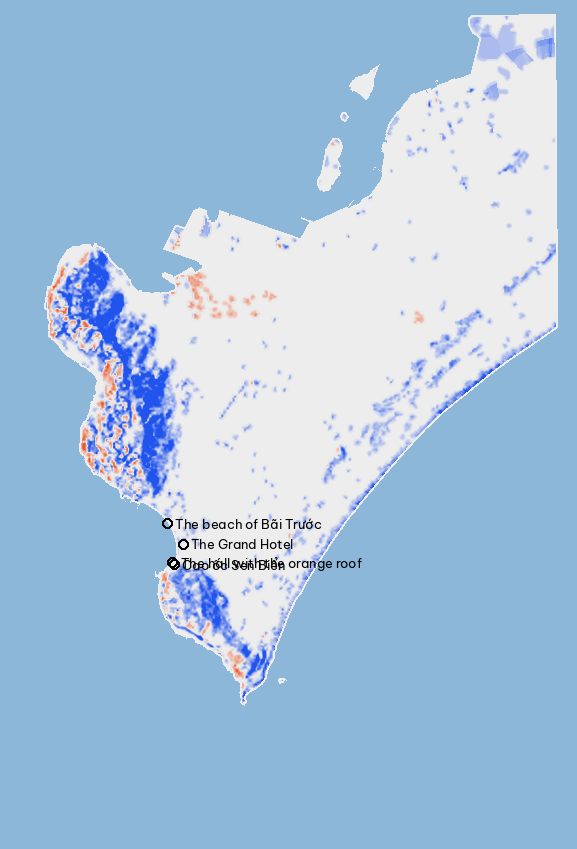
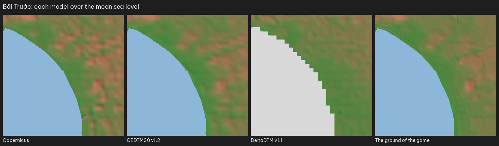
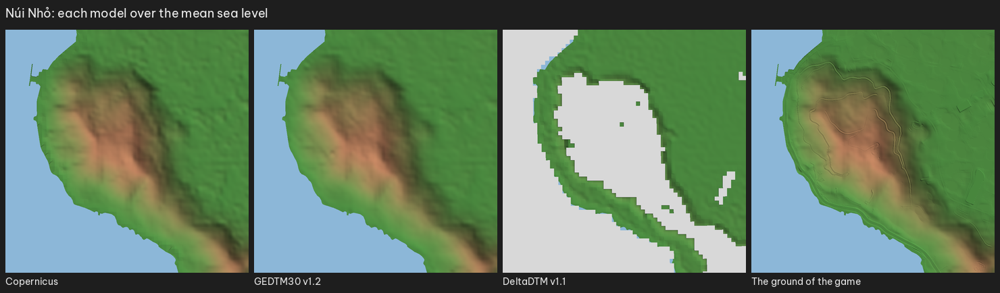
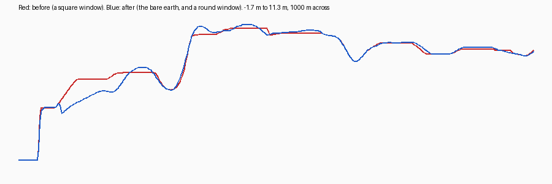

# The ground under the trees and the roofs (plan 0009, R5b)

Made by `tools/geo/build.py` from `data/geo/ground.json`. Do not edit by hand.

- **The zero of the heights.** All the heights are over the mean sea level: the heights over EGM2008 (Copernicus, GEDTM30, DeltaDTM, and the lidar) take away 1.16 m, the mean dynamic topography of DTU22 at Bãi Trước (report 0009, D-0009-07). Before, the land was 1.16 m too high against the sea of the tide.
- **The lidar ground.** 12257 bins of 20 m of the ATL03 ground photons of ICESat-2 (`lidar_tracks.json`) on the land of the box.
- **The rule.** For each group (a hill or the low land, and a class of the land cover), the model with the smallest RMSE against the lidar ground. A group with fewer than 30 lidar points keeps Copernicus. The build uses the model where it differs from Copernicus by more than 2.0 m on average (the mean over 30 m), with a smooth change to Copernicus over 60 m at the edge. The sea of the coastline (below the line of the high water) keeps the heights of plan 0005 (R8g).

## The models against the lidar ground

The difference is the model minus the lidar (m).

### By land cover

**Copernicus GLO-30**

| Part | Points | Mean | RMSE |
|---|---:|---:|---:|
| tree cover | 1445 | +3.83 | 6.51 |
| bushes | 313 | +3.58 | 6.30 |
| town | 7314 | +1.48 | 3.40 |
| bare ground and grass | 3185 | +1.01 | 2.38 |
| all | 12257 | +1.69 | 3.79 |

**GEDTM30 v1.2**

| Part | Points | Mean | RMSE |
|---|---:|---:|---:|
| tree cover | 1445 | +1.19 | 6.11 |
| bushes | 313 | -0.09 | 6.12 |
| town | 7314 | +0.79 | 3.15 |
| bare ground and grass | 3185 | +0.10 | 2.17 |
| all | 12257 | +0.63 | 3.54 |

**DeltaDTM v1.1**

| Part | Points | Mean | RMSE |
|---|---:|---:|---:|
| tree cover | 729 | -2.54 | 7.09 |
| bushes | 142 | -3.68 | 8.18 |
| town | 7069 | -0.89 | 3.38 |
| bare ground and grass | 1736 | -0.69 | 3.65 |
| all | 9676 | -1.02 | 3.94 |

### By hill

**Copernicus GLO-30**

| Part | Points | Mean | RMSE |
|---|---:|---:|---:|
| the low land | 11598 | +1.51 | 3.37 |
| Núi Lớn | 656 | +4.89 | 8.24 |
| Núi Nhỏ | 3 | +2.21 | 2.27 |
| all | 12257 | +1.69 | 3.79 |

**GEDTM30 v1.2**

| Part | Points | Mean | RMSE |
|---|---:|---:|---:|
| the low land | 11598 | +0.58 | 3.07 |
| Núi Lớn | 656 | +1.64 | 8.22 |
| Núi Nhỏ | 3 | +2.47 | 2.66 |
| all | 12257 | +0.63 | 3.54 |

**DeltaDTM v1.1**

| Part | Points | Mean | RMSE |
|---|---:|---:|---:|
| the low land | 9578 | -0.98 | 3.67 |
| Núi Lớn | 96 | -4.14 | 12.27 |
| Núi Nhỏ | 2 | -59.93 | 59.93 |
| all | 9676 | -1.02 | 3.94 |

## The model of each group

| Group | Points | Copernicus RMSE | GEDTM30 RMSE | DeltaDTM RMSE | Model | Why |
|---|---:|---:|---:|---:|---|---|
| the low land, tree cover | 995 | 5.57 | 4.98 | 5.86 | GEDTM30 v1.2 | the smallest RMSE (4.98 m) |
| the low land, bushes | 257 | 5.33 | 5.09 | 8.20 | GEDTM30 v1.2 | the smallest RMSE (5.09 m) |
| the low land, town | 7234 | 3.31 | 3.04 | 3.23 | GEDTM30 v1.2 | the smallest RMSE (3.04 m) |
| the low land, bare ground and grass | 3112 | 2.17 | 1.85 | 3.62 | GEDTM30 v1.2 | the smallest RMSE (1.85 m) |
| Núi Lớn, tree cover | 450 | 8.23 | 8.06 | 15.67 | GEDTM30 v1.2 | the smallest RMSE (8.06 m) |
| Núi Lớn, bushes | 56 | 9.56 | 9.49 | 5.57 | GEDTM30 v1.2 | the smallest RMSE (9.49 m) |
| Núi Lớn, town | 77 | 8.58 | 8.55 | 3.37 | DeltaDTM v1.1 | the smallest RMSE (3.37 m) |
| Núi Lớn, bare ground and grass | 73 | 6.73 | 7.75 | 7.54 | Copernicus GLO-30 | the smallest RMSE (6.73 m) |
| Núi Nhỏ, tree cover | 0 |  |  |  | GEDTM30 v1.2 | 0 lidar points (fewer than 30): the choice of nui_lon/tree, the nearest hill with enough points (the smallest RMSE (8.06 m)) |
| Núi Nhỏ, bushes | 0 |  |  |  | GEDTM30 v1.2 | 0 lidar points (fewer than 30): the choice of nui_lon/bush, the nearest hill with enough points (the smallest RMSE (9.49 m)) |
| Núi Nhỏ, town | 3 | 2.27 | 2.66 | 59.93 | DeltaDTM v1.1 | 3 lidar points (fewer than 30): the choice of nui_lon/town, the nearest hill with enough points (the smallest RMSE (3.37 m)) |
| Núi Nhỏ, bare ground and grass | 0 |  |  |  | Copernicus GLO-30 | 0 lidar points (fewer than 30): the choice of nui_lon/open, the nearest hill with enough points (the smallest RMSE (6.73 m)) |

## The change

- GEDTM30 v1.2: 626.2 ha, a mean change of -4.36 m.
- DeltaDTM v1.1: 4.6 ha, a mean change of -14.52 m.
- All: 1326.5 ha change by more than 0.05 m (a mean of -2.42 m); the most lowered cell 22.93 m, the most raised 10.78 m.

Blue: the bare earth is lower than Copernicus; red: higher (full color at 8 m).

## The places

The mean height of the land in a circle of the place (m): Copernicus over EGM2008 (the ground before plan 0009, with no roads and no levels), the same over the mean sea level, and the ground of the game now (the bare earth, then the roads, the levels of the places, and the showcase), over the mean sea level.

| Place | Copernicus over EGM2008 | Copernicus over the mean sea level | The ground of the game | Change |
|---|---:|---:|---:|---:|
| The beach of Bãi Trước | 4.47 | 3.31 | 2.87 | -1.60 |
| The hall with the orange roof | 7.65 | 6.49 | 6.06 | -1.59 |
| Cao ốc Sen Biển | 13.01 | 11.85 | 11.55 | -1.46 |
| The Grand Hotel | 8.09 | 6.93 | 5.60 | -2.49 |

## Bãi Trước and Núi Nhỏ, each model

## The profile of the town (report 0009, D-0009-20)

A line of 1000 m from west to east, 700 m north of chợ Xóm Lưới (game z -457). Before, the filter of the buildings of plans 0005 to 0026 opened the ground with a flat square window: it cut each hump of the ground into a flat square, with steps between the squares. Now the filter does not change the bare earth (GEDTM30 and DeltaDTM have no buildings), and elsewhere it opens with a flat round window: a slope of the ground stays, a bank keeps its edge, and a hump smaller than the window gets a round flat top.

The numbers are for the land more than 30 m from the sea.

| | Before | After |
|---|---:|---:|
| Cells flat to 5 mm with the next cell | 53 % | 27 % |
| The largest step between two cells (m) | 0.46 | 0.38 |

