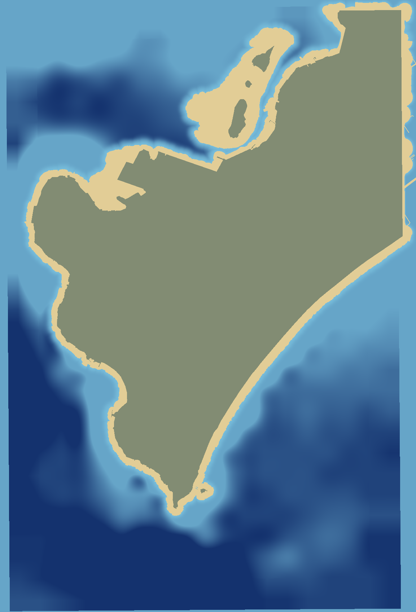

# The sea floor report (plan 0005, R8g)

Made by `tools/geo/build.py` on 2026-10-26.

## Sources

- The intertidal zone: 929824 grid cells with a height from the Sentinel-2 images and the tide (`tools/geo/intertidal.py`, the pixel method of DEA Intertidal), from -1.95 m to +0.93 m.
- The deeper water: the GEBCO 2025 grid.
- Between them, the floor slopes smoothly from the low-tide edge to the GEBCO depth. Where both have no value near the coast, the old slope stays.

## The game days

The sea level of the game days (22 January to 28 February 2019) goes from -2.25 m to +1.45 m.
At the lowest tide, 8.84 km² of sea floor is dry.

Green: the land. Sand: the sea floor that is dry at the lowest tide. Blue: the water at the lowest tide (darker is deeper, to 10 m).

## From the main beach of Bãi Trước out into the bay

The line starts at the water line of the data, game point (-7.9, 1.2), in the game direction (-0.99, 0.16).

| From the sand (m) | Height (m) | Depth at the lowest tide (m) | Depth at the highest tide (m) |
|---|---|---|---|
| 0 | +1.01 | 0.00 | 0.44 |
| 50 | -1.61 | 0.00 | 3.06 |
| 100 | -1.70 | 0.00 | 3.15 |
| 150 | -2.02 | 0.00 | 3.47 |
| 200 | -2.57 | 0.32 | 4.02 |
| 250 | -3.12 | 0.87 | 4.57 |
| 300 | -3.75 | 1.50 | 5.20 |
| 350 | -3.99 | 1.74 | 5.44 |
| 400 | -4.00 | 1.75 | 5.45 |
| 450 | -4.00 | 1.75 | 5.45 |
| 500 | -4.00 | 1.75 | 5.45 |
| 550 | -4.00 | 1.75 | 5.45 |
| 600 | -4.00 | 1.75 | 5.45 |
