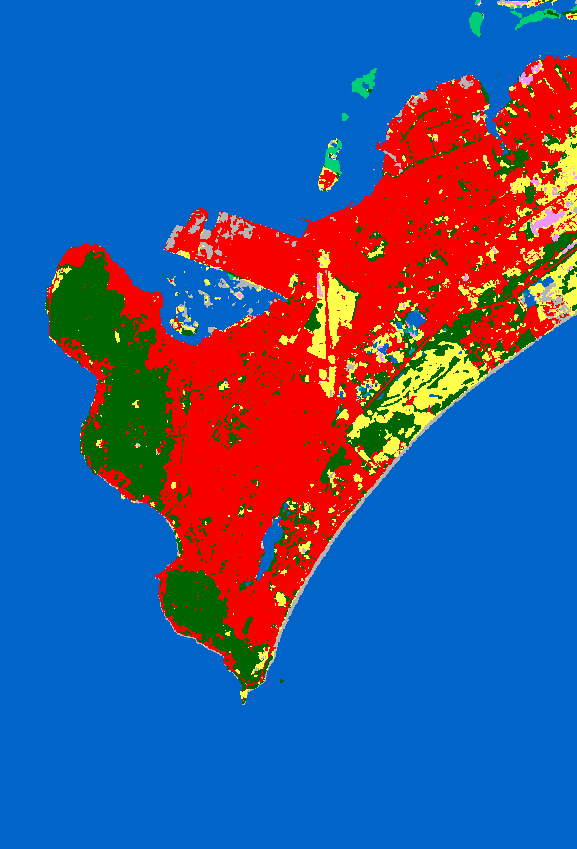
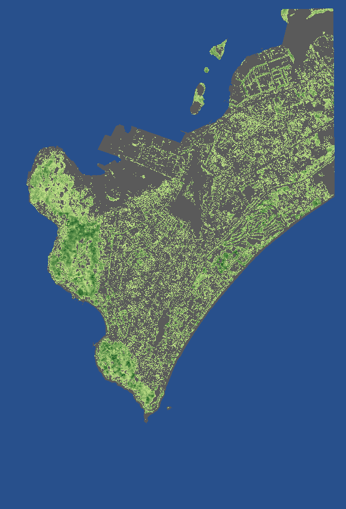

# Geodata report

Made by `tools/geo/build.py` on 2026-10-27.

## Extents

| Item | Value |
|---|---|
| Box (degrees) | 10.3° to 10.42° N, 107.05° to 107.13° E |
| OSM data (degrees) | 8.65744° to 10.77631° N, 106.53076° to 107.17618° E |
| Game X (m) | -2688.7 to 6161.8 |
| Game Z (m) | -8484.0 to 4849.8 |
| Origin | 10.34368307° N, 107.07404669° E (UTM 48N 727110 E, 1144150 N) |
| Height chunks | 960 (756 with land) |
| Highest DEM sample | 249.8 m |
| Mean height change in towns (buildings removed) | 0.16 m |

## Roads

Total road length: 692.3 km. Roads with a width tag: 7 of 4123. Hẻm: 2365.

| Type | Roads | Length (km) |
|---|---|---|
| residential | 1473 | 256.06 |
| service | 912 | 120.35 |
| primary | 233 | 105.85 |
| alley | 871 | 81.38 |
| secondary | 105 | 41.37 |
| tertiary | 68 | 28.34 |
| footway | 251 | 17.46 |
| unclassified | 41 | 17.21 |
| path | 50 | 16.90 |
| track | 24 | 4.42 |
| steps | 88 | 2.21 |
| pedestrian | 5 | 0.56 |
| cycleway | 1 | 0.14 |
| living_street | 1 | 0.08 |

## Blocks and buildings

- Blocks: 1975.
- Blocks with OSM building outlines: 409.
- Buildings: 2193.

## Landmarks

| Landmark | Found | OSM | Position (game X, Z) | Height (m) | Note |
|---|---|---|---|---|---|
| Bãi Trước | yes | way/220821647 | -2.55, -1.31 | 1.2 | 3 candidates, 347.9 m from the hint |
| Bãi Sau | yes | way/234800751 | 2463.57, 115.52 | -0.96 | 5 candidates, 391.9 m from the hint |
| Bãi Dâu | yes | way/895756059 | -1377.16, -2753.98 | 1.08 | 3 candidates, 435.3 m from the hint |
| Mũi Nghinh Phong | yes | node/2435353682 | 1076.55, 2561.69 | 1.33 | 1 candidates, 85.4 m from the hint |
| Núi Lớn | yes | node/2452682527 | -649.2, -1712.32 | 238.42 | 1 candidates, 188.9 m from the hint |
| Núi Nhỏ | yes | node/-1 | 374.1, 1035.7 | 175.6 | 1 candidates, 0.0 m from the hint |
| Tượng Chúa Kitô Vua | yes | way/235008112 | 1159.87, 1893.39 | 138.33 | 1 candidates, 83.3 m from the hint |
| Hải đăng Vũng Tàu | yes | way/229301316 | 402.21, 1056.5 | 173.11 | 1 candidates, 21.8 m from the hint |
| Bạch Dinh | yes | way/220753354 | -596.69, -776.93 | 28.11 | 1 candidates, 259.6 m from the hint |
| Tượng Đức Mẹ Bãi Dâu | yes | way/790529433 | -1290.64, -3064.05 | 57.0 | 2 candidates, 7.3 m from the hint |
| Miếu Hòn Bà | yes | way/221906193 | 1677.76, 2174.06 | 11.34 | 8 candidates, 8.4 m from the hint |
| Chùa Tam Bảo | yes | way/792193852 | -749.18, -1275.61 | 104.03 | 1 candidates, 5.1 m from the hint |
| Vi Ba | yes | way/35923559 | -722.46, -1106.78 | 75.47 | 5 candidates, 299.0 m from the hint |
| Hải Đăng | yes | way/35923584 | 332.79, 1014.55 | 169.1 | 3 candidates, 125.2 m from the hint |
| Bến xe Vũng Tàu | yes | way/220891652 | 1418.58, -757.78 | 6.21 | 2 candidates, 7.3 m from the hint |
| Chợ Vũng Tàu | yes | way/215166910 | 1299.74, -509.85 | 9.48 | 1 candidates, 785.3 m from the hint |
| Chợ Xóm Lưới | yes | node/2649575440 | 224.65, 242.56 | 7.88 | 1 candidates, 3.1 m from the hint |
| Chợ Phường 1 | yes | way/259528309 | 159.09, -708.46 | 8.75 | 1 candidates, 5.2 m from the hint |
| Vòng xoay Đài tưởng niệm Liệt sĩ | yes | way/975192902 | 1953.62, -562.5 | 9.62 | 8 candidates, 811.8 m from the hint |
| Ngã Năm | yes | node/3144051066 | 1178.71, -1254.11 | 6.48 | 1 candidates, 5.8 m from the hint |

## Homestay hẻm

Found: way 1408726731 (Hẻm 2 Hải Đăng, unclassified, 3.5 m wide, 567 m long). Check it on `homestay_area.png`.
The first curve of the lighthouse road turns -172° between 116 m and 138 m from the bottom.
- Candidate 1: way 1408726731 (Hẻm 2 Hải Đăng), 2.6° from the direction before the curve.

## The sea floor, the rocks, and the Hòn Bà ridge (R8g, R8h)

- The sea floor comes from the intertidal zone of the Sentinel-2 images and from GEBCO 2025: see `intertidal_report.md`. Where both have no value near the coast, it slopes from +1.2 m at the coastline to -4.0 m over 80 m.
- Rocks in the sea: 58 grid cells at +0.5 m.
- The rocky coast Mũi Nghinh Phong (overrides.json): 31059 m² of bare rock, on the land and in the sea in front of it.
- The flat rocks Đá ven kè Bãi Trước (overrides.json): 17903 m² at -1.00 m, dry when the tide is lower.
- 5 small islands with large boulders (up to 1.8 m) and trees on their tops.
- The ridge Đường ra Hòn Bà (way/221906223): 206 m long, 4 m wide, top at -1.70 m.
- The band of rocks Bãi đá ra Hòn Bà: about 34 m wide, 1495 grid cells in the sea, from -2.96 m (tide pools) to +1.07 m (outcrops).
- The sand flat in front of the path: 110 m around the beach end, at -1.85 m (1538 grid cells).
- The tide: see `tide_report.md`.

## Roadworks (R11a)

None.

## Objects on the sea (R13a)

- 20 cargo ships at anchor and 40 fishing boats.
- The ferry pier Cảng Cầu Đá: way/200554633, way/200554614.
- Groynes and breakwaters from OSM: way/286293879, way/895756048, way/895756049, way/895756057, way/895756058.

## Trees (R12a)

- bang: 6102
- casuarina: 3509
- coconut: 902
- flame: 4835
- frangipani: 2471
- shade: 11057
- tall_shade: 184
- From: bai_truoc_road 192, coast_roads 3956, named_roads 502, osm 385, parks 2151, street 21874.

## Land cover and trees (report 0005, D-0005-09; plan 0020, D8)

- Sources: ESA WorldCover 2021 v200 (10 m classes) and Meta and WRI High Resolution Canopy Height Maps (v1) (about 1 m, kept on a grid of 2.0 m with the highest value). Both CC BY 4.0.
- The canopy images over the play area are from 2019.42 to 2019.83 (decimal years, mean 2019.73).
- A canopy of 3 m or more is a tree, and a canopy of 0.6 m to 3 m in tree cover is a bush (WorldCover has almost no shrubland here). Grassland and bare ground show the ground (R10a). The built-up and the cropland classes keep the rules of the town and of `trees.json`.
- 86882 trees on the open land, with a mean height of 6.9 m and a mean crown radius of 4.5 m (`canopy_trees.json`, R10a). A tree stands on the highest canopy first, then on the lower canopy, at a spacing of 0.9 of its height (5 m to 12 m): the map has one height top for each group of crowns. The crown of a tree is the canopy that is nearer to it than to another tree.
- No trees and no bushes on 272.6 ha of paved places and platforms (the OSM areas and the landmarks of `data/geo/clearings.json`), and no tree trunks on the roads and the paths (report 0020, D-0020-01).

| Hill | Area (km²) | Tree cover | Bushes | Grass | Bare | Trees | WorldCover classes |
|---|---|---|---|---|---|---|---|
| Núi Lớn | 2.32 | 73 % | 7 % | 8 % | 0 % | 15771 | tree cover 88 %, built-up 11 %, grassland 1 %, bare or sparse 0 %, water 0 % |
| Núi Nhỏ | 0.92 | 76 % | 8 % | 6 % | 0 % | 6919 | tree cover 92 %, built-up 7 %, grassland 1 %, bare or sparse 0 % |

The hills: the land within 1.1 km of the top of Núi Lớn and 0.7 km of the top of Núi Nhỏ, higher than 20 m.

Dark green: tree cover. Yellow: grassland. Red: built-up. Gray: bare. Blue: water. Light green: mangroves.

Light green (1 m) to dark green (25 m or more): the canopy height. Gray: land with no canopy. Blue: the sea.

- The canopy map shows no tree within 5 m of 14600 of the 29060 street and park trees (plan 0020, R10a): bang 2937 of 6102, casuarina 2499 of 3509, coconut 536 of 902, flame 2296 of 4835, frangipani 1125 of 2471, shade 5192 of 11057, tall_shade 15 of 184. They stay, and I check them on photos. The first ones:
  - (91, 197)
  - (101, 159)
  - (106, 136)
  - (108, 121)
  - (112, 96)
  - (113, 91)
  - (112, 75)
  - (112, 66)
  - (110, 52)
  - (108, 43)
  - (106, 37)
  - (105, 30)
  - (102, 20)
  - (101, 14)
  - (93, -18)
  - (84, -47)
  - (72, -79)
  - (56, -122)
  - (50, -139)
  - (41, -160)
  - (37, -168)
  - (35, -173)
  - (32, -182)
  - (15, -209)
  - (11, -215)
  - (6, -223)
  - (2, -229)
  - (-2, -234)
  - (-8, -242)
  - (-11, -246)
  - and 14570 more.

## Town anchors (R6a)

`anchors.png` shows each candidate as a number. I write the correct Vietnamese names into `landmarks.json`.

| Number | Kind | OSM | Name in OSM | Position (game X, Z) |
|---|---|---|---|---|
| 1 | bus station | node/5596865382 | Xe Toàn Thắng | 2270.1, -2361.0 |
| 2 | bus station | way/220891652 | Bến xe Vũng Tàu | 1418.6, -757.8 |
| 3 | bus station | node/11813095037 | Bến xe Vũng Tàu | 1430.8, -747.6 |
| 4 | marketplace | way/235991337 | Chợ Rạch Dừa | 4556.8, -6041.7 |
| 5 | marketplace | way/790787255 | Chợ Thắng Nhất | 2972.9, -5335.0 |
| 6 | marketplace | way/259759825 | Chợ Bến Đá | -802.6, -4009.6 |
| 7 | marketplace | way/790384308 | Chợ Phường 9 | 1319.6, -3245.2 |
| 8 | marketplace | node/5552599299 | Chợ Bến Đình | 262.9, -3147.1 |
| 9 | marketplace | node/12995457671 | Chợ Phường 7 | 954.7, -2669.9 |
| 10 | marketplace | node/7100657303 | Chợ Phường 8 | 1906.6, -2204.0 |
| 11 | marketplace | node/2641109127 | Chợ Cô Giang | 505.3, -1255.2 |
| 12 | marketplace | way/259528309 | Chợ Phường 1 | 159.1, -708.5 |
| 13 | marketplace | node/11424996126 | Fruits (cheap & specials) | 1323.1, -700.5 |
| 14 | marketplace | way/215166910 | Chợ Vũng Tàu | 1299.7, -509.8 |
| 15 | marketplace | node/2339056843 | Chợ Du lịch Vũng Tàu | 2217.2, -182.6 |
| 16 | marketplace | node/5599563192 | Nguyễn Công Trứ | 308.7, 177.4 |
| 17 | marketplace | node/2649575440 | Chợ Xóm Lưới | 224.6, 242.6 |
| 18 | marketplace | node/13788662719 | Chợ Đêm Vũng Tàu | 1851.0, 384.9 |
| 19 | roundabout | way/744059421 | Đường số 1 | 4222.2, -7277.0 |
| 20 | roundabout | way/243919219 | Đường số 1 | 4398.5, -6789.8 |
| 21 | roundabout | way/243919220 | (no name) | 4552.2, -6365.9 |
| 22 | roundabout | way/565372328,1279678267,1279678271 | (no name) | 3971.1, -4145.0 |
| 23 | roundabout | way/1458906879 | (no name) | 5874.6, -3909.3 |
| 24 | roundabout | way/790529498 | (no name) | 160.6, -2537.9 |
| 25 | roundabout | way/790529505 | (no name) | 165.6, -2490.1 |
| 26 | roundabout | way/199528378,1446433949,1446433950 | Vòng Xoay Nguyễn Tri Phương | 939.7, -2297.5 |
| 27 | roundabout | way/118927579 | Vòng xoay Paradise | 2624.5, -1778.6 |
| 28 | roundabout | way/269819561 | (no name) | -650.2, -1712.3 |
| 29 | roundabout | way/694747968 | (no name) | -570.6, -1341.2 |
| 30 | roundabout | way/1150854196,1446433945,1446433946 | (no name) | 1177.1, -1244.1 |
| 31 | roundabout | way/1150848437,1502887824 | Bùng binh Lam Sơn | 19.7, -891.4 |
| 32 | roundabout | way/112177664,975192902,975192903 | Vòng Xoay Đài Tưởng Niệm Liệt Sĩ | 2046.1, -601.6 |
| 33 | roundabout | way/953253569 | Vòng Xoay Xóm Vườn | 638.7, -149.8 |
| 34 | junction | node/2440052520 | Hà Bổng / Đinh Núp | 4651.2, -4874.8 |
| 35 | junction | node/7108827695 | Đường 2 Tháng 9 | 5030.3, -4835.6 |
| 36 | junction | node/2454871079 | Hẻm 268 Trần Phú / Hẻm 326 Trần Phú | -1660.2, -4701.1 |
| 37 | junction | node/3702692182 | Hà Huy Tập / Nguyễn Hữu Cảnh / Đường 3 Tháng 2 | 5426.8, -3983.9 |
| 38 | junction | node/5000821862 | Nguyễn An Ninh / Phạm Hồng Thái / Đường 30 Tháng 4 | 1006.8, -2771.0 |
| 39 | junction | node/2317186304 | Hẻm 370 Nguyễn An Ninh / Nguyễn An Ninh / Đội Cấn | 1937.1, -2290.3 |
| 40 | junction | node/10705743296 | Nguyễn An Ninh / Đường 2 Tháng 9 / Đội Cấn | 2107.1, -2180.0 |
| 41 | junction | node/1337220599 | Bình Giã / Chu Mạnh Trinh / Hẻm 285 Bình Giã / Nguyễn Trọng Quản | 2064.4, -1820.7 |
| 42 | junction | node/419939179 | Bà Triệu / Lê Lai / Lê Quý Đôn / Nguyễn Văn Trỗi | 347.3, -976.6 |
| 43 | junction | node/419939060 | Lê Lợi / Lê Quý Đôn / Thủ Khoa Huân | 11.3, -656.8 |
| 44 | junction | node/2347538670 | Huỳnh Thúc Kháng / Hẻm 100 Xô Viết Nghệ Tĩnh / Xô Viết Nghệ Tĩnh | 1343.3, -402.1 |
| 45 | junction | node/419939084 | Thống Nhất / Trần Hưng Đạo | 264.6, -235.5 |
| 46 | junction | node/419939001 | Hoàng Hoa Thám / Nguyễn Trãi / Trương Công Định | 293.5, 134.3 |

## Corrections from overrides.json

- add node -1 ({'natural': 'peak', 'name': 'Núi Nhỏ', 'alt_name': 'Núi Tao Phùng'}): OSM has no object for Núi Nhỏ. The position is the highest point of the Copernicus DEM on the hill (177.9 m), next to the lighthouse.
- add way -2 ({'name': 'Bãi đá ra Hòn Bà', 'natural': 'shoal', 'surface': 'rock', 'tidal': 'yes'}): R8h: OSM has only the line of the path (way 221906223, a track), with no outline of the rocks. This band is 30 m wide: the path line with 15 m on each side, and 12 m more at each end, so that it touches the beach below Mũi Nghinh Phong and the islet. The heights of the rocks are in hon_ba.json.
- rock coast Mũi Nghinh Phong (150 m around 107.083721, 10.3204661): Mũi Nghinh Phong is a rocky cape (report 0005, D-0005-03). The point is the OSM node natural=cape (node 2435353682). OSM has bare rock, scree, and cliffs on its sides, but not at the tip, and the sea floor in front of the tip showed as sand at low tide.
- rock shelf Đá ven kè Bãi Trước (25 m wide at -1.0 m): Plan 0005, Q6: at low tide, flat dark rocks show along the sea wall south of the main beach of Bãi Trước, toward Núi Nhỏ, and people walk and fish on them. The ends, the width, and the height are builder values from the map: the rocks are dry when the tide is below -1.0 m, at most low tides of the game days. Check.

## Problems with the data

- area 18343238 is not a correct polygon: invalid area (area_id=36686477)
- Núi Lớn is not in the OSM data of the box
- Núi Nhỏ is not in the OSM data of the box

## Source files

| File | Source | Date | SHA-256 | License |
|---|---|---|---|---|
| assets/textures/ground/asphalt/diffuse.jpg | https://dl.polyhaven.org/file/ph-assets/Textures/jpg/1k/asphalt_02/asphalt_02_diff_1k.jpg | 2026-10-24 | `1aa5ce99f58a625c…` | CC0 (Poly Haven) |
| assets/textures/ground/asphalt/normal.jpg | https://dl.polyhaven.org/file/ph-assets/Textures/jpg/1k/asphalt_02/asphalt_02_nor_gl_1k.jpg | 2026-10-24 | `42a1c381b53204e8…` | CC0 (Poly Haven) |
| assets/textures/ground/asphalt/roughness.jpg | https://dl.polyhaven.org/file/ph-assets/Textures/jpg/1k/asphalt_02/asphalt_02_rough_1k.jpg | 2026-10-24 | `70ba3edc65525eb4…` | CC0 (Poly Haven) |
| assets/textures/ground/concrete/diffuse.jpg | https://dl.polyhaven.org/file/ph-assets/Textures/jpg/1k/brushed_concrete/brushed_concrete_diff_1k.jpg | 2026-10-24 | `4054ed6eb65cd063…` | CC0 (Poly Haven) |
| assets/textures/ground/concrete/normal.jpg | https://dl.polyhaven.org/file/ph-assets/Textures/jpg/1k/brushed_concrete/brushed_concrete_nor_gl_1k.jpg | 2026-10-24 | `f4953a881f34627c…` | CC0 (Poly Haven) |
| assets/textures/ground/concrete/roughness.jpg | https://dl.polyhaven.org/file/ph-assets/Textures/jpg/1k/brushed_concrete/brushed_concrete_rough_1k.jpg | 2026-10-24 | `24da5e4c3d17b7db…` | CC0 (Poly Haven) |
| assets/textures/ground/grass/diffuse.jpg | https://dl.polyhaven.org/file/ph-assets/Textures/jpg/1k/leafy_grass/leafy_grass_diff_1k.jpg | 2026-10-24 | `cfa40bc9d9417d18…` | CC0 (Poly Haven) |
| assets/textures/ground/grass/normal.jpg | https://dl.polyhaven.org/file/ph-assets/Textures/jpg/1k/leafy_grass/leafy_grass_nor_gl_1k.jpg | 2026-10-24 | `832328216adc0a7e…` | CC0 (Poly Haven) |
| assets/textures/ground/grass/roughness.jpg | https://dl.polyhaven.org/file/ph-assets/Textures/jpg/1k/leafy_grass/leafy_grass_rough_1k.jpg | 2026-10-24 | `0c2a1d91aacb8e54…` | CC0 (Poly Haven) |
| assets/textures/ground/rock/diffuse.jpg | https://dl.polyhaven.org/file/ph-assets/Textures/jpg/1k/rocky_terrain_02/rocky_terrain_02_diff_1k.jpg | 2026-10-24 | `d570c10b1d5302f4…` | CC0 (Poly Haven) |
| assets/textures/ground/rock/normal.jpg | https://dl.polyhaven.org/file/ph-assets/Textures/jpg/1k/rocky_terrain_02/rocky_terrain_02_nor_gl_1k.jpg | 2026-10-24 | `f4f9d9671c660f4e…` | CC0 (Poly Haven) |
| assets/textures/ground/rock/roughness.jpg | https://dl.polyhaven.org/file/ph-assets/Textures/jpg/1k/rocky_terrain_02/rocky_terrain_02_rough_1k.jpg | 2026-10-24 | `8652ee05de206888…` | CC0 (Poly Haven) |
| assets/textures/ground/sand/diffuse.jpg | https://dl.polyhaven.org/file/ph-assets/Textures/jpg/1k/coast_sand_01/coast_sand_01_diff_1k.jpg | 2026-10-24 | `58af2e40100f7f40…` | CC0 (Poly Haven) |
| assets/textures/ground/sand/normal.jpg | https://dl.polyhaven.org/file/ph-assets/Textures/jpg/1k/coast_sand_01/coast_sand_01_nor_gl_1k.jpg | 2026-10-24 | `fe4d045aec99e71e…` | CC0 (Poly Haven) |
| assets/textures/ground/sand/roughness.jpg | https://dl.polyhaven.org/file/ph-assets/Textures/jpg/1k/coast_sand_01/coast_sand_01_rough_1k.jpg | 2026-10-24 | `cbc3e0bf2214e043…` | CC0 (Poly Haven) |
| dem.tif | https://copernicus-dem-30m.s3.amazonaws.com/Copernicus_DSM_COG_10_N10_00_E107_00_DEM/Copernicus_DSM_COG_10_N10_00_E107_00_DEM.tif | 2026-10-24 | `4a212aa188369913…` | Copernicus DEM license, © DLR e.V. 2010-2014 and © Airbus Defence and Space GmbH 2014-2018 |
| osm.pbf | https://download.geofabrik.de/asia/vietnam-latest.osm.pbf | 2026-10-24 | `862cef84cb27aa2b…` | ODbL 1.0, © OpenStreetMap contributors |
