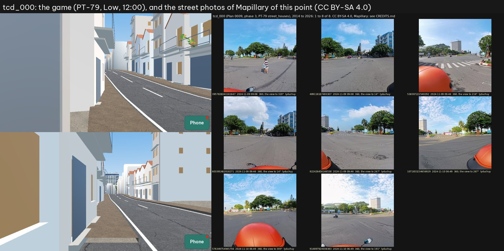
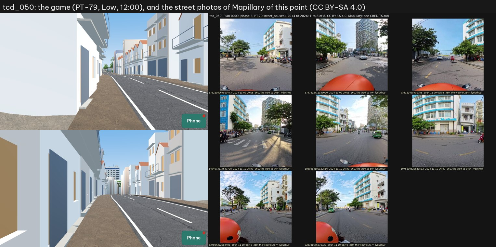
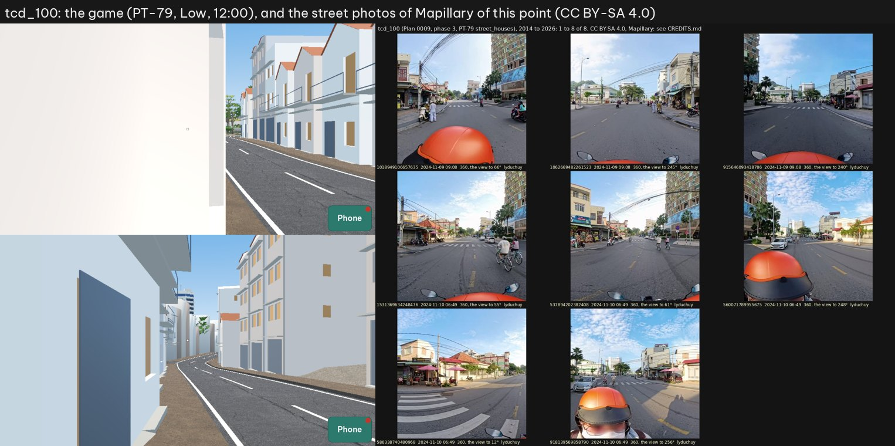
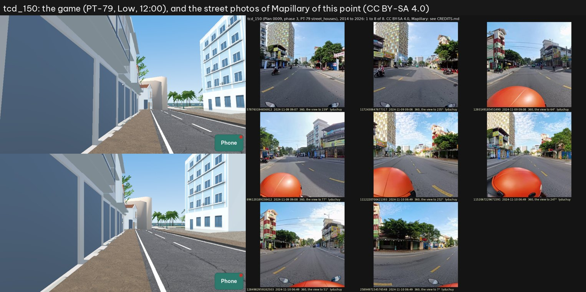
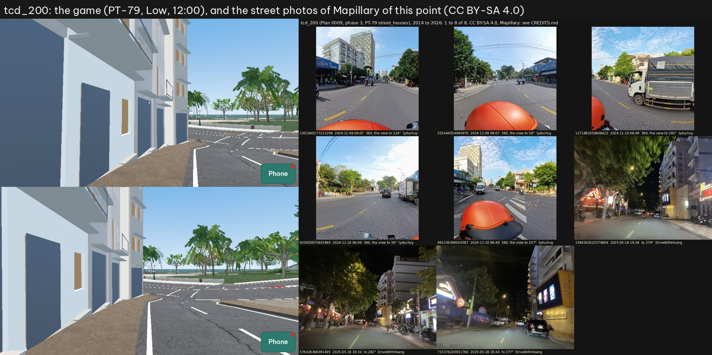

# The first street of phase 3: Trương Công Định

Plan 0009, phase 3 (R7 to R9, Q12). Left: the screenshots of PT-79 `street_houses` (Low, 12:00) at about the same place (the walk on each sidewalk); right: the street photos of Mapillary of the photo point (2014 to 2026: the photos here are of 2018, 2024, and 2025; CC BY-SA 4.0, see `docs/reference/mapillary/CREDITS.md`).

## tcd_000

## tcd_050

## tcd_100

## tcd_150

## tcd_200

