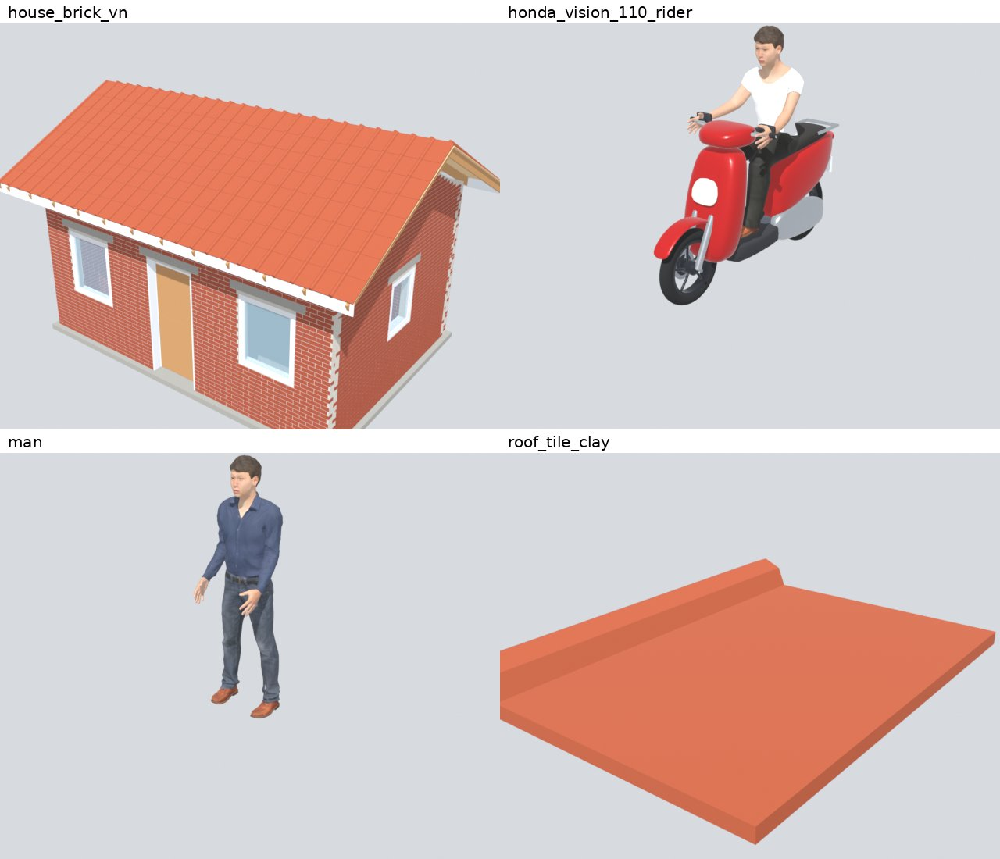

# 0023 Models from World

| Field | Value |
|---|---|
| Status | Draft. It waits until I say that World is ready (Q3). |
| Branch | `feat/0023-models-from-world` |
| Depends on | 0004 (the house kit), 0005 (the Vũng Tàu world). Uses the quality presets of 0004 and the impostor method of 0020. |
| Changes | 0006 (the person models come from World, D6), 0008, 0009, 0010, 0011 to 0015, 0018, 0021, 0022: each of these plans takes its models from the catalog of section 9. |

## 1. Goal

[World](https://github.com/sntran/World) is my one repository for the 3D models of all my projects. Vũng Tàu is one of these projects. At the end of this plan:

- Vũng Tàu gets its 3D models from World. A data file lists each model that the game uses as an order of World. A tool gets the files of each order and pins them to one version of World. The game keeps its own materials and light.
- The first models of World are in the game: the scooters, the outdoor units of the air conditioners, the ceiling fans, and the group of the morning exercise at Bãi Trước. These models exist in World now.
- Section 9 is the catalog: each model that the game needs, with the real details that I want. Each later plan takes its models from the catalog.
- Section 10 lists what World must add for Vũng Tàu. I add these items to World.

This picture shows the models of World on 2026-10-28 (commit `4ebf010`), rendered with their own colors. The house is a single-floor brick house with a gable roof. It is not yet a tube house of Vũng Tàu (section 9.3).

## 2. Out of scope

- The ground, the roads, the sea, the sea floor, the sea walls, the rock groynes, and the boulders. They come from the geodata (plan 0005), and the game makes them.
- The far town: the houses far from the player stay simple blocks from the building data of plan 0009, with the plaster shader.
- The trees of plan 0020. They stay in `tools/trees/` until World can make them (D7).
- The materials, the shaders, the light, and the quality presets. They stay in the game (D3).
- Downloads of models while the game runs. All models are in the build (D2).
- Changes to World. I make them in World. This plan only lists the requests (section 10).
- Traffic that moves on the roads (plan 0018).

## 3. Decisions

| ID | Decision | Reason |
|---|---|---|
| D1 | World is the one source of the 3D models of the game. The game makes no model in code, except the shapes of the geodata (section 2). `scripts/greybox.gd` goes away when each of its shapes has a model of World. | My decision (2026-10-28). One correction in World corrects each project. World gives each size of a part a source (a standard, a data sheet, or a measurement), so the models are true to size. |
| D2 | The game gets the files of World when it is built, not when it runs. The files are in the repository (`assets/world/`), and `data/world/lock.json` pins them to one commit of World. A new version of World comes in with one commit and a new review sheet. | The game runs offline on desktop and phones. The URL of a model on the factory changes when World corrects a part (`Cache-Control: max-age=300`), and a release must not change. The trees are in the repository in the same way (54 MB). |
| D3 | World gives the shape, the parts, and the joints. The game gives the look: each material role of World (`brick`, `concrete`, `glass`, `tile`, `paint`, `chrome`, `rubber`, `skin`, and so on) has a material of the game in `data/world/materials.json`. | The town must have one look: the plaster with damp and wear of plan 0004, the measured palette, the light by time, and the quality presets. The GLB files of World name each material by its role and have no textures (except the skin and the clothes of people), so this is easy. |
| D4 | The models are real: they have the shapes of the common makes of 2019 (Q1). No badge, no name, no logo, and no real livery is on a model in the game. The game text uses the general words: "xe tay ga" (a scooter), "xe số" (a step-through motorbike with gears). The names of World (for example `honda_vision_110`) stay in the data files. They never show on the screen. | I want the town to look real, and the town of 2019 was full of a few common makes. The rule "No real businesses" of `AGENTS.md` keeps the names and the logos out. |
| D5 | World gives three levels (near, mid, far). The game adds a fourth level for the models in rows and crowds (parked scooters, boats far out, people far away): an impostor, made with the method of the trees (plan 0020, D3). | A far scooter of World has about 4 000 triangles. 40 parked scooters along one street are 160 000 triangles, more than half of the Low budget (300 000). An impostor is two triangles. |
| D6 | The person models of plan 0006 come from the `person` blueprint of World. World already uses MakeHuman, with a skeleton of 53 bones, as plan 0006 does (D2 there). The approved look of `docs/prototype/people/` is the target for World. The game part of plan 0006 stays in plan 0006: the animations in the game, the head and the eyes, the blinks, the faces, and the lip sync. The model part of plan 0006 (R2 to R11, `tools/people/build.py`) waits for the World requests W3 to W6. | One person blueprint for all my projects. Phượt and Vũng Tàu need the same people. World has no face shapes and no visemes now, and plan 0006 needs them for the lip sync. |
| D7 | The trees stay in `tools/trees/` until World has a plant blueprint (W12) that makes the 14 types of `data/trees/types.json` with the same look (the sheets of report 0020) and with the same triangles or fewer. Then the tree values move to World as orders. | The trees just passed my review. A move now puts the look at risk. |
| D8 | Houses: World makes the parts of the house kit and the houses near the player. The game puts them on the lots. The far town stays as blocks (section 2). | The play area has thousands of buildings. A GLB for each building is too many files. The kit parts in MultiMeshes (plan 0004) are fast, and PT-32 measures them. |
| D9 | The known structures of plan 0008 are orders of World with a drawing (build to print), one for each structure. Each drawing has the sources of its sizes: the OSM outline, public heights, and photos. A statue is a figure of the `person` blueprint, with its pose, its clothes, a stone material, and its size. | A drawing of World keeps the sources and the parts in the receipt. A drawing that many orders use can become a blueprint later. |
| D10 | The models of World are under the AGPL-3.0. I have the copyright of World, so Vũng Tàu uses them with no change to its license (World `README.md`, "The license"). The parts from MakeHuman are CC0. `assets/CREDITS.md` lists World with the commit of the lock. | The license is clear, and each player can see where the models come from. |

## 4. Requirements

### The orders and the lock

- **R1.** `data/world/orders.json` lists each model of the game. Each entry has:
  - `id`: the name in the game, for example `scooter_tay_ga_1`.
  - `order`: the order of World as JSON (the `blueprint`, the `options`, the `colors`, the `joints`, the `targets`), as World `docs/factory.md` describes.
  - `levels`: the levels that the game uses (`near`, `mid`, `far`), and `impostor` (true or false, D5).
  - `uses`: the plan and the places that use the model.
  - `catalog`: the ID of the catalog entry of section 9.
- **R2.** `tools/world/fetch.py` gets the files of each order to `assets/world/ID.glb`, `ID.mid.glb`, `ID.far.glb`, `ID.parts.json`, and `ID.receipt.json`. It has two sources:
  - `--source=factory`: `POST /orders` on `https://world.mkfifo.com`, then the files `/o/HASH.*`. CI uses this source.
  - `--source=checkout --world=PATH`: a clone of World at the commit of the lock, with `mix world.order`. The workspace uses this source: it cannot reach `world.mkfifo.com` (the proxy answered 403 on 2026-10-28), but it can clone GitHub.
- **R3.** `data/world/lock.json` has the commit of World (`/version.json` of the factory, or the commit of the clone) and, for each `id`, the hash of the order and the SHA-256 of each file. `fetch.py --check` (a CI job) fails when a file or an order does not agree with the lock. `fetch.py --update` gets all files again from the newest World and writes the lock. The commit message is "Update the models of World to COMMIT".
- **R4.** The two sources give the same bytes for the same order and the same commit. A unit test of `tools/world/` gets three orders from each source and compares them. If they are not the same, I correct World (W14).

### The import

- **R5.** The import files of `assets/world/` turn off the LODs and the shadow meshes of Godot (World gives the levels). They keep the names of the nodes, because the joints of World are nodes.
- **R6.** `WorldModel` (`scripts/world/world_model.gd`) loads a model by its `id`:
  - The levels are one node, with visibility ranges from the quality preset, as the trees (`TreeLibrary.set_ranges()`).
  - Each material role gets its material from `data/world/materials.json` (D3). A role with no entry stops the import with an error that names the role and the model.
  - `joint(name)` gives the node of a joint. `set_pose(pose)` sets joints by name, in their limits, as World `docs/format.md` ("A pose") describes: a wheel, the steering, the side stand, a door, a seat.
  - `parts()` gives the list of the parts from `ID.parts.json`.
- **R7.** World uses meters, with z up and y to the front. The GLB files use the axes of glTF. A unit test loads each model of `orders.json` and checks: the lowest point is at y = 0 (±1 cm), the front of a vehicle is to +Z, and the height agrees with the parts list (±1 %).
- **R8.** `tools/world/impostors.py` (Blender, the version of plan 0020) makes an impostor of each model with `impostor: true`: pictures from 8 directions, with the material colors of the game, as `TYPE_impostor.png` of the trees. A row of models (R9a) uses MultiMeshes: the near level to 15 m, the mid level to 40 m, then the impostor. The quality preset sets the ranges.

### The first models

- **R9.** These models of World replace the shapes of the game. World has them now.
  - **a. Scooters.** `Greybox.scooter()` goes away. The scooters of the test street and of the Vũng Tàu world are orders of the `catalog` blueprint (`honda_vision_110`) with no badges (D4). Their paint colors come from `data/world/palette.json`, a list that I approve (white, red, black, gray, dark blue, pastel colors). A parked scooter stands on its side stand, at 10° to 30° from the line of the curb, with its front wheel turned. A row of parked scooters stands on the sidewalk in front of shops and houses, and in front of each house of the hẻm at night (section 9.1, V1).
  - **b. Outdoor units of air conditioners.** The AC units of the house kit (`house_parts.gd`, kind `ac_unit`) are the outdoor unit of `mini_split_mitsubishi_msz_gl12na` with no badge, on a bracket on the wall.
  - **c. Ceiling fans.** `ceiling_fan_52in` in the phở shop of the test street and in the front rooms that the player can see. The blades turn (joint role `spin`).
  - **d. The morning exercise.** At Bãi Trước from 05:00 to 06:30, two groups of the `exercise` blueprint stand on the paved edge of the park: `tai_chi` with fans (older people) and `aerobics`. Each person is a separate order (World `docs/factory.md`: a group of more than 3 people needs too much memory on the factory). Each person starts the loop at its own time.
- **R10.** `Greybox.person()`, `Greybox.boat()`, `Greybox.cart()`, `Greybox.stool()`, and `Greybox.potted_plant()` stay until World has their models (section 10). The boxes of the boats and the thúng in `sea_objects.gd` stay in the same way.

### Review, credits, and budget

- **R11.** PT-56 makes a review sheet of each model of `orders.json` in the game, with the materials of the game, at 12:00: from the front, from the side, and from three quarters, at each level. The export workflow publishes the sheets on GitHub Pages at `/world/`. I approve the look from the sheets.
- **R12.** `assets/CREDITS.md` has a row for World: the repository, the commit of the lock, and the license (D10). The Credits sheet of the game shows it.
- **R13.** The budgets of PT-32 and PT-54 stay within their limits with the new models.
- **R14.** `AGENTS.md` gets a section 5e: the orders, the lock, the two sources, the import, the materials, and the commands.

## 5. Phases

- **Phase A.** R1 to R8 with one model (the scooter), and the sheet of R11. The builder sends me the sheet. The status stays "In progress".
- **Phase B.** After I approve Phase A: R9 to R14 and all play tests.

## 6. Play-test scenarios

- **PT-56 `world_models`.** The review sheet of R11. Each model of `orders.json` is on a test ground at 12:00 on Low and on High. Check: no magenta or missing material, the model stands on the ground, the levels change at their ranges. Look at each picture.
- **PT-57 `parked_rows`.** In the Vũng Tàu world, a street near chợ Xóm Lưới with 40 parked scooters, at 19:00. Walk along the street on Low. The triangles stay under the limit of 300 000. At 20 m the scooters are mid level, and at 50 m they are impostors. The change of level does not pop: compare two screenshots 0.5 m apart at each range.
- **PT-58 `morning_exercise`.** Start at 05:30 at Bãi Trước. The two groups do their routines. The people do not move in the same frame (each person starts at its own time). Walk through a group: the player does not go through a person. At 06:30 the groups go away. Godot prints no errors.

PT-01, PT-03 to PT-55 must still pass.

## 7. Acceptance criteria

1. I approved Phase A.
2. `fetch.py --check` passes in CI. The workspace makes the same files from a clone of World.
3. The unit tests of R4 and R7 pass.
4. The sheets are on GitHub Pages at `/world/`, and I approved them.
5. All unit tests and all play tests pass. The builder looked at all screenshots.
6. `assets/CREDITS.md` and `AGENTS.md` are up to date.

## 8. Open questions

- **Q1.** Answered (2026-10-28): yes. We want the models to be real, so a model has the shape of the real make (for example the Honda Vision, the Honda Wave, or the Ford Transit van of the bus station). D4 keeps the badges, the names, and the logos off.
- **Q2.** Answered (2026-10-28): the architect added the requests of section 10 to World `TODO.md`, section "For Vũng Tàu" (World commit `b06a20d`).
- **Q3.** Answered (2026-10-28): wait. World is still in work. I say when it is ready. Then I approve this plan, and the builder starts. Until then the builder does not start R1 to R14.
- **Q4.** Answered (2026-10-28): yes. Plan 0006 waits for the people of World (D6).
- **Q5.** The catalog has facts with the status "Check". Each one is in the table of its group. Please answer them when you have time. A fact with "Check" does not go into the game.

## 9. The catalog of models

Each entry has an ID, what it is, the details that I want, where and when the game uses it, and what World has now:

- **Has:** World has the model now.
- **Close:** World has a model or a blueprint that needs options or changes.
- **New:** World needs a new model or blueprint (section 10).

Status of the facts: "Confirmed", "Source", and "Check" as in `docs/content/culture-notes.md`. The plans are the numbers of `docs/plans/README.md`.

### 9.1 Vehicles and carts

| ID | What | The details that I want | Where, when, plan | World | Status |
|---|---|---|---|---|---|
| V1 | Xe tay ga (scooter) | The common scooters of 2019, no badges. Colors of R9a. A license plate at the back: white, black letters, the code 72 of Bà Rịa - Vũng Tàu and a made-up number. Some details by seed: a helmet on the mirror or on the seat, a phone holder, a raincoat under the seat strap, a plastic cover on the seat, a basket hook with a bag. Parked: side stand, front wheel turned. | Everywhere. Parked rows on the sidewalks and in front of shops, a row in front of each house of the hẻm at night, in the front room of a house at night. 0009, 0018. | Close (`honda_vision_110`) | Plate code: Source (common knowledge). Details: Confirmed by my photos of the street. |
| V2 | Xe số (step-through motorbike with gears) | The most common motorbike of 2019 (the shapes of the Honda Wave and Dream). A rack at the back for goods. Some carry big loads: a stack of plastic crates, gas bottles, a cooler of ice. | Same as V1. Sellers and fishermen use it. 0009, 0018. | New (in World `TODO.md`) | Check: the share of xe số and xe tay ga in Vũng Tàu in 2019. |
| V3 | Rider and passenger | A rider with a half-shell helmet, often a face mask and a sun jacket (áo chống nắng); women with long sun gloves and a wrap skirt. A passenger behind. An older woman sits sideways behind the rider. A child stands or sits in front of the rider. | The coast road in the evening (0015), the Vi Ba road (0017), the player's scooter (0018), the ride app (0010). | Close (`traveler`, `ride`) | Helmets by law since 2007: Check. Side sitting: Check. |
| V4 | Xe đạp (city bicycle) | A city bicycle with a front basket and a rack at the back. Older women in đồ bộ and nón lá ride it. | Morning streets and the market. 0009. | New (World has a touring bicycle) | Source (culture notes, Houses). |
| V5 | Ride-app scooter | A V1 or V2 with a rider in a jacket and a helmet of a made-up app (made-up colors and name). | Bến xe, the ride to the homestay. 0010. | Close | Confirmed (ride apps from 2014). |
| V6 | Taxi | A small sedan and a 7-seat car, in the colors of made-up taxi companies, with a roof sign. | Bến xe, the coast road. 0010. | New (World has a Chevy Bolt) | Check: the taxi companies of 2019 had which colors? We do not copy them. |
| V7 | Xe khách (bus) | The 16-seat van on the route from Sài Gòn (the shape of the Ford Transit) and a 29-seat or 45-seat coach. Made-up company names on the sides. | Bến xe Vũng Tàu at the start. 0010. | Close (`van` blueprint, Ford Transit) | Check: the 16-seat van was the common bus from Sài Gòn in 2019. |
| V8 | Ba gác máy (motor tricycle for goods) | A motorbike front with a flat cargo bed at the back, loaded with crates of ice, gas bottles, or furniture. | Chợ Xóm Lưới in the morning. 0009. | New | Check: common in Vũng Tàu in 2019. |
| V9 | Xe bánh mì (bánh mì cart) | A small cart with a glass case (the bread, the pâté, the cold cuts, the pickles), a charcoal grill or a small gas burner, a stool for the seller. A made-up name painted on the glass. | Near chợ Xóm Lưới before sunrise to mid-morning. 0009, 0014. | New | Bánh mì hours: Check. |
| V10 | Xe hủ tiếu gõ (hủ tiếu gõ cart) | A cart with a large pot of broth over a fire, a glass case with noodles, meat, and herbs, a stack of bowls, a lamp that hangs. The helper carries two bamboo sticks to clack. A few low stools. | The streets at night. 0014. | New | Source (culture notes, Street food). In the hẻm of Vũng Tàu: Check. |
| V11 | Xe nước mía (sugarcane cart) | A press with a motor, a glass case with peeled cane, a basket of kumquats, a bucket of ice, plastic cups and bags. | Afternoon, near the beach and the market. 0014. | New | Source. |
| V12 | Xe trái cây (fruit cart) | A glass case on ice with cut fruit (pineapple, mango, guava, papaya, watermelon), a bag of salt and chili. | Afternoon, near the beach. 0014, 0015. | New | Check. |
| V13 | Đòn gánh (shoulder pole) | A pole with two flat baskets that hang from strings, with goods or a small kitchen. The seller walks with a small, bouncy step. | Morning, the market and the beach. 0014. | New | Check: still common in Vũng Tàu in 2019. |

### 9.2 Boats and the sea

| ID | What | The details that I want | Where, when, plan | World | Status |
|---|---|---|---|---|---|
| B1 | Ghe (small fishing boat) | Wooden, about 8 to 12 m. Blue with red trim, some green or red, with worn paint. A small cabin at the back, flags, an eye painted on each side of the bow. Coils of rope, nets, plastic baskets, floats on deck. Moored on a line to a buoy, the bow into the wind. | All over the bay of Bãi Trước, most dense in the south part; boats come in at about 15:00 at chợ Xóm Lưới. 0005 (`sea_objects.gd`), 0015. | New | Colors and load: Source (photos that I chose). Eyes on the bow: Check. |
| B2 | Thúng chai (basket boat) | Round, about 1.5 to 2 m across, of woven bamboo with a dark coat (tar or resin), a rim of thick bamboo. One person rows with one oar from the side, or stands and turns the oar. Some have a small motor. | Between the sand and the moored boats. 0005, 0015. | New | Confirmed (my 2026-10-26 notes). Size and motor: Check. |
| B3 | Fishing stakes | Rows of tall wooden or bamboo stakes in the sea, with nets between some of them. | Off Hạ Long. 0005. | New | Source (photos). |
| B4 | Ships at anchor | Bulk carriers, tankers, and the supply ships of the oil fields. Far level only. | Far out at sea. 0005. | New | Source (photos). Supply ships: Check. |
| B5 | Fast ferry | A fast boat to Sài Gòn with white curved roofs on the pier, in a made-up livery. | The pier near Bãi Trước. 0008, 0015. | New | Check (culture notes). |
| B6 | Phao bơi (swim ring) | Rented swim rings in bright colors, some as truck tubes. A stack at a rental place on the park edge. | Bãi Trước, late afternoon and evening. 0015. | New | Confirmed (my photos). |
| B7 | Beach furniture | Umbrellas, canvas folding chairs (ghế bố), thatched huts. | Bãi Sau. 0015. | New | Source (photos). |

### 9.3 Houses, streets, and the hẻm

| ID | What | The details that I want | Where, when, plan | World | Status |
|---|---|---|---|---|---|
| H1 | Nhà ống (tube house) | A front of 3 to 5 m, deep, 2 to 4 floors on a frame of concrete. Walls of hollow red brick (gạch ống) under plaster and paint (D3: the plaster shader of the game). The ground floor opens with a roll-up shutter (cửa cuốn) or a folding iron gate (cửa xếp). A front of polished granite or patterned tiles. A step up from the sidewalk and a small concrete ramp for scooters. Balconies with iron railings. Iron cages over windows and balconies. A flat roof terrace with a parapet, or corrugated metal, or clay tiles. Back extensions and small rooms on the terrace. | The real hẻm (Hẻm 2 Hải Đăng), the streets near chợ Xóm Lưới, the houses near the player. 0009. | Close (`house`: one floor, gable roof) | Confirmed and Source (culture notes, Houses). Ramps and iron cages: Check. |
| H2 | Biệt thự (villa) | Two floors, French style, terracotta tile roofs, a garden wall with a gate, on the slope above Hạ Long. | Hạ Long, Trần Hưng Đạo. 0008, 0009. | New | Source (photos). |
| H3 | Khách sạn mini (mini-hotel) | 5 to 8 floors, narrow, a vertical sign "KHÁCH SẠN" with a made-up name, a glass door, balconies. | Near the beach. 0009. | New | Source (culture notes). |
| H4 | The homestay | A tube house on the empty lot on the slope side of the hẻm. The front room with the family altar, the earth god altar on the floor near the door, a table and chairs, the scooters at night. The slope behind with the garden (9.7). | Hẻm 2 Hải Đăng. 0009, 0013, 0022. | New (from H1) | Confirmed (place). The rooms: I describe them in plan 0009. |
| H5 | Kit parts | Rail bars, balusters, potted plants (bougainvillea, small bonsai), AC outdoor units (R9b), a stainless steel water tank, a solar water heater, a satellite dish, an antenna, laundry on poles, a bird cage that hangs, a metal awning. Each part is a model with ports for the wall. | On the houses. 0004, 0009. | Close (AC unit), New (the others) | Source (culture notes). Bird cages: Check. |
| H6 | Signs and plates | The house number plate, the hẻm sign "Hẻm 2 Hải Đăng", shop signs with made-up names. The text comes from the game data, as a decal on a sign model. | The hẻm and the streets. 0009. | New (decals: World `TODO.md`) | Color of the number plates: Check. |
| H7 | Power poles | Concrete poles with thick bundles of cables along and across the street, transformers, meter boxes. | All streets and the hẻm. 0009. | New | Source (photos). |
| H8 | Street lamps and sidewalks | Street lamps, the tiled sidewalks, the curbs, trash bins. | All streets. 0009. | New | Source (photos). |
| H9 | Altars | The ancestor altar (bàn thờ) in the front room. The earth god altar (Thần Tài and Ông Địa) on the floor near the door of shops and houses, with incense, fruit, and a small red lamp. | Houses and shops. 0009, 0021. | New | Check: the earth god altar in Vũng Tàu. |

### 9.4 Sidewalk life and food places

These models make the street feel lived in: parked scooters, low stools, people who sit and talk on the sidewalk. The game "Long Quan Returns" shows this kind of street.

| ID | What | The details that I want | Where, when, plan | World | Status |
|---|---|---|---|---|---|
| S1 | Low plastic stools | Red, blue, and green plastic stools of about 25 cm, and taller ones of about 45 cm. Stacks of them. | Cà phê cóc, phở shop, carts, sidewalks. 0011, 0012, 0014. | New | Source (culture notes, Coffee). Heights: Check. |
| S2 | Low tables | Stainless steel tables and plastic folding tables. | Same. | New | Check. |
| S3 | Cà phê cóc | Stools along a wall, a ledge as a table, a phin on each glass, a glass of ice, a thermos of iced tea (trà đá), a polystyrene box of ice. | 0012. | New | Source. Trà đá: Check. |
| S4 | Phở shop | Stainless tables, plastic stools, a chopstick holder, hoisin and chili sauce bottles, the herb plate, a big pot of broth, a glass case with the meat, a ceiling fan (R9c). | 0011. | New (the fan: Has) | Confirmed and Source (culture notes, Phở). |
| S5 | Market stalls | Low tables, plastic baskets, aluminum basins with fish and shrimp, tanks with air pumps, a dial scale, a tarp umbrella, polystyrene boxes. | Chợ Xóm Lưới, Chợ Phường 1. 0009, 0014. | New | Source (culture notes). |
| S6 | Bánh khọt stall | A large round pan with many small cups, the plates with a printed flower pattern, the bowls of herbs and pickles. | 0014. | New | Source (culture notes, Vũng Tàu). |
| S7 | Hammock (võng) | A hammock in a shop, between two posts, or under a tree, with a person in it at noon. | Shops and the market, noon. 0009. | New | Check. |
| S8 | Cờ tướng (Chinese chess) | A small board on a stool, two older men who play, others who watch. | Sidewalks, afternoon. 0009. | New | Check. |
| S9 | Things of the house front | Brooms of straw, buckets, a scooter cover, shoes at the door, a big glazed water jar (lu, khạp), a clothes rack. | The hẻm. 0009. | New | Check. |

### 9.5 People

The people of plan 0006 and the people of the street. All people come from the `person` blueprint of World (D6).

| ID | What | The details that I want | Where, when, plan | World | Status |
|---|---|---|---|---|---|
| P1 | Southern adults | The faces and the bodies of `docs/prototype/people/` (wider nose, lower bridge, high cheekbones, sun skin, the marks of age, dark hair on older men). | All. 0006. | Close (`person`: a general East Asian face, light skin) | Confirmed (plan 0006, R2). |
| P2 | Clothes | Đồ bộ (a printed shirt and trousers that match), áo ba lỗ (a tank top), quần đùi (shorts with checks), short sleeves, faded plain colors, sun jackets, face masks, long sun gloves, wrap skirts, dép (flip-flops and sandals). No shoes of MakeHuman. No logos. | All. 0006. | New (World has casual suits and shoes) | Confirmed and Source (plan 0006, R4). |
| P3 | Hair and hats | A bun, short hair, hair tied back. The nón lá (World has it), the half-shell helmet, a cap. | All. 0006. | Close (`non_la`) | Confirmed (plan 0006, R5). |
| P4 | Ages | Young adults of 18 to 25 (students, ride-app drivers), and children (the families at the beach, lì xì at Tết). | 0010, 0015, 0021. | New (World: 25 to 90, no children) | Confirmed (my notes). |
| P5 | Workers | Fishermen (long sleeves, a hat, bare feet or boots), market sellers, the bánh mì seller, the hủ tiếu gõ helper, monks at Chùa Tam Bảo. | 0009, 0014, 0015, 0017. | New | Monks' robes: Check. |
| P6 | Faces and lip sync | The face shapes of the ARKit standard that plan 0006 uses and the 15 visemes, on a separate head mesh (plan 0006, D12). | Every talk. 0006. | New | Plan 0006. |
| P7 | Poses and animations | Walk, stand, talk with gestures, sit on a low stool, squat with flat feet (ngồi chồm hổm), eat with chopsticks and a spoon, drink from a glass, fan oneself, sweep, push a cart, carry a đòn gánh, row a thúng, pull a net, ride and sit behind a rider, lie in a hammock, swim with a ring, tai chi, aerobics, yoga, badminton, play cờ tướng. | All. 0006 and the plans that use the place. | Close (tai chi, yoga, aerobics, wave, point, ride) | Squat, badminton: Check. |

### 9.6 Tết (plan 0021)

| ID | What | The details that I want | Where, when | World | Status |
|---|---|---|---|---|---|
| T1 | Hoa mai | A mai tree in a large glazed pot, with many buds that open near Tết, yellow flowers with five petals. Some with small red envelopes on the branches. | Houses, the flower market at Bãi Trước. | New (W12) | Source (culture notes, Tết). |
| T2 | Other Tết plants | Kumquat trees in pots with fruit, marigolds (vạn thọ) and chrysanthemums in pairs of pots, hoa đào from the North, bonsai, cactus. | The flower market, house fronts. | New (W12) | Source. Kumquat trees: Check. |
| T3 | Decorations | Red couplets, red lanterns, the flags that hang over the streets, banners "Chúc mừng năm mới", the coconut trunks in blue and red cloth at Bãi Trước. | Streets and houses, from about day 7. | New | Source (culture notes). |
| T4 | Bánh tét and bánh chưng | Bánh tét (a cylinder in banana leaves, tied with strings), bánh chưng (square, in lá dong). A big pot over a wood fire, and a pressure cooker. | The homestay and a Northern neighbor. | New | Source and Check (culture notes). |
| T5 | Mâm ngũ quả | The tray of mãng cầu, dừa, đu đủ, and xoài, on the altar. | Houses, from about day 12. | New | Source. |
| T6 | Ông Táo | The paper hats, the carp in a bowl or a bag. | Day 7. | New | Check. |
| T7 | Lì xì and treats | Red envelopes, a tray of candied fruit, watermelons. | Tết days. | New | Watermelons: Check. |
| T8 | The flower boat | The decorated boat of flowers in the triangle park of Bãi Trước. | The spring flower festival. | New | Source (one year). |

### 9.7 The homestay garden (plan 0022)

| ID | What | The details that I want | Where, when | World | Status |
|---|---|---|---|---|---|
| G1 | Rice terraces | Small terraced fields on the slope with low mud walls, water at the edges, rice plants that grow by the game date. | Behind the homestay. | New | Confirmed (my decision for the game). |
| G2 | Vegetable and herb beds | Raised beds of herbs (rau răm, húng quế, ngò gai) and vegetables. | Same. | New | Confirmed. The plants: I name them in plan 0022. |
| G3 | Five fruit trees | Mãng cầu, đu đủ, chuối, xoài, dừa, with fruit by the season. | Same. | New (W12) | Confirmed. |
| G4 | Fish pond | A small pond with a low edge, fish, and plants on the water. | Same. | New | Confirmed. |
| G5 | Chicken coop and pig pen | A coop of bamboo and wire; a small pen of brick and concrete with a metal roof. | Same. | New | Confirmed (2019 is before the bans, culture notes). |
| G6 | Tools and jars | A watering can, a hoe, baskets, big glazed water jars for rain water. | Same. | New | Check. |

### 9.8 Animals

| ID | What | Where, when, plan | World | Status |
|---|---|---|---|---|
| A1 | Chickens and pigs | The homestay garden. 0022. | New | Confirmed. |
| A2 | Dogs and cats | Houses and the hẻm. 0009. | Close (`street_dog`, World `303dfaf`), cats New | Check. |
| A3 | Monkeys (long-tailed macaques) | Chùa Tam Bảo and the Vi Ba road. 0017. | New | Confirmed (place); the species: Check. |
| A4 | Fish, crabs, snails | The pond, the market, the tide pools of Hòn Bà. 0016, 0022. | New | Source. |
| A5 | Birds in cages | The house fronts. 0009. | New | Check. |

### 9.9 Known structures (plan 0008)

Each one is an order with a drawing (D9). The sizes need sources. These are the facts that we have now.

| ID | What | Known facts | Status |
|---|---|---|---|
| L1 | Tượng Chúa Kitô Vua | On the top of Núi Nhỏ, on a round base with a parapet. The view to Mũi Nghinh Phong and Hòn Bà. | Source (culture notes). The height of the statue: find a source. |
| L2 | Hải đăng Vũng Tàu | A white tower of about 18 m at the south end of Núi Nhỏ. Started in 1862, restored in 1913. | Source. |
| L3 | Bạch Dinh | A white villa on the slope of Núi Lớn. | Need sources. |
| L4 | Tượng Đức Mẹ Bãi Dâu | A white statue on the hillside of Núi Lớn above the coast road. | Confirmed. |
| L5 | Miếu Hòn Bà | A red gate with "MIẾU HÒN BÀ", steps, the miếu with an orange tile roof, two old concrete bunkers. | Confirmed and Source. |
| L6 | Chùa Tam Bảo | 72 Vi Ba, the pagoda with the monkeys. | Confirmed. The buildings: find photos. |
| L7 | Cảng Cầu Đá | The stone jetty of about 400 m, built by the French in 1896, at 9 Hạ Long. In 2019 it has no Côn Đảo boat. | Source. |
| L8 | Khách sạn Hải Âu | The hotel at Cầu Đá. | Check: did it stand in 2019? |
| L9 | Nhà thờ lớn Vũng Tàu | A steep gable and a bell tower, on Trần Hưng Đạo. | Confirmed (landmark). |
| L10 | Tượng đài Trần Hưng Đạo | The statue on Trần Hưng Đạo. Not the one of Mê Linh square in Ho Chi Minh City. | Confirmed (landmark). The form: find photos. |
| L11 | Temples and pagodas above Hạ Long | Red and orange tile roofs on the slope above the road. | Source. Which ones: Check. |
| L12 | Town anchors | The main bus station, Chợ Phường 1, chợ Xóm Lưới, the big roundabout, Ngã Năm. | Confirmed. |

## 10. Requests to World

These are the changes that Vũng Tàu needs from World. The numbers W1 to W16 are for this plan only. W1 to W15 are in World `TODO.md`, section "For Vũng Tàu" (Q2). W16 was already there ("Godot import").

| ID | Request | For |
|---|---|---|
| W1 | A blueprint of the tube house (nhà ống), already an idea in World `TODO.md`: the front, the depth, the floors, the frame of concrete, `gạch ống` under a `plaster` role, the roofs (flat terrace with a parapet, corrugated metal, clay tiles), cửa cuốn, cửa xếp, iron cages, balconies, back extensions, rooms on the terrace. The options of the house kit of plan 0004 (kind, style, roof) are options of the blueprint. Then a hẻm: a row of houses on each side, with the sidewalks and the paving. | H1 to H4 |
| W2 | The kit parts as separate models with ports on the wall: rail bars, balusters, pots with plants, the AC unit on a bracket, the water tank, the solar water heater, the dish, the antenna, laundry, bird cages, awnings, signs. | H5 to H8 |
| W3 | The person blueprint with the look of `docs/prototype/people/`: the face targets, the sun skin, the marks of age. | P1 |
| W4 | The clothes and the hair of P2 and P3, made by code with the methods of the prototype (plan 0006, R4a), with the cloth patterns of the game palette. | P2, P3 |
| W5 | Ages from 18, and children (World `TODO.md`: the targets of a child are not in the data). | P4 |
| W6 | Face shapes (the ARKit subset of plan 0006, R10) and the 15 visemes on a separate head mesh, in the GLB as morph targets. | P6 |
| W7 | The animations of P7 as animations of the model, in a loop or once. | P7 |
| W8 | Vehicles: the xe số, the city bicycle with a basket, the taxi cars, the passenger van and the coach, the ba gác máy, a passenger seat and the side-sitting pose, a port for the plate with a text decal from the order, the details of V1 by seed, and an option with no badges. | V1 to V8 |
| W9 | Carts and stalls: bánh mì, hủ tiếu gõ, nước mía, fruit, the đòn gánh, the stools and the tables, the market stall, the bánh khọt pan. | V9 to V13, S1 to S9 |
| W10 | Boats: the ghe (options: length, colors, cabin, flags, load), the thúng chai, the stakes with nets, the ships (far level), the fast ferry, the swim rings, the beach furniture. | B1 to B7 |
| W11 | Animals: chickens, pigs, dogs, cats, monkeys, fish, birds, with their skeletons and a few animations (walk, eat, sit). | A1 to A5 |
| W12 | Plants from rules (World `TODO.md`) that can make the 14 tree types of plan 0020 with the same look and budget, and the Tết plants, the garden plants, and the potted plants. Then the trees move to World (D7). | T1, T2, G2, G3, H5 |
| W13 | Statues and landmarks: a large figure of the person blueprint (a scale option, robes, a stone material) and the drawings of section 9.9 with their sources. | L1 to L12 |
| W14 | The same order and the same commit give the same bytes on the factory and with `mix world.order` in a clone (R4). A `license` field in the receipt. A copy that never changes for a release (`/v/VERSION/`, an idea in World `docs/factory.md`). | R2 to R4, D10 |
| W15 | A far level that is light enough for rows and crowds: at most about 500 triangles for a scooter, 1 500 for a person, 300 for a stool. | D5 |
| W16 | The Godot import of World `TODO.md`: Vũng Tàu makes `WorldModel` (R6). World can point to it or take it. | R6 |

## 11. Builder notes
