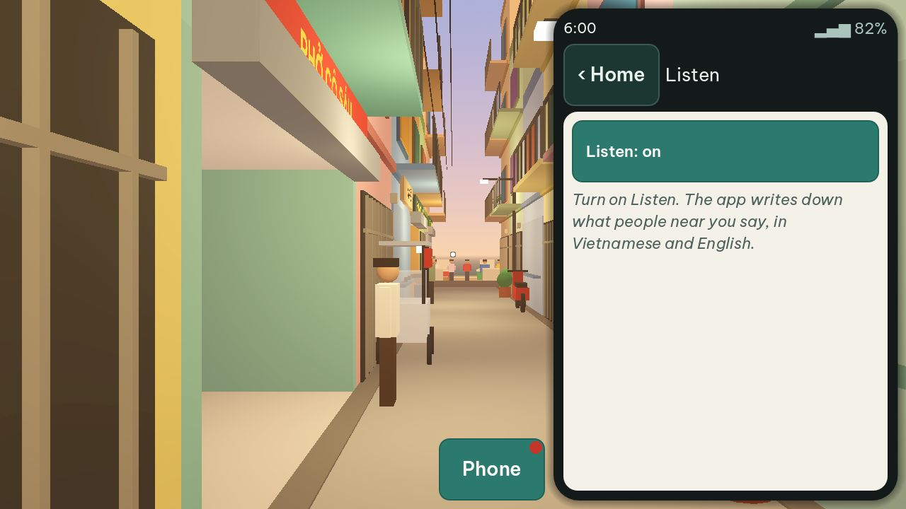
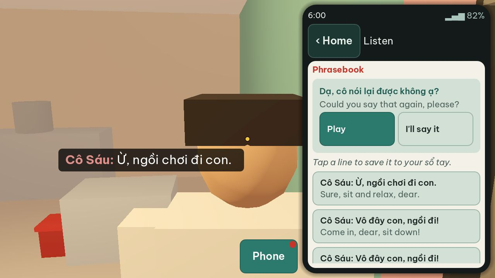
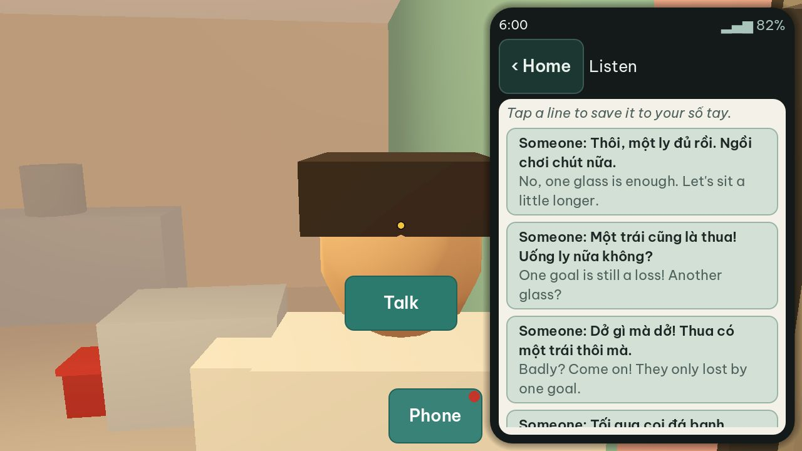
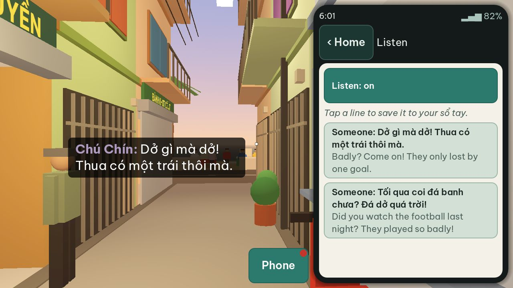
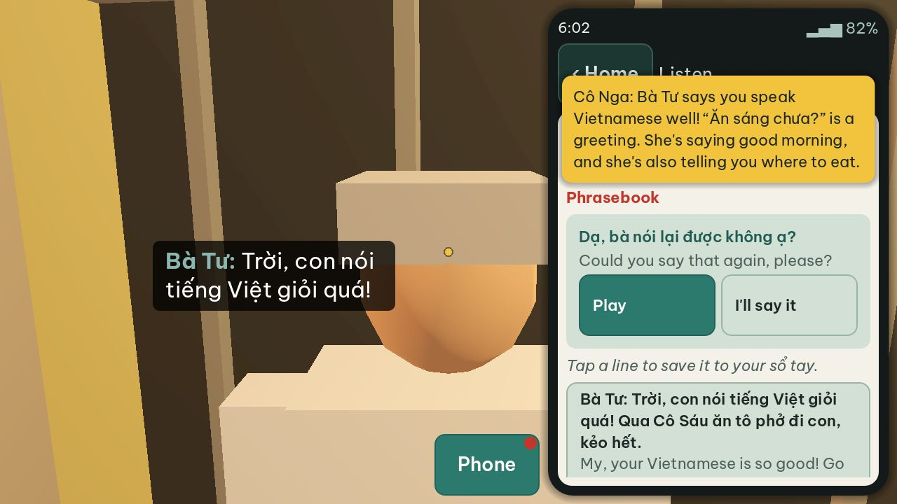

# Play-test report: plan 0003, Voices and the phone

## 1. Commit

`f6fcadd` on `main`. The game code is the same as `32f402a` ("Set plan 0003 to Built") and `76fba59` ("Update the voices").

## 2. What the architect ran

| Run | Result |
|---|---|
| Unit tests (`tools/test.sh`): 7 scripts, 71 tests, 620 asserts | All pass |
| PT-18 `talk_listen`, PT-21 `phone_apps`, PT-22 `subtitle_rules` at 1280×720 and 2400×1080 | All pass |
| PT-19 `overhear`, PT-20 `reply_modes`, PT-23 `walk_away`, PT-24 `sound_captions` at 1280×720 | All pass |
| An exploratory scenario with real input (Listen on before a line, a talk with Cô Sáu, "say again" at different times, 90 s near the cà phê cóc with Listen on, Lens, Settings) at 1280×720 | 4 defects (D-0003-01 to D-0003-04) |
| The voice files: format and loudness (`ffprobe`, `ffmpeg ebur128`) on 3 files | Vorbis, mono, 48 kHz, −16.0 to −16.1 LUFS |
| The audition page at `https://sntran.github.io/Vung_Tau/voices/` | Online: 25 preset voices (8 Southern, 2 Central, 15 Northern), 5 lines each |
| CI on `main` (the "Test" workflow) | Not stable: see D-0003-05 |

The other scenarios (PT-01, PT-03 to PT-17) ran in CI. The workspace has 2 CPUs, and one run takes about 100 s.

## 3. Defects

### D-0003-01: The Listen app tells the player to turn on Listen when it is on (medium)

- **Steps:** Start at 06:00. Raise the phone, open Listen, tap "Listen: off". Do not go near a person.
- **Expected:** The button shows "Listen: on", and the empty transcript says that the app listens (for example "Listening… The lines that you hear show here.").
- **Actual:** The button shows "Listen: on", but the text below says "Turn on Listen. The app writes down what people near you say…".
- **Cause:** `ListenApp.refresh()` shows `listen_empty` for an empty transcript in both states.
- **Play-test step to add:** In PT-18, after the tap on `listen.toggle`, check the hint text when the transcript is empty.

### D-0003-02: The phrasebook moves under the finger when the line ends, and the player gives the wrong answer (high)

- **Steps:** Talk with Cô Sáu at 06:00. She says "Vô đây con, ngồi đi!". Open Listen. While she speaks, the phrasebook shows only "Dạ, cô nói lại được không ạ?" at the top. Tap its **Play** button just when her line ends.
- **Expected:** She says her line again.
- **Actual:** When the line ends, the replies "Dạ, con cảm ơn cô." and "Thank you!" come in above "say again". The tap lands on **Play** of "Dạ, con cảm ơn cô.". The phone thanks her, she answers "Ừ, ngồi chơi đi con.", and the talk ends (state "idle"). The player did not choose this. The exploratory scenario hit it on the first try.
- **Cause:** `ListenApp._phrasebook()` puts the replies first and "say again" last, and the replies show only in the state "answer".
- **Correction:** Keep each phrase in a fixed place. Put "say again" first, or show the replies of the line during the line too (disabled until the line ends). A tap must act on the phrase that was under the finger at the start of the tap.
- **Also:** A "say again" with **Play** while the person speaks plays the phone voice over the voice of the person. The person must stop, or "say again" must wait for the end of the line.
- **Play-test step to add:** Tap "say again" in the last 0.2 s of a line, and check that the person says the same line again.

### D-0003-03: The neighbors repeat the same argument every 20 seconds (medium)

- **Steps:** Start at 06:00. Stand near the cà phê cóc with Listen on for 90 s.
- **Expected:** Neighbors talk like real people: not the same words again and again.
- **Actual:** Chú Bảy and Chú Chín say the same four lines about last night's football 3 times in 90 s (`"every_s": 20` in `data/spots.json`). The transcript fills with copies: of 16 entries, 13 are the football chat, and 9 of these are copies. A player who stays for breakfast hears the same argument many times.
- **Correction:** A chat plays once, then waits a long time (for example 10 to 20 minutes of game time), or the people have more chats and do not repeat one in the same morning. Write the new lines with the status "check". The transcript keeps a maximum number of entries (for example the last 50). Each frame, `phone_state()` turns the full transcript into a string, and a long transcript makes the phone slow.
- **Play-test step to add:** In PT-19, wait 3 minutes near the neighbors and check that no chat line repeats.

### D-0003-04: The subtitle names a person that the Listen app calls "Someone" (low)

- **Steps:** Start at 06:00. Stand near the cà phê cóc with Listen on.
- **Expected:** The same name rule in the subtitles and in the Listen app.
- **Actual:** The subtitle shows "Chú Chín:" and "Chú Bảy:". The Listen app shows "Someone" for the same lines (R19), because the player has not met them. Chú Bảy and Chú Chín cannot be met (`"talk": false`), so the Listen app never shows their names.
- **Question for me:** Which rule do I want? Subtitles show "Someone" (or the role, such as "A neighbor") before the player meets the person, or the player "meets" a person by hearing their name.

### D-0003-05: The play tests in CI fail at random (medium)

- **Evidence:** On `main`, "Play tests (part 1 of 6)" failed for `99b22e4` and `186e1af`, and passed for `d7da185` and `e1ee808`. These commits do not change the game. The builder's branch has a commit "Give a play-test run 300 s of real time, because the CI computers are…", so the builder knows of slow CI computers.
- **Expected:** The same commit gives the same result each time.
- **Correction:** Find the scenario of part 1 that fails, and make it wait for game states, not for real time. Merge the time-limit change to `main`.

### D-0003-06: The "far" screenshot of PT-19 shows only a wall (low)

- **Steps:** Run PT-19 `overhear`.
- **Actual:** At 15 m from the neighbors, the player stands against the end wall of the hẻm and looks at it. The screenshot is one flat color. A broken screen looks the same, so the screenshot cannot show a defect.
- **Correction:** Walk to 15 m in the other direction, or turn the view along the hẻm before the screenshot.

### D-0003-07: A notification covers the top of the phone for 3 s (low)

- **Actual:** The banner covers the **Home** button, the app title, and the first line of the app for 3 s. The taps go through it, so the player can still use the phone, but the player cannot see what they tap.
- **Correction:** Put the banner at the top of the phone above the status bar, or push the app down while it shows, or let the player swipe it away.

### D-0003-08: Godot imports the files in `docs/` (low)

- **Steps:** Run `godot --headless --path . --import` after a clone.
- **Actual:** Godot imports the 75 MP3 files of the audition page and the pictures in `docs/`. It writes a `.import` file next to each, and `git status` lists them. The exports exclude `docs/*`, so the builds are correct, but the import is slower and the work tree is not clean.
- **Correction:** Add an empty `docs/.gdignore`.

## 4. Audit of the requirements

| Req. | Result | Notes |
|---|---|---|
| R1 | Pass | `vi`, `en`, `say`, `voice_style`, `replies` (with `next_said` and `english`), `actions`, and `then` are in `data/dialogue/hem.json`. |
| R2 | Pass | The narration moved to Lens, messages, and sound captions (builder note N1). |
| R3 | Open | First voices are in `data/voices.json`. I did not choose the final voices yet (acceptance 2). The `note` in `data/voices.json` says "The owner chooses…". Rewrite it in the first person (`CONTRIBUTING.md`). |
| R4 | Pass | `Content` checks the hashes at start. Unit test `test_manifest_check`. |
| R5, R6 | Pass | 40 clips with a manifest. Vorbis, mono, 48 kHz. |
| R7 | Pass | `voices.yml` ran on `main` and committed "Update the voices". |
| R8 | Pass | −16.0 to −16.1 LUFS on the 3 files that the architect measured. |
| R9 | Pass | The audition page is online at `/voices/`. |
| R10 | Pass | VieNeu-TTS, MOSS-Audio-Tokenizer-Nano, and sea-g2p (Apache 2.0, checked by the builder) are in `assets/CREDITS.md`. |
| R11 | Pass | Voice at the head, 12 m range. |
| R12 | Pass | The subtitle holds 0.6 s after the audio. See D-0003-04 for the name. |
| R13 | Pass | PT-22 checks every line at both sizes. Text height 32 px at 720 px. |
| R14 | Pass | "[lóc cóc]" and "[a TV upstairs]". |
| R15 | Pass | PT-23. The call after the player is a line of the person. |
| R16, R17, R18 | Pass | 38% width, swipe down, status-bar time, dot. See D-0003-07. |
| R19 | Defect | D-0003-01, D-0003-04. |
| R20 | Defect | Works, but see D-0003-02. |
| R21, R22 | Pass | Play, I'll say it (with the tone of each syllable), English, actions, save to the Sổ tay. |
| R23 | Pass | Lens shows the card of the place in the frame, with "Open now" and "Closed now". |
| R24, R25 | Pass | Messages from cô Nga by time and by event. |
| R26, R27, R28 | Pass | PT-21 and the clock scenario. Settings stay after a restart. |
| R29 | Pass | The talk panel, the top bar, the toast, and the sheets are gone. |

### Acceptance criteria

| # | Result |
|---|---|
| 1 | Pass. |
| 2 | Open: I must listen to the audition page and choose the voices. |
| 3 | Pass, except D-0003-05 (CI) and D-0003-06 (a screenshot that cannot show a defect). |
| 4 | Pass. |
| 5 | Open: I must try the Android debug APK on a phone in daylight. |
| 6 | Pass. |

### Content for me to check

All new lines have the status "check". These need my ear or my decision:

- **Voices that say English.** `batu.reply_english` ("Good morning! Phở, phở! Cô Sáu."), `bacha.english` ("Welcome, welcome!"), `nga.english` ("Good, good!"), and `cosau.english` ("Ô kê, ô kê!") are read by a Vietnamese voice model. Listen to them in the game: English words can sound wrong.
- **Cô Út calls the traveler "con".** "Bánh khọt nè! Ăn thử đi con!" A seller of about 40 who calls an adult stranger usually says "em" or "anh/chị", not "con". Bà Tư (about 70) and the older people can say "con".
- **Plan 0003, Q5:** the phone voice is Northern ("Mai Anh"). A Southern voice is the other choice.

## 5. Order of the corrections

1. D-0003-02 (wrong answers are a "wrong answer" moment that the player did not choose).
2. D-0003-05 (CI must be stable before the next plans).
3. D-0003-01, D-0003-03.
4. D-0003-04 after my answer, then D-0003-06 and D-0003-07.
