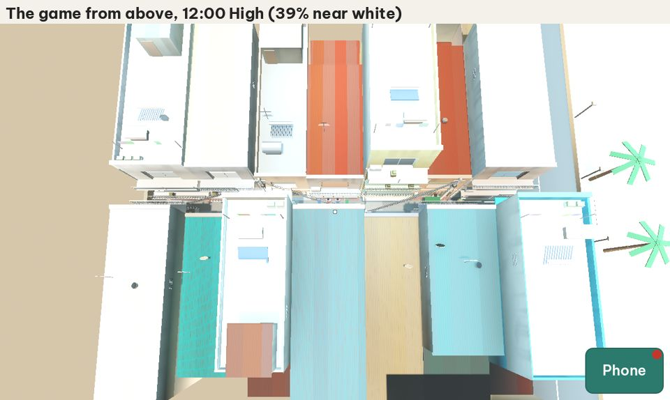

# Play-test report: plan 0004, Desktop and the house detail kit

## 1. Commit

`a546611` on `main`. The game code is the same as `53fbace` ("Set plan 0004 to Built").

## 2. What the architect ran

| Run | Result |
|---|---|
| Unit tests (`tools/test.sh`): 8 scripts, 76 tests, 649 asserts | All pass |
| PT-25 `look_review` (Forward+ High and Mobile Low, 07:00, 12:00, 17:30, 20:00) | Pass. See the look defects D-0004-03, D-0004-04, D-0004-06. |
| PT-26 `desktop_controls`, PT-27 `gamepad`, PT-28 `quality_presets`, PT-29 `shutters`, PT-30 `window_sizes`, PT-31 `house_seeds`, PT-32 `budget` at 1280×720 | All pass |
| PT-01 `fp_walk`, `fp_tap_walk`, `fp_collision`, `fp_focus` in the narrower hẻm (R11a) at 1280×720 | All pass |
| PT-23 `walk_away` and PT-20 `reply_modes` at 2400×1080 | `walk_away` fails 2 times of 2 (D-0004-01). `reply_modes` passes. |
| Desktop exports from a fresh clone with the commands of `export.yml` | Windows, macOS, and Linux: exit 0, files made |
| CI on `main` since `53fbace` | "Test" fails on each run (D-0004-01). "Export" fails on each run in the job "Desktop builds" (D-0004-02). |
| Probes of the architect (not play tests): views from above the hẻm, and the distance to each person in a talk | D-0004-03, D-0004-05 |

## 3. Defects

### D-0004-01: The play tests fail in CI on each run, and the hẻm is blocked at 2400×1080 (high)

- **Evidence:** On `main`, the "Test" workflow failed for `53fbace`, `0017e0e`, `9208d0a`, and `a546611`. "Play tests (part 4 of 6)" fails on each run, and part 3 on three of four. The status of plan 0004 is "Built", but step 4 of the workflow in `AGENTS.md` says that all play tests must pass first.
- **One cause that the architect found:** PT-23 `walk_away` at 2400×1080 fails 2 times of 2 in the workspace, alone on the computer: "the talk ends at 6 m: 1.87 m" and "Cô Sáu calls after the player". The player walks east from Phở Cô Sáu with the joystick and stops near the bánh mì cart. In the 2.8 m hẻm (R11a), the cart and the people at it fill the width. The scenario passes at 1280×720.
- **Expected:** All play tests pass in CI before "Built". A player can always walk the length of the hẻm at every time of day.
- **Correction:** Read the logs of parts 3 and 4 (the architect's workspace cannot download CI logs). Keep a free path of at least 0.9 m (the player capsule and a margin) along the hẻm at all times: move the cart customers, or let the player pass between people. Add a play-test step that walks the full hẻm at 06:00, 07:00, 12:00, 18:00, and 20:30 at both sizes.

### D-0004-02: The desktop builds fail in CI (high)

- **Evidence:** The job "Desktop builds" of the "Export" workflow fails in the step "Export the Windows, macOS, and Linux builds" on each run since `53fbace`, about 20 s after the start of the step. No desktop build was uploaded yet. The same commands from a fresh clone in the architect's workspace give exit 0 and the three files.
- **Expected:** R6: CI uploads the Windows, macOS, and Linux builds. Acceptance criterion 3 needs them.
- **Correction:** Read the log of the step. Check the cache of the export templates: the key `godot-templates-…` is the same for the jobs that use only the web or the Android templates.

### D-0004-03: The roofs do not look like a dense hẻm of Vũng Tàu (medium)

- **Expected:** R7 and R10c: in a dense hẻm, most roofs are corrugated metal in faded mint or teal, rust, orange or tan, and some red. Rust shows in streaks along the ridges. Flat terraces have tanks, solar water heaters, laundry, plants, and rebar. I compared the game with the top-down photo of a dense hẻm that I chose for R10c (the photo is not in the repository).
- **Actual:**
  - The metal roofs use grey, beige, and dark grey. There is no mint or teal roof. Rust streaks do not show from above.
  - The flat terraces are white and almost empty.
  - All houses have the same depth and a flat back, and the roofs are at a few heights only. In the photo, houses have back extensions, roofs at many heights, small rooms on the terraces, and metal roofs over parts of terraces.
- **Cause:** The grey and white clusters of R10c (43%) are mostly concrete terraces and walls, not metal sheets. `metal_roofs` in `palette.json` uses them for the metal sheets.
- **Correction:** Metal sheets get their colors from the mint and teal, rust, orange and tan, and red clusters only. Flat terraces take the grey and white share. More rooftop parts on the terraces (R7). Variation in depth, back extensions, and small rooms on terraces. Add a fixed view from above to PT-25.

### D-0004-04: The light is wrong at 17:30 and 20:00 on High (medium)

- **Actual:** At 17:30 the hẻm is almost black. At 20:00 it is brighter than at 17:30, and the walls are flat cream, like day light. At 12:00 the shade is blue and cold.
- **Expected:** The light follows the time: a warm, bright noon with hard shadows, a golden 17:30, and a dark 20:00 with pools of light under the lamps and from the shop fronts.
- **Correction:** Check the SDFGI energy of 4 (builder note N5) at night: it makes the lamps light the whole hẻm. Use a different energy or ambient light by time of day. Add PT-25 checks of the mean brightness of the lower half of the view: 20:00 must be darker than 17:30, and 17:30 darker than 12:00.

### D-0004-05: In a talk, the player stands too close to the person (medium)

- **Measured:** In a talk, the eyes of the player are 0.77 m from the head of Cô Sáu, cô Nga, Bác Hà, and Cô Út (0.75 m on the ground). The face of the person fills the view.
- **Expected:** A normal distance for a talk: 1.0 m to 1.2 m. Plan 0006 adds real faces. At 0.75 m they will look too close and strange.
- **Cause:** Builder note N10: the people and the stand points moved with the narrower hẻm.
- **Correction:** A stand point at 1.0 m to 1.2 m from the person, along the hẻm if the width is too small. Add a check of the distance to PT-18.

### D-0004-06: The patches of fallen plaster are small spots all over the walls (low)

- **Actual:** Many small red patches at all heights, also high on the walls and on the parapets. From a distance they look like red spots.
- **Expected:** R8: patches mostly low on the wall and at the edges, fewer and larger. Most walls of new houses have none.
- **Correction:** Fewer, larger patches. Use the "low" and "edge" weights more strongly. New houses (paint age low) have no patch above the ground floor.

### D-0004-07: Low on a computer starts the game two times at each start (low)

- **Actual:** Builder note N1: the desktop build uses Forward+, and Low uses the Mobile renderer, so the game starts again at each start.
- **My decision (changes R4):** On a computer, Low uses Forward+ with all effects off (no SSAO, SSIL, SDFGI, or fog), the 25 m shadow, and the 0.75 render scale. No preset needs a restart on a computer. Android and iOS keep the Mobile renderer, and the web build keeps Compatibility. Remove the restart code if no preset needs it.

### D-0004-08: The houses are all in line (medium)

- **Expected (first-hand, 2026-10-24):** In a dense hẻm, houses are not in line with each other. They face in different directions, with different depths, back extensions, and roofs at many heights. See the top-down photo of R10c.
- **Actual:** In the test street, all houses have the same depth, a flat back, and parallel walls (D-0004-03, picture above).
- **Correction in this plan:** The kit makes houses with different depths, back extensions of one or two floors, a small room on some roof terraces, and metal roofs over a part of a terrace. The fronts on the test street stay on the street line.
- **For plan 0009:** The house generator turns houses to follow the real lot shapes, so the houses face in different directions.

### D-0004-09: The buildings must be colorful, like the photos (medium)

- **My decision (answers Q5, changes R10a):** I prefer colorful buildings, like the photos.
- **Measured by the architect** on three of my photos (the top-down dense hẻm and two views from Núi Nhỏ, without plants, sky, and dark shade): 28% to 36% of the building surfaces have a saturation above 0.25. Rust, orange, and terracotta are 17% to 25%. Mint and teal are 2% to 8%. Yellow is 2% to 5%. Blue is 1% to 6%. In the game from above (picture of D-0004-03), almost all surfaces are grey or white.
- **Correction:**
  - Metal roofs as in D-0004-03.
  - Bold walls: about 30% of the walls instead of 15%, up to 1 house in 3 in a hẻm of homes. Colors: mint, teal, pastel yellow, salmon, sky blue, and two-color fronts. Keep the rule that two neighbors do not have the same color.
  - Add a check to PT-25: from the fixed view above the test street, 25% to 40% of the pixels of the buildings have a saturation above 0.25.

## 4. Audit of the requirements

| Req. | Result | Notes |
|---|---|---|
| R1 | Pass | Renderers set. PT-30 checks 16:9, 21:9, and 16:10. |
| R2, R3 | Pass | PT-26 and PT-27. Esc opens the phone home screen (Q6 is still open). |
| R4 | Change | My decision in D-0004-07: Low on a computer uses Forward+ with the effects off. |
| R5 | Pass | Shadows on all presets. The web build keeps them off, with the reason in `AGENTS.md`. |
| R6 | Defect | D-0004-02. `docs/release-notes.md` exists. |
| R7 | Partly | All parts exist. See D-0004-03 for the roofs. |
| R8, R9 | Partly | See D-0004-06. |
| R10, R10a, R10b | Change | `content_checker.gd` checks the palette rules. My answer to Q5 changes the rules: D-0004-09. |
| R10c | Defect | D-0004-03. |
| R11 | Pass | Concrete floor with cracks, patches, and the drain. |
| R11a | Defect | The hẻm is 2.8 m wide. Walking, tap to walk, and the phone pass at 1280×720. See D-0004-01 and D-0004-05. |
| R12 | Pass | `docs/content/reference/houses.md` has the links. I did not mark the parts yet. |
| R13, R14 | Pass | Measured: Low 359 to 477 draw calls, 132 664 to 149 778 triangles. High 481 to 874 draw calls, 183 292 to 277 168 triangles. |

### Acceptance criteria

| # | Result |
|---|---|
| 1 | Fail: D-0004-01. |
| 2 | Open: I look at the PT-25 screenshots. The architect's findings are D-0004-03, D-0004-04, and D-0004-06. |
| 3 | Blocked: D-0004-02. I test on macOS and Windows (Q1). |
| 4 | Pass. |

## 5. Order of the corrections

1. D-0004-01 and D-0004-02 (CI must be green, and the desktop builds must exist).
2. D-0004-05 (plan 0006 needs it).
3. D-0004-03, D-0004-08, D-0004-09, and D-0004-04 (the look).
4. D-0004-06 and D-0004-07.

## 6. Note: the test street is not the homestay hẻm

The real homestay hẻm is only homes, with the slope of Núi Nhỏ on one side and one row of houses on the other side. Nobody sells anything in it (first-hand, 2026-10-24). The street of plans 0001 to 0004, with its shops and carts, is a test street. Plan 0009 builds the real hẻm and moves the shops and their people to the streets near chợ Xóm Lưới. Do not add more shops to the test street.

## 7. Re-check (2026-10-25)

Commit `0c33960`. CI on `main` is green, and the export uploads the Windows, macOS, and Linux builds. The architect ran PT-25 again and measured the screenshots.

| Defect | Result | Evidence |
|---|---|---|
| D-0004-01 | Fixed | CI green. The new scenario `hem_walk` walks the full hẻm at five times on both sizes. |
| D-0004-02 | Fixed | The artifacts `windows-build`, `macos-build`, and `linux-build` exist for `0c33960`. |
| D-0004-03 | Fixed, but see D-0004-10 | The metal roofs have mint, teal, rust, and orange colors. The terraces have rooms, plants, and laundry. |
| D-0004-04 | Fixed | 20:00 is darker than 17:30, and 17:30 is darker than 12:00 (PT-25 checks it). |
| D-0004-05 | Fixed | The eyes of the player are 1.10 m from the head of Cô Sáu in a talk. |
| D-0004-06 | Fixed | Fewer and larger patches, mostly low. |
| D-0004-07 | Fixed | Low uses Forward+ on a computer. No restart. |
| D-0004-08 | Fixed | Back extensions, small yards, rooms on terraces. |
| D-0004-09 | Fixed | About 30 % bold walls. PT-25 checks the saturation from above. |

### D-0004-10: On High, the roofs and walls seen from above are too pale (medium)

- **Measured** in the view from above at 12:00 on High: 39 % of the pixels are near white (value above 0.92, saturation below 0.1), and the mean value is 0.87. In my top-down photo of a dense hẻm: 3 % near white, and a mean value of 0.62. At 07:00 and 17:30 the game has 34 % to 35 % near white.
- **Cause (probable):** the exposure and the tone mapping. The terraces are grey in `palette.json` (`#CBCAC0`, `#91968E`), but they show white. The Filmic tone mapping (`tonemap_mode = 2`) with the default white point clips the bright surfaces, and SDFGI (energy 5 by day) adds light to all of them.
- **Correction:** Use the AgX tone mapping (Godot 4.4 and later) or set the white point and the exposure, so that sunlit surfaces keep their color. Then check the noon shade again: in the "along" view at 12:00, the shade has a mean value of 0.21 now, darker than a real hẻm at noon, where the sunlit walls light the shade. Add to PT-25: in the view from above at 12:00 on High and on Low, at most 10 % of the building pixels are near white, and the mean value is 0.55 to 0.75.

**Status:** plan 0004 stays "Built" until D-0004-10 is corrected. Then two of my checks remain: I look at the PT-25 screenshots (criterion 2), and I start the macOS and Windows builds on my computers (criterion 3).