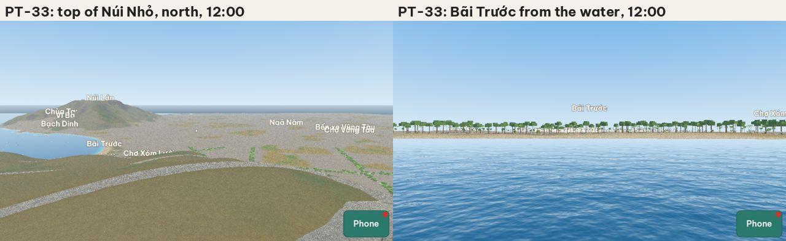
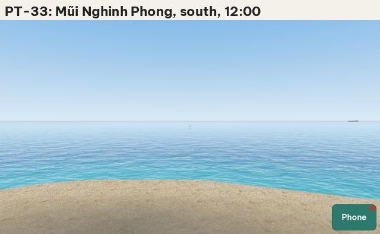
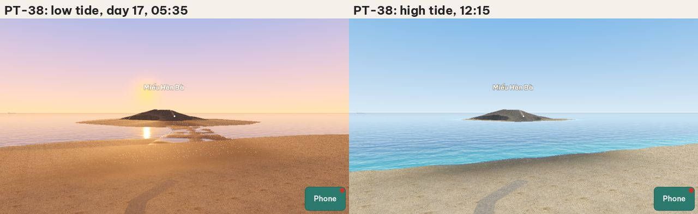

# Play-test report: plan 0005, Real geography of Vũng Tàu

## 1. Commit

`0c33960` on `main` ("Set plan 0005 to Built").

## 2. What the architect ran

| Run | Result |
|---|---|
| Unit tests (`tools/test.sh`): 95 tests | All pass |
| CI on `main` for `0c33960`: unit tests, the geodata pipeline tests, the voice build tests, and the play tests in 6 parts | All pass |
| PT-33 `geo_views` (5 runs: 06:00, 12:00, 18:00, 21:00, and 3 June 2027) | Pass. See D-0005-01, D-0005-02, D-0005-03. |
| PT-38 `geo_tide` (low tide on day 17, then 3 hours after the dry time) | Pass. The rock path is dry at low tide and under water at high tide. |
| `data/geo/build/report.md`, `tide_report.md`, `anchors.png`, `homestay_area.png` | All exist. All landmarks of R1 are found. |
| The credits screen (`data/credits.json`) and `assets/CREDITS.md` | See D-0005-04. |

The other geography scenarios (PT-34 to PT-37, PT-39) passed in CI. They take 12 runs or more each, so the architect did not run them again on the 2 CPUs of the workspace.

## 3. Defects

### D-0005-01: The hills have no trees (high)

- **Actual:** From the top of Núi Nhỏ, Núi Lớn and the near slopes are smooth, bare grass. The hill trees grow only in the near chunks (300 m), and the views show none.
- **Expected:** R12: trees on the hills. In my photos, Núi Lớn is covered by dense trees (green in the rainy season, with brown and red leaves in the dry season). On Núi Nhỏ, above the Hạ Long road, the dry season shows yellow-brown grass and scrub with patches of trees (photos of 2026-10-26). The hills are the first thing that a player sees of Vũng Tàu.
- **Correction:** Dense trees on all slopes with the surface "wood" or above 12 m, at every distance: near trees as now, and a simple far form (for example clumps or a tree canopy texture on the ground) for the mid and far chunks. Plan 0020 replaces the near tree shapes later, so do not spend time on the look of the near trees here: this defect is about trees at every distance. Add a check to PT-33: in the view from the top of Núi Nhỏ, the slopes of Núi Lớn show a canopy color, not the grass color.

### D-0005-02: PT-33 does not frame the places that I must compare (medium)

- **Actual:** The view "Bãi Trước from the water" is 260 m from the beach and shows only a line of trees: Núi Nhỏ and Núi Lớn are outside the frame (76° and more from the view direction, with a view of ±43°). The view from Núi Nhỏ looking north does not show Bãi Sau, which is 66° to the right.
- **Expected:** Acceptance criterion 3: I compare the shapes of the hills, the coast, and the beaches with the real places. The views must show them as my photos do: Bãi Trước as a bay between the two hills, and Bãi Sau as a long curve to the north-east.
- **Correction:** Put the Bãi Trước view 1.5 km to 2 km out in the bay and higher (about 60 m), looking at the middle of the bay, so that both hills show. Add a view from Núi Lớn looking south-east over Bãi Trước to Núi Nhỏ, and a view from Núi Nhỏ looking north-east along Bãi Sau.

### D-0005-03: Mũi Nghinh Phong is sand (medium)

- **Actual:** The view from Mũi Nghinh Phong stands on smooth sand.
- **Expected:** Mũi Nghinh Phong is a rocky cape. The rock mask covers only slopes above 35° and the Hòn Bà band, so the low rocks of the cape are sand.
- **Correction:** Mark the cape as rock in `overrides.json` (from the OSM coastline at the tip, or from `natural=bare_rock` and `natural=cliff` if OSM has them). I check it in the next PT-33.

### D-0005-04: The EOT20 notice is not on the credits screen (medium)

- **Actual:** `data/credits.json` has OpenStreetMap, Copernicus, Poly Haven, and the font. `assets/CREDITS.md` has no EOT20 line. `tide.json` has the license: CC BY 4.0, Hart-Davis et al. (2021), DOI 10.17882/79489.
- **Expected:** D12 and acceptance criterion 4: the credits screen shows the EOT20 notice. CC BY 4.0 requires the credit.
- **Correction:** Add EOT20 to `data/credits.json` and `assets/CREDITS.md`, with the citation and the DOI. Add pyTMD (used in CI) to `assets/CREDITS.md`. Add a check to PT-16: the credits page shows "EOT20".

### D-0005-05: Hòn Bà is a smooth dark cone (low)

- **Actual:** The rock path works with the tide (dry at low tide, under water 3 hours later). But the islet is a smooth, almost black hump.
- **Expected:** In my photo, Hòn Bà is a pile of grey and brown boulders with trees and plants on top, and the temple. The rock path is grey-brown with some green at the low edges.
- **Correction:** A lighter grey-brown rock color, larger boulders, and some trees on the top. The temple comes with plan 0008.

### Plan text corrected by the architect

Plan 0005 still named the old plan numbers for the structures and the houses. They are now 0008 and 0009 (section 1, R15, and N28).

## 4. Audit of the requirements

| Req. | Result | Notes |
|---|---|---|
| R1 to R6 | Pass | 692 km of roads, 1975 blocks, 2193 buildings. All landmarks found. |
| R6a | Pass, open question | `anchors.png` exists. I name the anchors (Q4, Q9). |
| R7, R8 | Pass | `overrides.json` adds Núi Nhỏ, the Hòn Bà band, and the roadworks. |
| R8a to R8c | Pass, open question | "Hẻm 2 Hải Đăng" leaves the end of the first hairpin. It runs south along the foot of Núi Nhỏ, with the slope on the east side and one row of houses between it and the coast road. This matches my description. I confirm it (Q5). |
| R8d to R8i | Pass | The amplitudes are within 6 % of the Vũng Tàu station. The game agrees with the 200 test values within 0.02 m (unit test). |
| R8j | Open | I choose day 1 (Q8). |
| R9, R10 | Pass | |
| R11, R11a | Pass | The roadworks are at the corner of the homestay hẻm. The news gives no width for the widening ([Tuổi Trẻ, 2026-07-07](https://news.tuoitre.vn/road-leading-to-vung-taus-164-year-old-lighthouse-set-for-upgrade-103260707165932032.htm): more than 220 m, with sidewalks, drains, and street lights, open in 2027), so 3 m is a builder value (Q10). |
| R12, R12a | Defect | D-0005-01, D-0005-03. |
| R13, R13a | Pass | The sea follows the tide. The deep water message shows. Ships at anchor, boats in the bay, the pier. |
| R14 | Pass | 06:00, 12:00, 18:00, and 21:00 differ. |
| R15 | Pass | Markers. In the view from Núi Nhỏ some names overlap (Chùa Tam Bảo, Vi Ba, Bạch Dinh). The markers are temporary (plan 0008). |
| R16 | Not checked | A phone result needs a real phone. |
| R17, R18 | Pass | GUT and Python tests in CI. |

### Acceptance criteria

| # | Result |
|---|---|
| 1 | Pass. |
| 2 | Pass. |
| 3 | Open: I compare the PT-33 views after D-0005-01 and D-0005-02. |
| 4 | Fail: D-0005-04. |
| 5 | Pass. |

## 5. Order of the corrections

1. D-0005-04 (a license duty).
2. D-0005-01 and D-0005-02 (I need them to judge the shapes).
3. D-0005-03 and D-0005-05.
