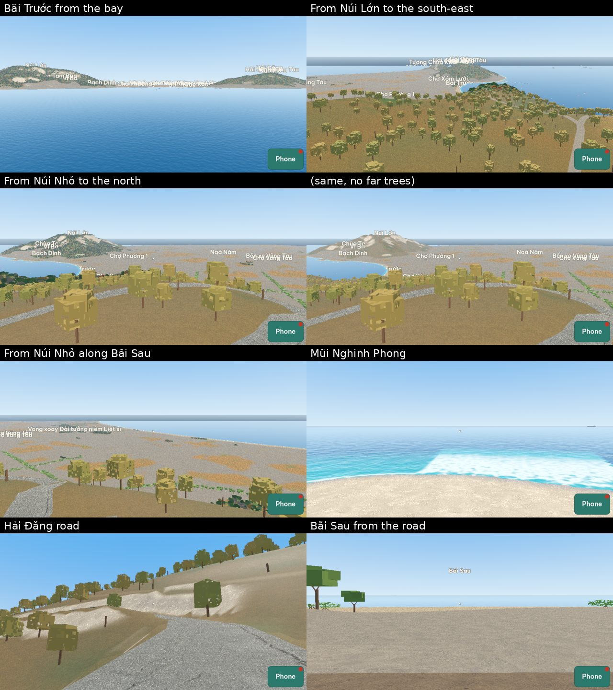
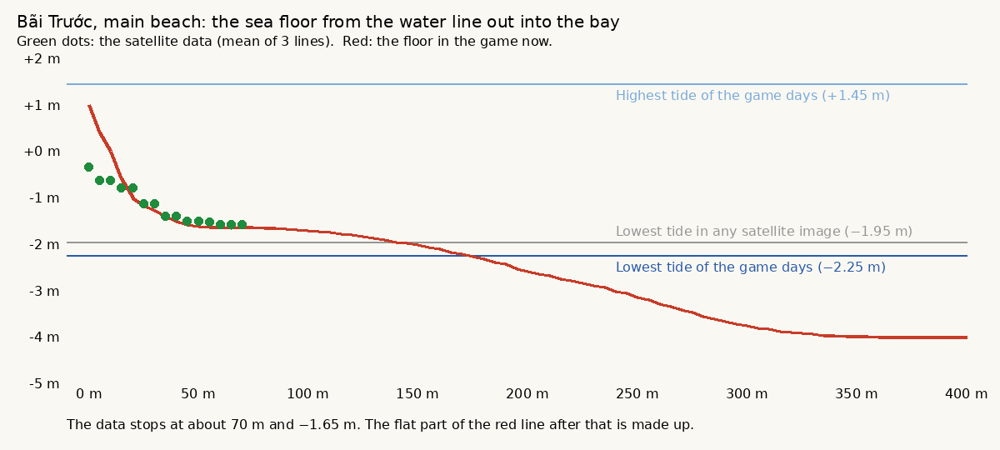
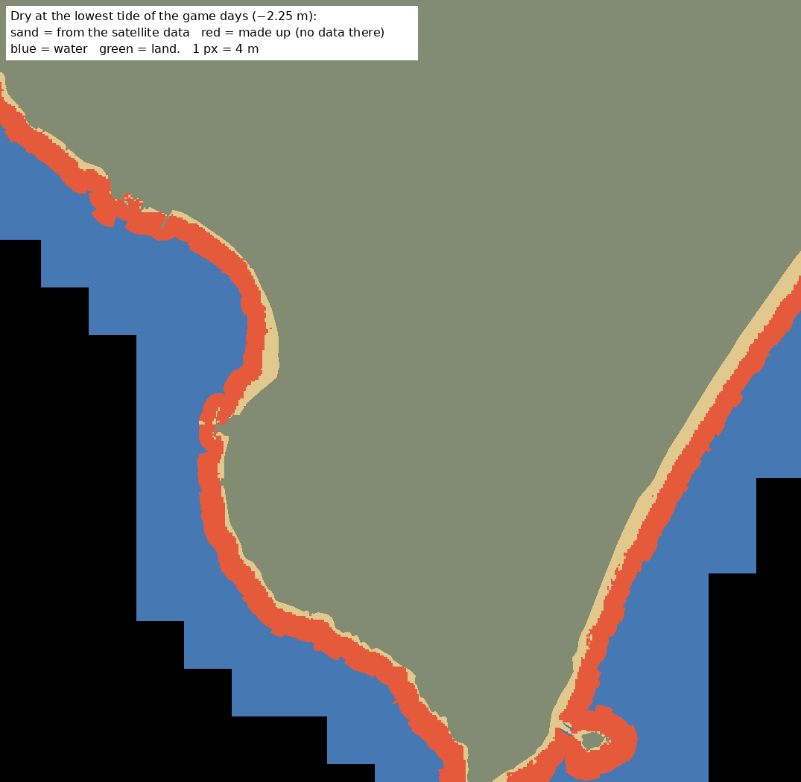
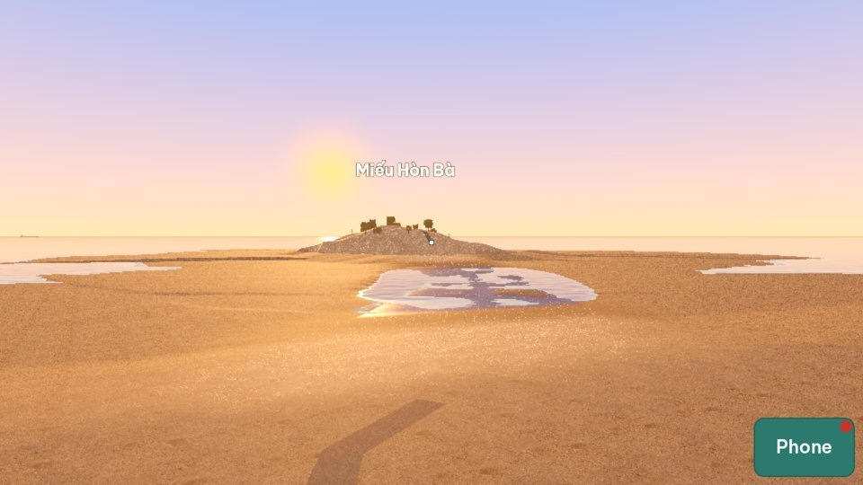
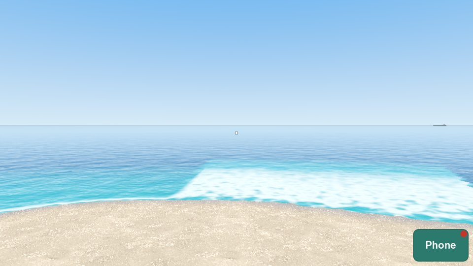
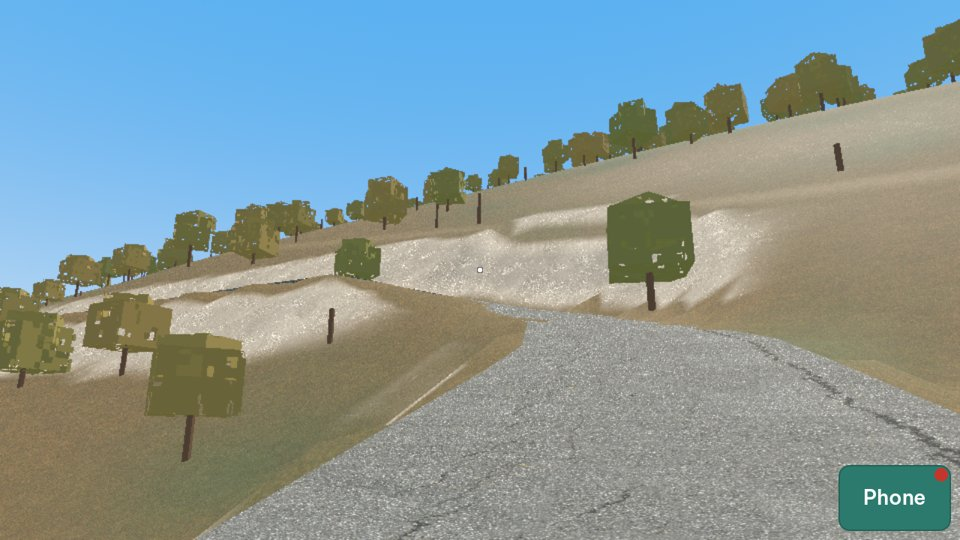

# Play-test report: plan 0005, Real geography of Vũng Tàu

## 1. Commit

`0c33960` on `main` ("Set plan 0005 to Built").

## 2. What the architect ran

| Run | Result |
|---|---|
| Unit tests (`tools/test.sh`): 95 tests | All pass |
| CI on `main` for `0c33960`: unit tests, the geodata pipeline tests, the voice build tests, and the play tests in 6 parts | All pass |
| PT-33 `geo_views` (5 runs: 06:00, 12:00, 18:00, 21:00, and 3 June 2027) | Pass. See D-0005-01, D-0005-02, D-0005-03. |
| PT-38 `geo_tide` (low tide on day 17, then 3 hours after the dry time) | Pass. The rock path is dry at low tide and under water at high tide. |
| `data/geo/build/report.md`, `tide_report.md`, `anchors.png`, `homestay_area.png` | All exist. All landmarks of R1 are found. |
| The credits screen (`data/credits.json`) and `assets/CREDITS.md` | See D-0005-04. |

The other geography scenarios (PT-34 to PT-37, PT-39) passed in CI. They take 12 runs or more each, so the architect did not run them again on the 2 CPUs of the workspace.

## 3. Defects

### D-0005-01: The hills have no trees (high)

- **Actual:** From the top of Núi Nhỏ, Núi Lớn and the near slopes are smooth, bare grass. The hill trees grow only in the near chunks (300 m), and the views show none.
- **Expected:** R12: trees on the hills. In my photos, Núi Lớn is covered by dense trees (green in the rainy season, with brown and red leaves in the dry season). On Núi Nhỏ, above the Hạ Long road, the dry season shows yellow-brown grass and scrub with patches of trees (photos of 2026-10-26). The hills are the first thing that a player sees of Vũng Tàu.
- **Correction:** Dense trees on all slopes with the surface "wood" or above 12 m, at every distance: near trees as now, and a simple far form (for example clumps or a tree canopy texture on the ground) for the mid and far chunks. Plan 0020 replaces the near tree shapes later, so do not spend time on the look of the near trees here: this defect is about trees at every distance. Add a check to PT-33: in the view from the top of Núi Nhỏ, the slopes of Núi Lớn show a canopy color, not the grass color.

### D-0005-02: PT-33 does not frame the places that I must compare (medium)

- **Actual:** The view "Bãi Trước from the water" is 260 m from the beach and shows only a line of trees: Núi Nhỏ and Núi Lớn are outside the frame (76° and more from the view direction, with a view of ±43°). The view from Núi Nhỏ looking north does not show Bãi Sau, which is 66° to the right.
- **Expected:** Acceptance criterion 3: I compare the shapes of the hills, the coast, and the beaches with the real places. The views must show them as my photos do: Bãi Trước as a bay between the two hills, and Bãi Sau as a long curve to the north-east.
- **Correction:** Put the Bãi Trước view 1.5 km to 2 km out in the bay and higher (about 60 m), looking at the middle of the bay, so that both hills show. Add a view from Núi Lớn looking south-east over Bãi Trước to Núi Nhỏ, and a view from Núi Nhỏ looking north-east along Bãi Sau.

### D-0005-03: Mũi Nghinh Phong is sand (medium)

- **Actual:** The view from Mũi Nghinh Phong stands on smooth sand.
- **Expected:** Mũi Nghinh Phong is a rocky cape. The rock mask covers only slopes above 35° and the Hòn Bà band, so the low rocks of the cape are sand.
- **Correction:** Mark the cape as rock in `overrides.json` (from the OSM coastline at the tip, or from `natural=bare_rock` and `natural=cliff` if OSM has them). I check it in the next PT-33.

### D-0005-04: The EOT20 notice is not on the credits screen (medium)

- **Actual:** `data/credits.json` has OpenStreetMap, Copernicus, Poly Haven, and the font. `assets/CREDITS.md` has no EOT20 line. `tide.json` has the license: CC BY 4.0, Hart-Davis et al. (2021), DOI 10.17882/79489.
- **Expected:** D12 and acceptance criterion 4: the credits screen shows the EOT20 notice. CC BY 4.0 requires the credit.
- **Correction:** Add EOT20 to `data/credits.json` and `assets/CREDITS.md`, with the citation and the DOI. Add pyTMD (used in CI) to `assets/CREDITS.md`. Add a check to PT-16: the credits page shows "EOT20".

### D-0005-05: Hòn Bà is a smooth dark cone (low)

- **Actual:** The rock path works with the tide (dry at low tide, under water 3 hours later). But the islet is a smooth, almost black hump.
- **Expected:** In my photo, Hòn Bà is a pile of grey and brown boulders with trees and plants on top, and the temple. The rock path is grey-brown with some green at the low edges.
- **Correction:** A lighter grey-brown rock color, larger boulders, and some trees on the top. The temple comes with plan 0008.

### Plan text corrected by the architect

Plan 0005 still named the old plan numbers for the structures and the houses. They are now 0008 and 0009 (section 1, R15, and N28).

## 4. Audit of the requirements

| Req. | Result | Notes |
|---|---|---|
| R1 to R6 | Pass | 692 km of roads, 1975 blocks, 2193 buildings. All landmarks found. |
| R6a | Pass, open question | `anchors.png` exists. I name the anchors (Q4, Q9). |
| R7, R8 | Pass | `overrides.json` adds Núi Nhỏ, the Hòn Bà band, and the roadworks. |
| R8a to R8c | Pass, open question | "Hẻm 2 Hải Đăng" leaves the end of the first hairpin. It runs south along the foot of Núi Nhỏ, with the slope on the east side and one row of houses between it and the coast road. This matches my description. I confirm it (Q5). |
| R8d to R8i | Pass | The amplitudes are within 6 % of the Vũng Tàu station. The game agrees with the 200 test values within 0.02 m (unit test). |
| R8j | Open | I choose day 1 (Q8). |
| R9, R10 | Pass | |
| R11, R11a | Pass | The roadworks are at the corner of the homestay hẻm. The news gives no width for the widening ([Tuổi Trẻ, 2026-07-07](https://news.tuoitre.vn/road-leading-to-vung-taus-164-year-old-lighthouse-set-for-upgrade-103260707165932032.htm): more than 220 m, with sidewalks, drains, and street lights, open in 2027), so 3 m is a builder value (Q10). |
| R12, R12a | Defect | D-0005-01, D-0005-03. |
| R13, R13a | Pass | The sea follows the tide. The deep water message shows. Ships at anchor, boats in the bay, the pier. |
| R14 | Pass | 06:00, 12:00, 18:00, and 21:00 differ. |
| R15 | Pass | Markers. In the view from Núi Nhỏ some names overlap (Chùa Tam Bảo, Vi Ba, Bạch Dinh). The markers are temporary (plan 0008). |
| R16 | Not checked | A phone result needs a real phone. |
| R17, R18 | Pass | GUT and Python tests in CI. |

### Acceptance criteria

| # | Result |
|---|---|
| 1 | Pass. |
| 2 | Pass. |
| 3 | Open: I compare the PT-33 views after D-0005-01 and D-0005-02. |
| 4 | Fail: D-0005-04. |
| 5 | Pass. |

## 5. Order of the corrections

1. D-0005-04 (a license duty).
2. D-0005-01 and D-0005-02 (I need them to judge the shapes).
3. D-0005-03 and D-0005-05.
4. The approved changes of 2026-10-26 (plan 0005, open questions): day 1 in 2019 (Q8, Q13), no roadworks (Q13), the boats and the thúng (Q6), the old market (Q12), and the sea floor from public data (R8g, Q14).

## 6. Re-check (2026-10-26)

Commit `9a3a2ba`. The architect ran PT-33 (12:00) and PT-35 (both runs) again, took the low-tide screenshot of PT-38, read the code of the sea floor, and measured the data in `data/geo/raw/` and the height chunks.

| Item | Result | Evidence |
|---|---|---|
| D-0005-01 | Fixed | From the top of Núi Nhỏ, Núi Lớn shows a canopy with the far trees, and pale grass without them (PT-33 checks it: 77 % of the points). Near trees are still sparse boxes on brown ground: plan 0020 replaces them. |
| D-0005-02 | Fixed | The view from the bay shows Bãi Trước between Núi Lớn and Núi Nhỏ. The two new views show Bãi Trước from Núi Lớn and Bãi Sau from Núi Nhỏ. The markers overlap (temporary, plan 0008). |
| D-0005-03 | Not fixed in the view | The view of Mũi Nghinh Phong still stands on smooth sand. The tip has rock now, but the camera stands on a made-up sand flat south of the tip (D-0005-06). |
| D-0005-04 | Fixed | The credits page and `assets/CREDITS.md` have EOT20, pyTMD, the Sentinel-2 notice, GEBCO, and the method. |
| D-0005-05 | Fixed | Light grey-brown rock, boulders, and trees on the top of Hòn Bà. |
| Day 1 (Q8) | Done | `calendar.json` is 2019-01-22, approved. The dry times match mine. |
| No roadworks (Q13) | Done | `roadworks.json` is empty. |
| Boats, thúng, stakes, flat rocks (Q6) | Done | 40 boats, 16 thúng, 6 rows of stakes off Hạ Long, and dark flat rocks along the sea wall. The places are builder values: I check them. |
| Chợ Phường 1 (Q12) | Done | In `landmarks.json`. |
| The sea floor (R8g) | Defects | D-0005-06, D-0005-07, D-0005-08. |

### D-0005-06: Most of the sea floor near the coast is made up, and it is too shallow (high)

- **Actual:**
  - At the lowest tide of the game days (−2.25 m), 8.4 km² of sea floor is dry. Only 3.5 km² of it has a value from the satellite data. The other 4.9 km² (red in the picture) is made up: a band of 40 m to 230 m (median 96 m) along almost every coast, also along the rocky coast of Hạ Long and around Hòn Bà.
  - At Bãi Trước, the data ends about 70 m from the water line, at about −1.65 m. After that, the floor stays almost flat at −1.7 m to −2.0 m out to 150 m, then goes down to −4 m. `intertidal_report.md` shows this flat part as if it were data ("the floor is −1.6 m to −2.0 m out to about 150 m"). So "the sand is dry to about 180 m" is not a measurement.
  - Around Hòn Bà, the data has only a few scattered pixels, but the floor is −0.4 m to −1.5 m for 120 m on all sides. At the low tide of day 1, the islet stands on a dry plain, and the player can walk around it. The rock path is then not the only way, and that is the point of the place (plan 0016).

    

  - South of Mũi Nghinh Phong, the data has no value, but the floor is −0.3 m to −1.0 m for 100 m. At 12:00 on day 1 it is a sand flat at the tip (the PT-33 view).
- **Causes:**
  1. The filter `MIN_SHARE = 0.08` needs 8 % dry images. Only 19 of the 220 images have the sea below −1.5 m (the lowest is −1.95 m), so a pixel lower than about −1.55 m cannot get a value. The data stops there because of the filter, not because the floor stops.
  2. From the edge of the data, `sea_floor_from_data()` blends with a smoothstep that starts flat (`down = smoothstep(0, 300 m, distance)`), so the floor stays near the edge height for about 100 m. A few scattered pixels (for example near the tip of the cape) make a whole shelf.
  3. 59 images are in the list two times (the same time, two processing versions, for example `S2A_48PYS_20190518_0_L2A` and `_1_L2A`). There are 161 different images, not 220, and the doubles count two times.
- **Expected:** the floor is from the data where the data has a value. Where it has no value, the floor does not make new shallow ground: it goes down from the edge of the data, and the report shows which parts are data and which are not.
- **Correction:**
  1. Keep one image for each time (the newest processing version).
  2. More low-tide images: use the Sentinel-2 images of 2016 to 2024 (the beaches change little), and add Landsat 8 and 9 (30 m) if needed. Write in the report how many images have the sea below −1.5 m and below −2.0 m.
  3. Replace the share filter with counts: a pixel needs at least 5 wet and 5 dry clear images.
  4. Beyond the edge of the data, the floor goes down at once, at the slope of the data at its edge (from the outer 30 m), and never flatter than 1 m in 60 m, to the GEBCO depth or −4 m. No smoothstep that starts flat. A group of data pixels smaller than about 20 pixels does not make a shelf.
  5. `intertidal_report.md`: in the table, mark each row "data" or "made", and show the made parts in another color on the dry map, with the area of each.
  6. PT-35: check the depth only where the data has a value, and check that beyond the edge the floor goes down by at least 0.5 m in the next 50 m. PT-38: at the low tide, the water is at least 0.3 m deep at 30 m on each side of the rock path.
- **What the data says now:** at Bãi Trước the floor goes from about −0.6 m at the water line to about −1.65 m at 70 m (a slope of about 1 m in 65 m). If that slope goes on, the sand is dry to about 100 m at the lowest tide of the game days. More low-tide images can show it.

### D-0005-07: Foam covers wide shallow water as a white sheet (medium)

- **Actual:** the foam is where the water along the view is thinner than 1.2 m (`water.gdshader`, `foam_depth`). Over a wide shallow area, the whole area is white, with a hard straight edge (the view of Mũi Nghinh Phong). Bãi Trước is a calm bay: my photos show no white surf at the swimming beach.
- **Expected:** foam is a narrow band at the water line (a few meters), stronger on the open coast (Bãi Sau) and on the rocks, and weak in the calm bay of Bãi Trước. No hard edges.
- **Correction:** make the foam from the distance to the water line (the depth falls to 0 there), not from the depth alone. Add a check to PT-35: in the screenshot at low tide from the sand of Bãi Trước, at most 5 % of the water pixels are near white.

### D-0005-08: The report of the sea floor does not show what is made up (low)

Part of D-0005-06, correction 5. Listed alone, because the report is how I check the data: I must see which parts are measured.

### D-0005-09: The land looks grey and dead (high)

My words (2026-10-26): "the screenshots make the land so dead. It's so grayish. I know the trees on the mountains are not that green, but I think we can make the view more alive."

- **Measured** (the land part of each image, below the sky): the PT-33 views at 12:00 on day 1 against my photos of Vũng Tàu, two of them from the dry season (April).

  | | Green pixels (green is the largest channel) | Mean value |
  |---|---|---|
  | Game: from Núi Lớn, from Núi Nhỏ to the north and to the north-east, the Hải Đăng road | 7 % to 24 % | 0.59 to 0.70 |
  | My photos: Bãi Trước from above, the slope of Núi Nhỏ over Hạ Long (April), Núi Lớn from Hạ Long | 23 % to 57 % (four of six above 30 %) | 0.21 to 0.57 (most 0.3 to 0.5) |

  The saturation is similar (0.22 to 0.35 in the game, 0.12 to 0.38 in the photos). So the land is not grey because of the tone mapping: it is too bright, and it has too little green.
- **What the photos show:**
  - In the dry season (April, the driest month), the slopes of Núi Nhỏ above Hạ Long are a dense mosaic of olive and dark green bushes and small trees, with patches of yellow-brown grass. Bare ground shows only on the steep granite.
  - The town has red and orange roofs, colored walls, and green trees along the streets and in the park.
  - Wet sand and wet rock at low tide are dark.
- **In the game:**
  - Sparse box trees stand on flat, smooth ochre and beige ground. Most of each slope is bare ground. The pale patches on the Hải Đăng road look like snow.
  - The town is a flat grey plain (it has no houses until plan 0009).
  - At low tide, the sand of the intertidal zone at Bãi Trước is as dry and light as the beach above it (`r-low-tide-sand.jpg`).
  - On 22 January, `season.gd` gives the hills a dryness of 0.8. That is almost the April value (0.85), but in my April photo the slopes are still mostly green.
- **Correction:**
  0. Use public data for the cover (added 2026-10-26, approved): ESA WorldCover 2021 (10 m classes: tree cover, shrubland, grassland, cropland, built-up, bare or sparse, water, mangrove) gives what grows on each place, and the Meta and WRI canopy height maps (about 1 m) give where the trees stand and how tall they are. Both are CC BY 4.0 (the builder checks the terms and writes the notices). They run in CI like `intertidal.py`, and they read only the play area. `build.py` writes the cover class and the canopy height into the surface data, and the near trees, the far forms, the bushes, and the ground colors use them, in place of the rule "wood or above 12 m". Record the dates of the images: the canopy map has the observation date of each area (2019 is best; the hills change slowly). The report shows a map of the cover classes and a map of the canopy heights, with the share of each class on Núi Lớn and Núi Nhỏ.
  1. Cover the hill slopes: a dense layer of bushes and small trees (the type `scrub` of plan 0020, and a bush detail in the ground shader for the far views). Bare ground only on rock and steep granite, and where the data says bare. Do it with plan 0020: the near forms come from there, but the cover and the colors are this defect.
  2. Take the colors of the dry season from my April photos. The driest value of `season.gd` is that look: olive and dark green with some yellow-brown, not ochre ground. Day 1 (January) is between the rainy green and that look.
  3. The land is darker: a mean value of 0.40 to 0.55 in the PT-33 views at 12:00.
  4. Until plan 0009 builds the houses, the town ground seen from far away shows a pattern of roofs (red, orange, grey, and the colors of the palette) and green trees, not one grey.
  5. The intertidal zone below the last high water looks wet: darker, with a shine, and small pools, and it dries slowly after the sea goes down.
  6. Add checks to PT-33 at 12:00 on day 1: in the views from Núi Lớn and from Núi Nhỏ and on the Hải Đăng road, 30 % or more of the land pixels are green, and the mean value of the land is 0.40 to 0.55. In the view from Núi Lớn, 40 % or more of the town pixels have a saturation above 0.2.

### Order of the new corrections

1. D-0005-06 and D-0005-08 (the sea floor: Hòn Bà and the beaches depend on it).
2. D-0005-09 (the land), together with plan 0020 (Real trees).
3. D-0005-07 (the foam).

**Status:** plan 0005 stays "Built". D-0005-03 is re-checked after D-0005-06, because the sand at the cape comes from the made-up floor.

### D-0005-10: The ground has too many triangles for Low (high)

- **Actual:** the builder measured the ground of plan 0005 alone, with no trees, on Low at the PT-54 views (plan 0020, Q7): 1 430 000 triangles at "Núi Nhỏ top", 1 210 000 at "Bãi Trước road", and 600 000 at "Bãi Sau road". The near chunks have a grid of 2 m out to 300 m, and the shadow pass draws them again.
- **Expected:** plan 0004 (R14): Low has 300 000 triangles or less in a view. Low is for phones and weak computers (plan 0005, R16).
- **Correction:** detail levels for the ground chunks by distance, with skirts so that no cracks show between the levels. For example: a grid of 2 m to 150 m, 4 m to 400 m, 8 m to 1 km, and 16 m or 32 m farther (Low uses the coarser grids sooner). The sun shadow uses the coarse grids. Then PT-54 checks the whole view against R12 again, on all presets. Measure the frame time before and after.
- **Decision (2026-10-27):** I keep the Low limit. The ground becomes lighter; the limit does not change.

## 7. Decisions of 2026-10-27, for plan 0020

The builder copies these answers into the open questions of plan 0020 when it rebases on main.

- **Q6 (the Norfolk pines on Quang Trung):** not known for 2019. They stay out of the game (bàng and coconut palms only) until a photo of 2019 shows them.
- **Q7 (the Low budget):** see D-0005-10. The ground becomes lighter. Until D-0005-10 is corrected, PT-54 may check only the part that the trees add (half of each limit or less), as the builder made it.
- **Q8 (High at 07:00 and 17:30 in PT-52):** no. CI takes High at 12:00 only. The architect takes the other times on High in the audit.
- **The public data (D-0005-09, correction 0, and plan 0020, D8 and R10a, commit `e38d4f0`):** the branch `feat/0020-real-trees` was made before that commit, so its trees and cover do not use ESA WorldCover and the canopy height maps yet. Rebase on main and do it before plan 0020 is "Built".
- **Order:** finish the CI of `feat/0020-real-trees`, rebase on main, then the public data (D8, R10a), then D-0005-10.
