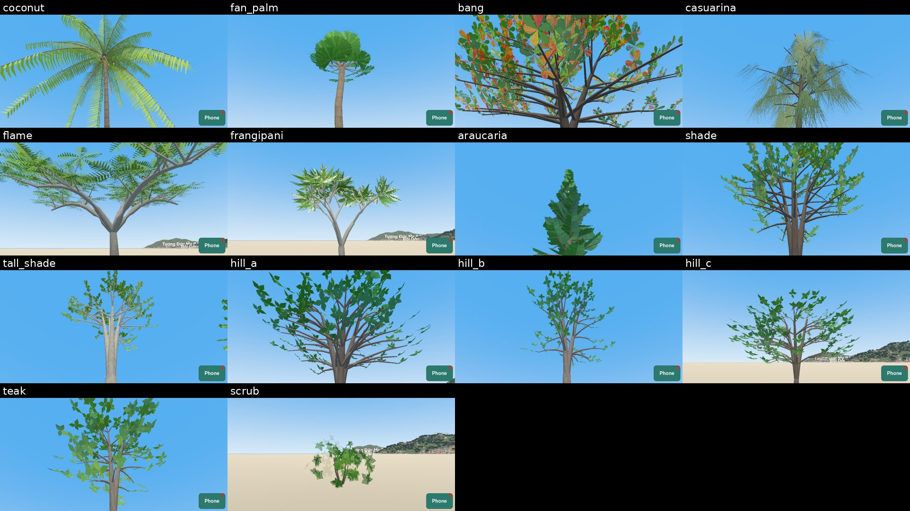
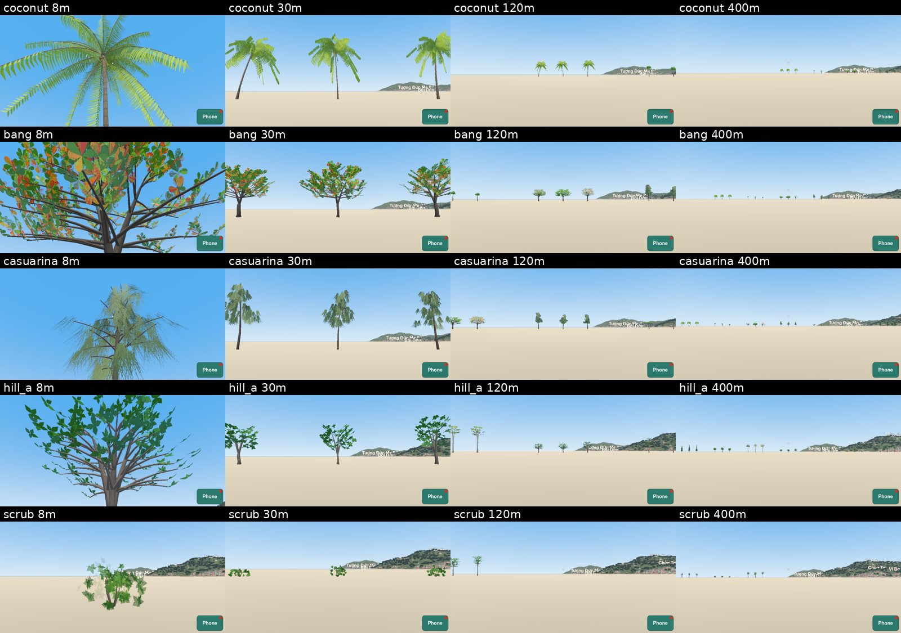
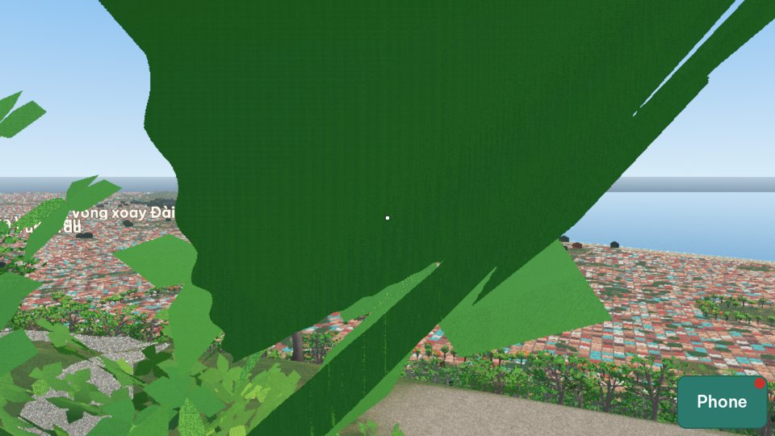

# Play-test report: plan 0020, Real trees

## 1. Commit

`8fa9a0e` on `main`. Plan 0020 has the status "Built".

## 2. What the architect ran

| Run | Result |
|---|---|
| CI on `main` (the branch `fix/0005-ground-detail` with the same commit is green) | Pass on the branch. The tree build check passes. |
| PT-52 `tree_gallery`, runs 3 and 4 (all 14 types at 12:00 on day 1, Low) | Pass. My sheets are below. The sheet run (13) needs all 12 runs, so I did not make it. |
| PT-33 at 12:00 | Pass, but see D-0020-01. |
| PT-54 on Low | Pass: 212 000 to 265 000 triangles (limit 300 000), 219 to 301 draw calls. |
| PT-54 on High | Stopped after 300 s in the workspace (2 CPUs). CI passes it. See D-0020-05. |

## 3. Defects

### D-0020-01: A tree blocks the view from the top of Núi Nhỏ, and PT-33 passes (high)

- **Actual:** in the PT-33 view "From Núi Nhỏ along Bãi Sau", a near tree covers half of the frame with flat dark green leaves. The view "From Núi Nhỏ to the north" stands in a forest. The top of Núi Nhỏ is the round, paved platform of Tượng Chúa Kitô Vua, with no trees on it. PT-33 checks only that the places are in the frame, not that the player can see them.
- **Correction:**
  1. No trees on the paved tops and the platforms of the known places (the summit of Núi Nhỏ, the lighthouse, the terraces of Núi Lớn), and none on the roads and the paths. Use the OSM areas (`highway`, `man_made`, `tourism`, `amenity` areas, and the landmarks of R1) as places with no trees.
  2. Add to PT-33: in each view, objects nearer than 3 m to the camera cover at most 5 % of the frame.

### D-0020-02: The leaves of the hill trees and the shade trees are too large (medium)

- **Actual:** at 8 m and 30 m, `hill_a`, `hill_b`, `hill_c`, and `shade` show single leaves about 0.4 m to 0.6 m long, in sparse groups. The trees look like paper cutouts. Most broad leaves of the forest of Núi Lớn and of the street trees are 5 cm to 20 cm long (`teak` and `bang` have large leaves, and that is correct).
- **Correction:** smaller leaves in dense groups for these types (leaf cards with many small leaves for the middle form), so that a crown is a mass of leaves with gaps, as in my photos of Trần Hưng Đạo and the hills.

### D-0020-03: Half of the street trees have no tree in the canopy map (medium)

- **Actual:** `report.md` says that the canopy map of 2019 shows no tree within 5 m of 14 600 of the 29 060 street and park trees (casuarina 2 499 of 3 509, shade 5 192 of 11 057), and "I check them on photos". Nobody can check 14 600 trees on photos. The rules of `data/geo/trees.json` put a tree each 9 m on all trunk, primary, secondary, and tertiary roads, so many rows in the game do not exist.
- **Correction:**
  - On the roads that I confirmed (Quang Trung, Ba Cu, Trần Hưng Đạo, Thùy Vân, Hạ Long, Trần Phú, and the park of Bãi Trước), keep the rows of my photos, but move each tree to the nearest tree top of the canopy map within 6 m when there is one.
  - On the other roads, put a street tree only where the canopy map has a tree top within 6 m of the road edge, with the type mix of the road. The canopy map can miss single palms: keep the coconut palms of the park and of Quang Trung.
  - The report gives the share for each road group, not a list.

### D-0020-04: Some types do not look like the photos (low)

- **Coconut palm:** the leaflets are yellow-green and bright. In my photos of Bãi Trước, the fronds are a darker green, with yellow-green only on some old fronds.
- **Fan palm:** a round mass like a head of broccoli, not round fan leaves on long stems.
- **Scrub:** at 8 m, a few floating leaves with gaps; a bush is a dense mass of small leaves.
- **Norfolk pine:** a single cone of leaves, not flat layers of branches. It is not in the game now (Q6), so this can wait.

### D-0020-05: PT-54 on High takes more than 300 s in the workspace (low)

- **Actual:** the High run stopped after 300 s here. CI passes it, but the CI computers are slower, so it is near its limit.
- **Correction:** split PT-54 into one run for each view and preset.

## 4. Acceptance criteria

| # | Result |
|---|---|
| 1 | Open: I look at the sheets of PT-52 (the pictures in section 2 are a part of them) and approve the look after D-0020-02 and D-0020-04. |
| 2 | Open: after D-0020-03, I look at Bãi Trước in PT-53. |
| 3 | Pass on Low. High passes in CI. |
| 4 | Pass in CI on the branch. |

## 5. Order of the corrections

1. D-0020-01 (the views and the places with no trees).
2. D-0020-03 (the street trees from the canopy map).
3. D-0020-02 and D-0020-04 (the look).
4. D-0020-05.
