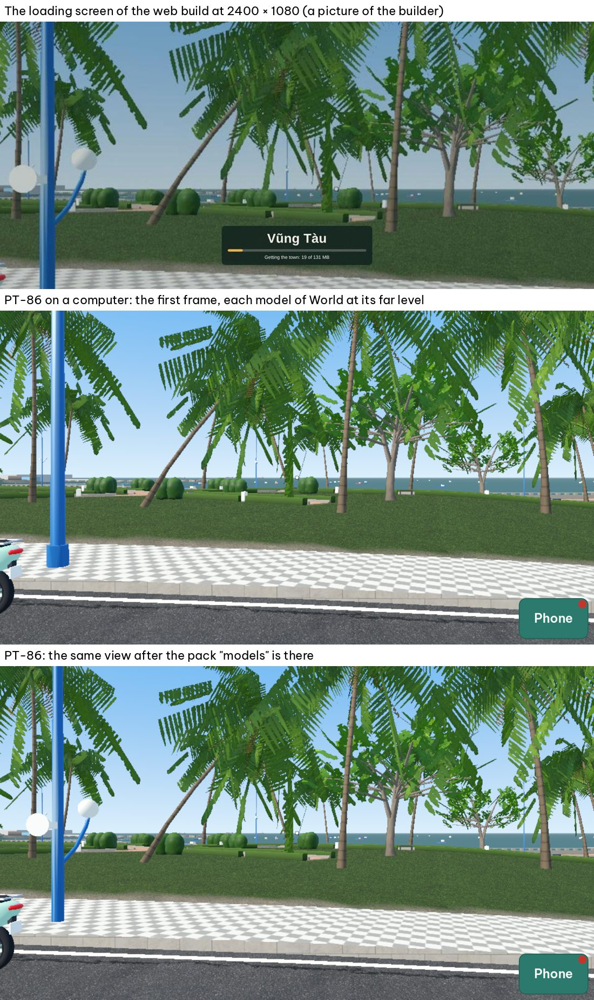
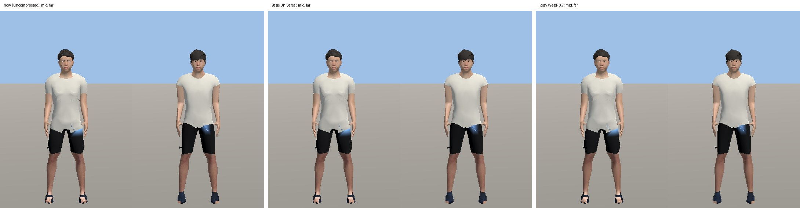

# Report 0031: the web build loads in steps

| Field | Value |
|---|---|
| Plan | [0031](../plans/0031-web-load.md) |
| Branch | `feat/0031-web-load` |
| Audit 1 | 2026-11-26, at `a4210ce` (steps 1 and 2) |
| Audit 2 | 2026-11-26, at `dbbf86c` (the items 1 to 7: D11 to D16) |
| Result | Steps 1 and 2 are made as the plan says, and they help. In the measures of the workspace no target of D10 is met; on my phone the start took about 25 s (section 6). The plan has the changes D11 to D16 for the next steps. |

## 1. What I audited

The report of the builder did not come to me. I read the builder notes of the plan (section 9 on the branch), `docs/web/load.md`, and the code, and I ran the unit tests (161 pass). CI passes on `a4210ce` (Test run 454, Export run 261).

My workspace cannot open `workers.dev`, and it has no export templates, so I did not open the web build and I did not make it. The numbers of the web build in this report are those of the builder. The numbers of the files are mine.

## 2. What is done

| Item | State |
|---|---|
| R1: the measures as a phone | Done. `tools/web/check.js --measure` writes the tables of `docs/web/load.md`. |
| R2: the web pack leaves out the near levels of the buildings and `data/geo/raw` | Done, with `tools/web/check_pack.py` (the deploy fails on a file that must be out) and `tests/unit/test_web_pack.gd`. |
| R3: the compact form of the build data | Done as gzip copies that only the web build reads. A computer reads the JSON as before. |
| R4: the test of a second pack, and the packs | The test is done in Chromium: it works when the game keeps the download in memory and writes the file itself (`HTTPRequest.download_file` writes 0 bytes on the web). One pack is made: `people`. The stop of the game when a pack loads is not measured (see D-0031-03). No test in Firefox or Safari: the workspace has neither. Chrome on my Pixel 10 is the reference, so that is not a defect. |
| R5 (threads), R6 (the loading screen) | Not started: steps 3 and 4. |
| R7: the hash in the names | In part: the files are under the commit of the build, with a cache time of one year. |
| R8: the measure of the people (D9) | Not done by the builder. I measured it (section 4). |
| R9: the deploy removes old builds | Not done. |
| R10: AGENTS.md | Done. |
| PT-85 | Made. The first move passes at each start. The ride of 300 m does not end in the workspace (0.4 frames a second), so PT-85 fails there on the ride only. |

## 3. The numbers of the builder against the targets

At 25 Mbit/s, 720 × 1280, an empty cache, the processor four times slower:

| | Base line | Step 1 | Step 2 | Target (D10) |
|---|---|---|---|---|
| Over the network before the first frame | 331 MB | 199.5 MB | 122.4 MB | 40 MB |
| First frame | 192 s | 144 s | 115 s | 20 s |
| The player can move | 326 s | 271 s | 255 s | 40 s |
| With the cache: the player can move | 313 s | 256 s | 195 s | 15 s |
| The page at the first frame | 1 923 MB | 1 711 MB | 1 407 MB | 700 MB |

The download is 2.7 times smaller, and the second visit downloads nothing before the first frame. But each target is far.

## 4. Findings

### D-0031-01: The times of the workspace do not tell the time on a phone (high)

The workspace has no graphics chip. Chromium draws there with SwiftShader, at 0.4 to 0.6 frames a second. The world builds its parts some in each frame: the showcase 8 ms of work in each frame (`VungTau.SHOWCASE_FRAME_MS`), and one chunk, one patch, or one far tile in each frame (AGENTS.md, section 5c). So in the workspace the time from the first frame to "the player can move" (about 130 s of the 255 s) is the count of the frames times 2 s for each frame. A phone that draws 30 frames a second does the same frames in some seconds. The other way is also true: a phone can be slower than the workspace in the parts that the processor does.

So nobody knows now how long my phone waits. Two things follow:

- I must see the times on my phone, with no stopwatch (D11).
- While the player cannot move, the world must build with all the time of each frame, not with 8 ms (D12). Then a slow frame rate does not make the wait long, on a phone and in the workspace.

### D-0031-02: The import makes the people three times larger (high)

The pack `people` is 93.4 MB (81.3 MB with Brotli). I compared the files of World with the scenes that Godot makes from them:

| Files | From World (GLB) | After the import (scene) |
|---|---|---|
| The people, mid level (20) | 24.5 MB | 57.7 MB |
| The people, far level (20) | 5.9 MB | 35.7 MB |
| The other models, near, mid, and far | 118.9 MB | 115.3 MB |

`tools/world/fetch.py` writes `gltf/embedded_image_handling=3` in each import file: the pictures of a model go into its scene with no compression. A person has pictures (the skin, and the baked picture of the far level); the other models have almost none. So the pack `people` can be about 30 MB with the pictures kept small, and less with pictures that the graphics chip keeps compressed (Basis Universal): these also take less memory. The plan has D13 for this.

The newest World also gives a set of people with one shared picture (12 people at the mid level: 16.6 MB as single files, 6.4 MB as a set; report 0009, section 10.5a). That comes with the plan that takes the new World, not with this plan.

### D-0031-03: A pack stays in the memory of the page, and the memory after the ride is 2 449 MB (high)

The file system of the web build is in the memory of the page. The game keeps the download of a pack in memory, writes it to `user://packs/`, and loads it. The file stays there as long as the page is open, and its resources are loaded too. The builder measured 1 407 MB at the first frame and 2 449 MB at the end of the ride of PT-85, with the people there. The write and the load of the pack are in one frame, and no measure gives the length of that frame (R4 asks for it).

Two more things to check, which I did not see in the code or the notes:

- Godot keeps `user://` in the storage of the browser (IndexedDB) and reads it into memory at each start. If that is so for `user://packs/`, the second visit reads 93 MB into memory before the first frame, and then downloads the pack again, because `WebPacks` does not look for a file that is there.
- A pack comes over the network again at each visit unless the cache of the browser keeps it.

The plan has D15 and D16 for this.

### D-0031-04: The cache of the browser does not keep a large file (medium)

The builder found it: Chromium kept the start pack of 114 MB, but not the pack of 191 MB of step 1. A phone has a smaller cache, so I do not know if my phone keeps 114 MB. The second visit must not depend on that (D15).

### D-0031-05: The start pack is three times its target (medium)

The start pack is 121.8 MB: 49.6 MB of textures, 27.8 MB of near levels of the things of the showcase, 22 MB of mid levels, 13.2 MB of build data. At 25 Mbit/s that is 39 s of download: the first frame cannot come in 20 s. The builder asks for a decision: the start pack can lose the models of the showcase only if the first frame shows less. That is Q5 of the plan (D14).

## 5. What is good

- Each number of the builder has its build, its command, and its table. I can compare the steps.
- The test of the second pack found a real fault of Godot on the web (`download_file` writes 0 bytes) and a way that works.
- The game reads a pack in parts of 4 MiB: the pack `people` takes about 20 frames, not 1 240.
- The checks of the pack run at each deploy.

## 6. My look on my phone (2026-11-26)

After this audit the report of the builder came to me, and I opened the build of step 2 on my Pixel 10: the loading screen took about 20 s, and then the street was ready after about 5 s more. I did not note the connection (at home I have fiber) or if the cache was empty.

| | The workspace of the builder (25 Mbit/s) | My phone |
|---|---|---|
| To the first frame | 115 s | about 20 s |
| From the first frame until I can ride | 140 s | about 5 s |

What follows:

- D-0031-01 is confirmed: the times of the workspace are not the times of the phone. The report of the builder also says that an old Godot process used two processors of its workspace during the measures, so its times are slower again.
- On my phone the wait after the first frame is short. The wait before the first frame is the main part. On a fast connection it is mostly the work of the phone (the compile, the start of the engine, the build of the world); at 25 Mbit/s the download of 122 MB adds about 39 s.
- So the order of the next work changes: first the times on the screen (D11), then the size of the first download (D13, D14) and the packs that the page keeps (D15), then the loading screen and the load by time (D7, D12) and the memory (D16). The threads (D6) come last, and only if the parts of D11 on my phone show that the build of the world is a large part of the start.

## 7. Audit 2 (2026-11-26): the items 1 to 7

I audited `feat/0031-web-load` at `dbbf86c`. The builder did the seven items in my order, kept all seven, and did not start the threads.

### 7.1 Runs

| Run | Result |
|---|---|
| Unit tests | 172 pass. |
| PT-87 `start_by_time` (new), three runs | Pass: the scooter can start 16.0 s after the first frame at the full frame rate, 13.3 s at 3 frames each second, 12.0 s at 1 frame each second. |
| PT-86 `far_first` (new) | Pass: 64 models show only their far level before the pack, and no hole. |
| PT-80 runs 1 and 2, PT-81, PT-74 run 1 (two times), `reply_modes` at 2400 × 1080 | Pass. These are the play tests that failed in CI (7.3). I could not make one fail. |
| CI | Not green. See 7.3. |
| The web build | I cannot open it (section 1). The numbers of the web build are those of the builder. |

### 7.2 The numbers of the builder (720 × 1280, 25 Mbit/s, an empty cache, the workspace)

| | Step 2 | After item 6 | Target (D10) |
|---|---|---|---|
| Over the network before the first frame | 122.4 MB | 94.1 MB | 40 MB |
| First frame | 115 s | 85 s | 20 s |
| The player can move | 255 s | 135 s | 40 s |
| With the cache: the player can move | 195 s | 97 s | 15 s |
| The pack `people` over the network | 81.3 MB | 16.7 MB | |
| The memory of the pictures of the people | 263 MB | 79 MB | |

Each item helps or does no harm, and each has its table and its version. The times are those of the workspace (D-0031-01): my phone is the measure.

### 7.3 Findings

**D-0031-06: CI is not green, and it was not reliable on the whole branch (high).** Of the 20 test runs after the merge of main, 12 failed, each on other play tests. Since item 5 (D12) no run passed: runs 471 to 475 failed, runs 476 and 477 were stopped before their end, and run 478 (the head) has a failure already.

| Play test | Runs | What CI says |
|---|---|---|
| `touch_controls` 1280 × 720 | 459, 474 | The game ends with exit code 134 (an abort), after 40 s. |
| `showcase_walk` run 1 | 464, 478 | The player is inside the body of a walker for 174 steps. |
| `reply_modes` 2400 × 1080 | 474, 475 | A person does not speak in 30 s of game time. |
| `scooter_ride` run 1 | 475 | The player and the view do not stop in 15 s. |
| `bai_truoc_trees` | 466, 472, 474 | A run takes more than 300 s. |
| `tree_budget` | 469 | |
| `start_by_time` run 3 | 471, 473 | The ratio was 1.61 and 1.69 (the limit is 1.5); corrected in `9301e52`. |

In my workspace each of these passes, and my workspace cannot get the files of a CI run (the screenshots and the logs). So I do not know the causes. Three are not a slow computer: an abort of the game, the player in a walker, and a person who does not speak. The builder must get the logs of these runs and find each cause. The rule stays: the builder does not stop before CI is green on the head.

**D-0031-07: The game stops for some seconds when a pack loads (high).** The builder measured the longest frame while a pack loads: 7 s to 11 s in the workspace (the processor four times slower), and did not find the step that takes it. On a phone that can be a stop of 2 s or more in the middle of a ride. R4 says that a pack must not stop the game longer than the limit of plan 0018.

**D-0031-08: The start of the game itself is now the largest part (medium).** The parts of the start that D11 gives (with the cache, the processor four times slower): the download 4 s, the compile 1 s, the engine 3 s, the world 40 s, then 53 s until the player can move. I measured the same start on a computer in my workspace:

| From the start of the engine | Time |
|---|---|
| The engine and the content are ready | 1.4 s |
| The test street (the hẻm) builds, and the game then removes it | 0.8 s |
| The Vũng Tàu world builds (`setup()` and `prepare_at()`) | 6.9 s |
| The first frame is drawn | 14.6 s more (the first frame at 23.7 s) |
| The scooter can start | 14.7 s more |

So before the first frame the game works for about 22 s on a computer with no graphics card, with no download. No step of the plan cuts this part yet. Three things show at once: the game builds the test street at each start of the Vũng Tàu world and then throws it away; the build of the world reads and makes more than the first frame shows; and the first frame takes two times as long as the build (the shaders and the first upload of the meshes and the pictures). The plan needs a step for this before the threads (7.5).

**D-0031-09: The scooter waits for the whole showcase (low).** D7 says that the player can move when the parts within 150 m are ready. The steps of the showcase have no place, so the build cannot stop at 150 m. On my phone the wait was about 5 s, so this can wait.

**Notes.**

- PT-87 compares the real time of two runs. On a shared computer of CI that can fail with no defect; it failed two times before the correction `9301e52`. Watch it.
- The memory of the page in the workspace (1 349 MB at the first frame) has the memory of the software graphics in it. The line of the times on the page counts the heap of the engine and the JavaScript heap: 560 MB when the player can move. My phone shows that line.
- The deploy now removes the builds older than the last five. The first removal took out 13 builds, so the old link of `feat/0018-scooter` in this report and in report 0018 can be dead. The link of `feat/0031-web-load` has the same scooter.
- `tools/web/r2.py` changes only the bucket `vung-tau`.

### 7.4 The questions of the builder

- **Basis Universal for the pictures of the people (D13).** At 5 m I see no difference between the three forms (the second picture). Basis Universal keeps the pictures compressed in the memory of the graphics (79 MB against 256 MB for the lossy form), for 7 MB more of download. The audit recommends yes. The builder made it the import on a computer too; the play tests of the showcase pass with it.
- **Q6: the levels as single files.** The audit recommends: not now. It saves about 167 MB of the memory of the page, but it changes how each model loads, and it does not help the start. My phone has room for it. I decide again if my phone shows a problem with the memory, or after the game takes the new models of World (their files are smaller).
- **The limit of R16.** PT-85 fails on 2 023 MB at the end of the ride, and it cannot pass in the workspace: most of that number is the software graphics. The audit recommends that R16 counts the heap of the engine and the JavaScript heap (the number of the line of the times), with the same limit of 1 000 MB. (I answer.)
- **The threads (step 3).** I decide after I read the line of the times on my phone. D-0031-08 says that a profile of the start comes first.

### 7.5 What the audit recommends next

1. CI green: the cause of each failure of D-0031-06.
2. The stop when a pack loads (D-0031-07).
3. A new step: the start of the game (D-0031-08). A profile of each part of `setup()`, `prepare_at()`, and the first frame, on the web with the processor four times slower; then no build of the test street in the Vũng Tàu world, and only what the first frame shows before the first frame.
4. Then the threads, if the profile and my phone say so.

## 8. What is open

- The line of the times on my phone (a screenshot): https://feat-0031-web-load-vung-tau.fifo.workers.dev/?start=bai_truoc&ride
- On my phone I did not yet look at the second visit, at the moment when the people come (a stop of the game), and at the turn with the thumb far to the side.
- My answers of 7.4: Basis Universal, Q6, the limit of R16, and the threads.
- D-0031-06 to D-0031-09.
