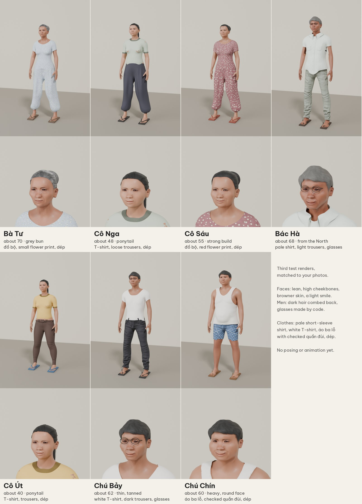

# People prototype

This prototype makes the first look of the seven people of the hẻm with Blender and MPFB 2. I approved this look as the target of plan 0006 ("close enough for now"). Use it as a reference for the values and the methods. Do not copy it as the build: the build of plan 0006 has its own rules (R6 to R13).

## Files

| File | Content |
|---|---|
| `people.json` | The values of each person: MPFB macro values, face targets, skin, skin tint, hair, hair color, clothes, cuts, dép, glasses, and the face expression. |
| `preview.py` | Makes each person and renders a full-body view and a face view with Cycles. |
| `prints.py` | Makes the cloth prints: small flowers for đồ bộ, and checks for quần đùi. |
| `people_v3.jpg` | The target look. |

## Run

1. Make a Python 3.13 venv and install `bpy` (5.2.3).
2. Copy `src/mpfb` of MPFB 2 to `~/.config/blender/5.2/extensions/user_default/mpfb`.
3. Download the packs from the release `people-packs-1`. Unzip each pack into `~/.config/blender/5.2/extensions/.user/user_default/mpfb/data`.
4. Run `python prints.py prints`.
5. Run `python preview.py OUT_DIR` (all people) or `python preview.py OUT_DIR batu` (one person). `SAMPLES=24` makes a fast render. `FACE_ONLY=1` renders only the face.

One person takes about 80 s on 2 CPUs.

## What I learned

- **The "asian" skins of MakeHuman are light-skin textures.** `old_asian_female` uses `old_lightskinned_female_diffuse2.png`. To get the skin of people who live in the sun, the prototype lowers the saturation of the skin texture (0.7) and multiplies it by a brown tint (`skin_tint`). Tint each texture node only one time: the skin materials share node groups.
- **The `asian` value alone gives a general East Asian face.** Vietnamese faces need more: a wider nose with a lower, flatter bridge (`nose-scale-horiz-incr`, `nose-flaring-incr`, `nose-point-width-incr`, `nose-hump-decr`, `nose-curve-concave`), a shorter face (`head-scale-vert-decr`), high cheekbones and lean cheeks for older people (`cheek-bones-incr`, `cheek-volume-decr`), and eyes that are open enough (`eye-scale-incr`, `eye-height1-incr`). Without `mouth-angles-up`, older faces look sad. See the face targets of each person in `people.json`.
- **Expressions.** The ARKit face units of `faceunits01` give a smile (`mouthSmileLeft`, `mouthSmileRight`, `cheekSquintLeft`, `cheekSquintRight`). After `FaceService.set_expression()`, call `FaceService.interpolate_targets()` so that the eyebrows, eyelashes, and teeth follow.
- **Hair color.** Older men in the photos have dark hair, often dyed. The hair materials are tinted by a hue/saturation node and a screen mix (`hair_val`, `hair_mix`).
- **Clothes that MakeHuman does not have, made by code:**
  - Short sleeves: delete the sleeve vertices of a long-sleeve shirt by their distance along the upper arm bone (`cut`, `short_sleeves`). Also delete the cuffs near the forearm and the hand.
  - Knee shorts: delete the trouser vertices below the knee (`cut`, `knee`).
  - Áo ba lỗ: copy the torso surface of the body, cut it along smooth curves (neck hole, arm holes, hem) with `iso_cut`, and push it out by 7 mm. A cut by whole faces gives a jagged edge. Make it before the clothes, because the clothes hide parts of the body.
  - Dép: a sole and a thong strap for each foot, from the foot and ball bones.
  - Glasses: two rims, a bridge, and two arms, from the position of the eyes.
- **A cut must show the skin again.** MPFB hides the body under each clothes item with a vertex group `Delete.NAME` and a mask. After a cut, remove from that group the body vertices that are more than 15 mm from the cloth that is left (`uncover`).
- **Pose.** The rest pose is an A-pose. The prototype turns the upper arms, forearms, and hands down by code (`relax`). In the game, the animations give the pose.

## Known faults

- A small gap shows under the cut sleeve of a button shirt.
- The neck and sleeve bands of `toigo_basic_tucked_t-shirt` keep a darker color.
- The women's faces have fewer changes than the men's faces. I had reference photos of men only.
- The dép are simple boxes with a bevel.
