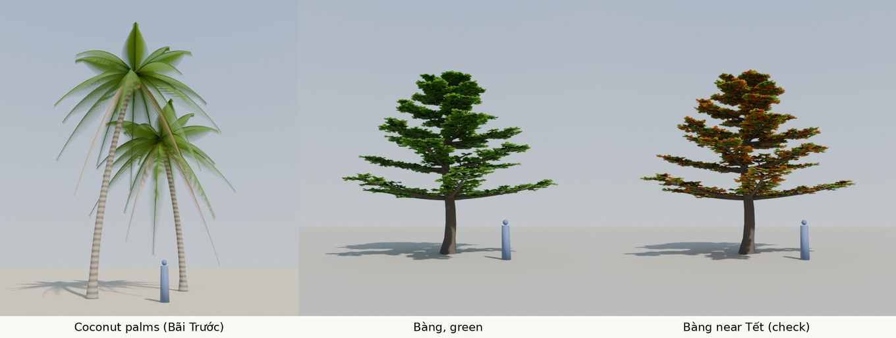

# Tree prototype (plan 0020)

These pictures show the target look of the trees. They are not game assets.

| File | Content |
|---|---|
| `trees.py` | Makes and renders the trees with Blender as a Python module (`bpy` 5.2.3, Cycles). Each run takes about 40 s on 2 CPUs. |
| `trees_v1.jpg` | Coconut palms (Bãi Trước), a bàng tree with green leaves, and a bàng tree near Tết with some red and orange leaves. The blue figure is 1.7 m high. |

## How the trees are made

- **Coconut palm.** A curved trunk with rings (a wave texture on the trunk). 22 fronds on a golden-angle spiral: young fronds point up, old fronds hang down, and the last two are dead and brown. Each frond is a thin curved stem with about 95 pairs of leaflets. A leaflet is a narrow strip of 4 parts that points out, forward, and down, so the leaflets of a frond make a V. Nine coconuts under the crown.
- **Bàng.** A straight trunk with 6 layers (tiers) of 3 to 5 branches that grow out flat and turn up a little at the ends. The lower layers are longest. Twigs grow from the outer part of each branch, with a group of 9 to 13 large leaves at the end and in the middle of each twig.
- **Leaves** are a green surface mixed with a translucent surface, so they glow when the sun is behind them.

## Known faults

- The palm fronds are a little too solid at the tips, and the crown is too regular.
- The bàng branches start too low on the trunk for a street tree.
- The game cannot use these meshes as they are: they have too many triangles. Plan 0020 (D3) makes three forms of each tree.
