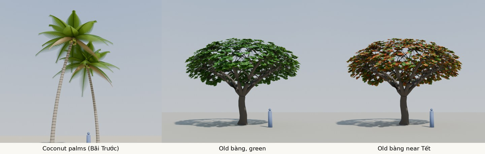

# Tree prototype (plan 0020)

These pictures show the target look of the trees. They are not game assets.

| File | Content |
|---|---|
| `trees.py` | Makes and renders the trees with Blender as a Python module (`bpy` 5.2.3, Cycles). Each run takes about 40 s on 2 CPUs. |
| `trees_v2.jpg` | Coconut palms (Bãi Trước), an old bàng tree with green leaves, and an old bàng tree near Tết with some red and orange leaves. The blue figure is 1.7 m high. Version 2 (2026-10-26): the palm fronds spread out in a round crown and do not hang to the ground, and the bàng has a wide dome, as I remember them. |

## How the trees are made

- **Coconut palm.** A curved trunk with rings (a wave texture on the trunk). 22 fronds on a golden-angle spiral, from 30° to 100° from the vertical. Each frond arches out and its tip curves down, so the crown is round. The last two fronds are short, dead, and brown, and hang under the crown. Each frond is a thin curved stem with about 95 pairs of leaflets. A leaflet is a narrow strip of 4 parts that points out, forward, and a little down, so the leaflets of a frond make a V. Nine coconuts under the crown.
- **Bàng (old tree).** A short, thick trunk (3 m), then 6 big limbs that spread up and out. Each limb has side branches, and each side branch has small branches that end inside a wide dome (12 m wide, about 7 m high). About 1 600 groups of 9 to 13 large leaves sit on the outer part of the dome, each on a short twig from the nearest branch. No branch goes out of the dome.
- **Leaves** are a green surface mixed with a translucent surface, so they glow when the sun is behind them.

## Known faults

- The palm fronds are a little too solid at the tips, and the crown is too regular.
- The top of the bàng dome is a little thin, and some twigs show there.
- A young bàng has flat layers of branches, like a pagoda. Only the old, dome form is made.
- The game cannot use these meshes as they are: they have too many triangles. Plan 0020 (D3) makes three forms of each tree.
