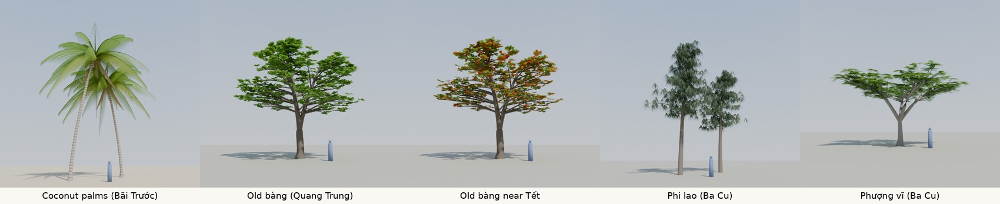

# Tree prototype (plan 0020)

These pictures show the target look of the trees. They are not game assets.

| File | Content |
|---|---|
| `trees.py` | Makes and renders the trees with Blender as a Python module (`bpy` 5.2.3, Cycles). Each run takes about 90 s on 2 CPUs. |
| `trees_v3.jpg` | Version 3 (2026-10-26), made from my photos: coconut palms (Bãi Trước), an old bàng (Quang Trung), the same bàng near Tết, casuarinas (Ba Cu), and a flame tree (Ba Cu). The blue figure is 1.7 m high. |

## How the trees are made

- **Coconut palm.** A tall, thin trunk with rings (a wave texture), 11 to 13 m, that leans and curves. 24 fronds of about 5.8 m on a golden-angle spiral, from 30° to 105° from the vertical. Each frond arches out and its tip curves down. About 120 pairs of long, thin leaflets on each frond hang down like a curtain. Three short dead fronds hang under the crown. Ten coconuts.
- **Bàng (old tree).** A thick trunk forks at 2.6 m into 3 leaders that go up and a little out. From each leader, layers of near-flat branches go out to the shell of a tall, rounded crown (12 m wide, about 7 m high). Short twigs along the outer part of each branch end in groups of 9 to 13 large leaves. Some leaves are yellow-green (new leaves). The crown is open, so the sky shows through. Near Tết: about 20 % of the leaves are gone, and many of the rest are red or orange.
- **Casuarina (phi lao).** A tall, thin trunk (11 to 13 m) that leans a little. Short, thin branches start at about 40 % of the height, with gaps. Tufts of thin, grey-green needles hang down from the branches.
- **Flame tree (phượng vĩ).** A light grey trunk forks at 2.3 m into 5 wide limbs. Twigs end inside a wide, flat crown (14 m wide). Each twig has about 10 fern-like leaves, each with 12 pairs of small leaflets.
- **Leaves** are a green surface mixed with a translucent surface, so they glow when the sun is behind them.

## Known faults

- The young palm fronds at the top are a little stiff.
- The casuarina crown is a little too even. In my photo, it is more ragged.
- The flame tree has no flowers. It flowers from late April to early July, not in the game days.
- The game cannot use these meshes as they are: they have too many triangles. Plan 0020 (D3) makes three forms of each tree.
