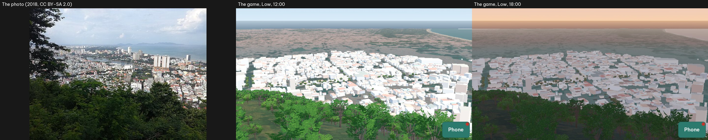
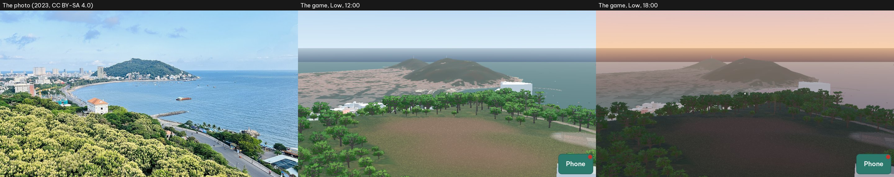
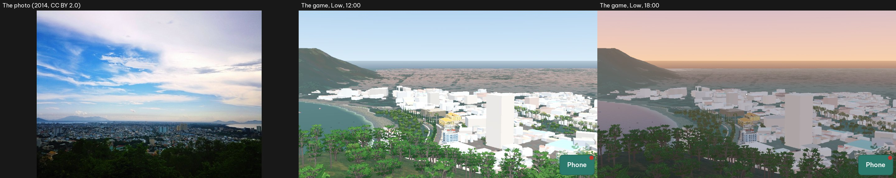
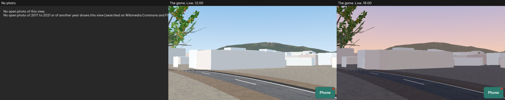

# The views of the town (plan 0009, PT-68)

Made by `tools/town/sheets.py` from the screenshots of `tools/playtest.sh town_views`. The boxes of the town are the far level of phase 2: each building of 2019 as a box of its outline and its height, with a roof. On Low they show to 1 500 m; farther, the ground shows its pattern of roofs.

## The top of Núi Nhỏ, at the lighthouse

- The eye: The gallery of the lighthouse (the photo is from it; the ground at its foot has trees round it).
- The photo: [View of Vung Tau from Vung Tau lighthouse (August 3, 2018) (43913500872).jpg](https://commons.wikimedia.org/wiki/File:View_of_Vung_Tau_from_Vung_Tau_lighthouse_(August_3,_2018)_(43913500872).jpg), Damian Vo, CC BY-SA 2.0, 2018-08-03. The town from the gallery of the lighthouse on Núi Nhỏ, looking north-east: roofs below, Bàu Sen lake, the twin towers, the coast of Bãi Sau, and the hills of Long Hải far away.

## The top of Núi Lớn

- The eye: The top of Núi Lớn (the peak of OpenStreetMap), over the trees and the edge of the top, as the view nui_lon_south_east of PT-33 (12 m over the top and 18 m more), looking at Bãi Trước with Núi Nhỏ behind it: the direction of the photo from the cable car. The geotag of the photo of 2011 (looking east) is on the flat top, where the trees and the edge hide the town.
- The photo: [Nhìn toàn cảnh TP.VŨNG TÀU từ Cáp treo Vũng Tàu.jpg](https://commons.wikimedia.org/wiki/File:Nh%C3%ACn_to%C3%A0n_c%E1%BA%A3nh_TP.V%C5%A8NG_T%C3%80U_t%E1%BB%AB_C%C3%A1p_treo_V%C5%A9ng_T%C3%A0u.jpg), Luci nguyễn, CC BY-SA 4.0, 2023-08-25. From the cable car on the south-west side of Núi Lớn, looking south-east: Bạch Dinh below, Trần Phú road, the bay of Bãi Trước with boats, and Núi Nhỏ at the end of the bay.

## The Hải Đăng road

- The eye: The point of the Hải Đăng road nearest to the geotag of the photo (12 m from it: the geotag is on a lot beside the road, where a building stands), 1 m over the highest tree of the canopy map within 8 m (as PT-33): the photo is from the railing, over the tree tops of the slope below the road.
- The photo: [Hometown (Flickr 15594420532)](https://www.flickr.com/photos/han_chu/15594420532/), Han Minh Chu, CC BY 2.0, 2014-06-01. The whole town from the Hải Đăng road over the trees, looking north to north-north-east: far hills on the left and the water of Bãi Sau on the far right.

## The bus view of plan 0010: Lê Hồng Phong near Ngã Năm, toward Núi Lớn

- No open photo of 2017 to 2021 or of another year shows this view (searched on Wikimedia Commons and Flickr, 2026-11-21); Mapillary cannot be reached from the workspace.
