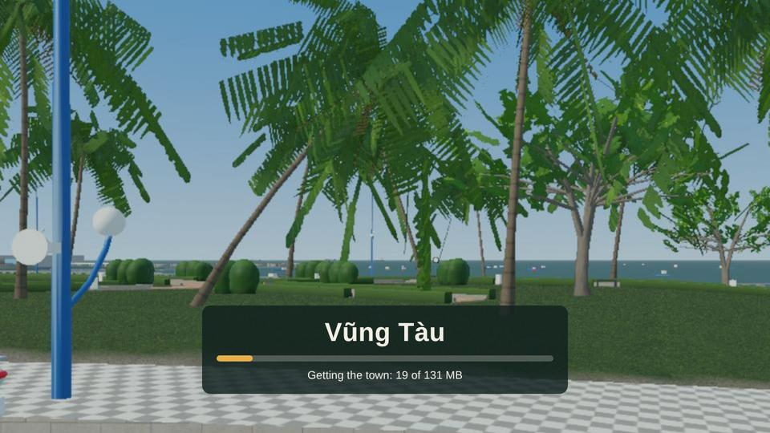

# The load of the web build (plan 0031)

Each step of plan 0031 is measured before and after (D2), with `tools/web/check.js --measure` (R1, D3): Chromium of the workspace as a phone (a touch screen, a mobile user agent, the processor four times slower, the screen 720 × 1280 and 2400 × 1080), with a limit on the network of 25 Mbit/s and of 100 Mbit/s (a latency of 40 ms), first with an empty cache and then again with the cache (a profile on the disk).

```sh
node tools/web/check.js "https://BRANCH-vung-tau.fifo.workers.dev/?start=bai_truoc&ride" OUT --measure --md=docs/web/load.md --step="NAME"
node tools/web/check.js "https://BRANCH-vung-tau.fifo.workers.dev/" OUT --pt85     # PT-85, after each deploy
```

The columns:

- **Over the network before the first frame**: the bytes of all the files of the page (compressed as they come) until the first frame of the world.
- **First frame**: from the start of the navigation to the first frame of the world (`window.vungTau.firstFrameMs`).
- **Can move**: until the player can move: the clock runs (the ground of the start is ready) and the scooter does not wait for the showcase (`window.vungTau.canMoveMs`, report 0018, D-0018-03).
- **Heap of the engine**: the memory of WebAssembly of Godot at the first frame. An iPhone gives a page about 300 MB to 500 MB only (plan 0031, D10).
- **JavaScript heap**: the heap of the page at the first frame (the files of the loader are there).
- **Page (renderer + GPU)**: the resident memory of the processes of Chromium for the page at the first frame (the renderer and the GPU process).

The targets of D10 (at 25 Mbit/s): at most 40 MB over the network before the first frame; the first frame at most 20 s after the page opens; the player can move at most 40 s after it (with the cache at most 15 s); the page at most 700 MB at the first frame.

The workspace draws WebGL 2 with SwiftShader (on the processor), and the throttle of the processor slows only the page, not SwiftShader: a phone with a graphics chip draws faster, and its processor can be slower than four times the workspace. The numbers are for the comparison of the steps; my look on the phone gives the real times.

## The test of D5: a second pack that the game downloads while it runs (2026-11-26)

`node tools/web/check.js URL OUT --packtest` opens the page with `?packtest`: after the first frame, the game downloads `packtest.pck` of its build (1.6 MB, made by `tools/web/make_pack.gd`), puts it in `user://`, loads it with `ProjectSettings.load_resource_pack()`, and makes the near level of the building `nha_mai_ngoi_cam` from it. The main pack of step 1 does not have that file (`scripts/web/pack_test.gd`).

| Build | Server | The way | Bytes that HTTPRequest counts | The file in `user://` | `load_resource_pack()` | The scene from the pack |
|---|---|---|---|---|---|---|
| Step 1 (`32feaeec2693`) | the Worker (Brotli) | HTTPRequest writes the file (`download_file`) | — (not given by that test) | 0 bytes | false | no |
| Step 1 (`32feaeec2693`) | a local server (no compression) | HTTPRequest writes the file (`download_file`) | — | 0 bytes | false | no |
| Step 2 code (local export) | a local server (no compression) | HTTPRequest writes the file (`download_file`) | 1 592 168 | 0 bytes | false | no |
| Step 2 code (local export) | a local server (no compression) | the body in memory, then FileAccess writes the file | 1 592 168 | 1 592 168 bytes | true (63 ms with the load of the scene) | yes, 1 mesh |
| Step 2 (`e2430eaea126`) | the Worker (Brotli) | HTTPRequest writes the file (`download_file`) | 1 592 168 | 0 bytes | false | no |
| Step 2 (`e2430eaea126`) | the Worker (Brotli) | the body in memory, then FileAccess writes the file | 1 592 168 | 1 592 168 bytes | true (66 ms with the load of the scene) | yes, 1 mesh |

The result: **it works in Chromium** (HeadlessChrome 157 of the workspace), with the body in memory and FileAccess. On the web, `HTTPRequest.download_file` of Godot 4.7.2 writes a file of 0 bytes, although the request counts all the bytes; the compression is not the cause (the same with a local server and no compression). `scripts/web/web_packs.gd` uses the way that works. The workspace has no Firefox and no Safari (a download of Firefox was not permitted in the workspace): the test in those browsers is not done. Chrome on a Pixel 10 is the reference (Q3).

## Base line: the build of part A, with the measures of R1 (98ff3d71277c) (2026-11-26)

`https://d7325705-vung-tau.fifo.workers.dev/?start=bai_truoc&ride`, the processor 4 times slower. A value in bold is over its target of D10 (at 25 Mbit/s).

| Size | Network | Cache | Over the network before the first frame | First frame | Can move | Heap of the engine | JavaScript heap | Page (renderer + GPU) |
|---|---|---|---|---|---|---|---|---|
| 720 × 1280 | 25 Mbit/s | empty | **331 MB** | **192 s** | **326 s** | 344 MB | 636 MB | **1923 MB** |
| 720 × 1280 | 25 Mbit/s | with the cache | 321.4 MB | **182 s** | **313 s** | 344 MB | 634 MB | **1913 MB** |
| 720 × 1280 | 100 Mbit/s | empty | 331 MB | 108 s | 239 s | 344 MB | 636 MB | **1926 MB** |
| 720 × 1280 | 100 Mbit/s | with the cache | 321.4 MB | 103 s | 231 s | 344 MB | 635 MB | **1913 MB** |

## Base line at 2400 × 1080 (98ff3d71277c) (2026-11-26)

`https://d7325705-vung-tau.fifo.workers.dev/?start=bai_truoc&ride`, the processor 4 times slower. A value in bold is over its target of D10 (at 25 Mbit/s).

| Size | Network | Cache | Over the network before the first frame | First frame | Can move | Heap of the engine | JavaScript heap | Page (renderer + GPU) |
|---|---|---|---|---|---|---|---|---|
| 2400 × 1080 | 25 Mbit/s | empty | **331 MB** | **197 s** | **537 s** | 344 MB | 637 MB | **2012 MB** |
| 2400 × 1080 | 25 Mbit/s | with the cache | 321.4 MB | **193 s** | **513 s** | 344 MB | 634 MB | **1998 MB** |
| 2400 × 1080 | 100 Mbit/s | empty | 331 MB | 110 s | 432 s | 344 MB | 636 MB | **2011 MB** |
| 2400 × 1080 | 100 Mbit/s | with the cache | 321.4 MB | 108 s | 433 s | 344 MB | 634 MB | **2002 MB** |

## Step 1: the cuts and the compression (32feaeec2693) (2026-11-26)

`https://8d365a1b-vung-tau.fifo.workers.dev/?start=bai_truoc&ride`, the processor 4 times slower. A value in bold is over its target of D10 (at 25 Mbit/s).

| Size | Network | Cache | Over the network before the first frame | First frame | Can move | Heap of the engine | JavaScript heap | Page (renderer + GPU) |
|---|---|---|---|---|---|---|---|---|
| 720 × 1280 | 25 Mbit/s | empty | **199.5 MB** | **144 s** | **271 s** | 344 MB | 434 MB | **1711 MB** |
| 720 × 1280 | 25 Mbit/s | with the cache | 191.5 MB | **135 s** | **256 s** | 344 MB | 432 MB | **1715 MB** |
| 720 × 1280 | 100 Mbit/s | empty | 199.5 MB | 89 s | 210 s | 344 MB | 434 MB | **1712 MB** |
| 720 × 1280 | 100 Mbit/s | with the cache | 191.5 MB | 82 s | 208 s | 344 MB | 432 MB | **1698 MB** |
| 2400 × 1080 | 25 Mbit/s | empty | **199.5 MB** | **151 s** | **476 s** | 344 MB | 434 MB | **1800 MB** |
| 2400 × 1080 | 25 Mbit/s | with the cache | 191.5 MB | **146 s** | **477 s** | 344 MB | 432 MB | **1786 MB** |
| 2400 × 1080 | 100 Mbit/s | empty | 199.5 MB | 97 s | 446 s | 344 MB | 434 MB | **1797 MB** |
| 2400 × 1080 | 100 Mbit/s | with the cache | 191.5 MB | 103 s | 455 s | 344 MB | 432 MB | **1787 MB** |

## Step 2: the start pack and the pack of the people (e2430eaea126) (2026-11-26)

`https://f69165a5-vung-tau.fifo.workers.dev/?start=bai_truoc&ride`, the processor 4 times slower. A value in bold is over its target of D10 (at 25 Mbit/s).

| Size | Network | Cache | Over the network before the first frame | First frame | Can move | Heap of the engine | JavaScript heap | Page (renderer + GPU) |
|---|---|---|---|---|---|---|---|---|
| 720 × 1280 | 25 Mbit/s | empty | **122.4 MB** | **115 s** | **255 s** | 344 MB | 255 MB | **1407 MB** |
| 720 × 1280 | 25 Mbit/s | with the cache | 0 MB | **63 s** | **195 s** | 344 MB | 254 MB | **1395 MB** |
| 720 × 1280 | 100 Mbit/s | empty | 122.4 MB | 80 s | 218 s | 344 MB | 255 MB | **1407 MB** |
| 720 × 1280 | 100 Mbit/s | with the cache | 0 MB | 62 s | 203 s | 344 MB | 254 MB | **1399 MB** |
| 2400 × 1080 | 25 Mbit/s | empty | **122.4 MB** | **126 s** | **478 s** | 344 MB | 255 MB | **1498 MB** |
| 2400 × 1080 | 25 Mbit/s | with the cache | 0 MB | **73 s** | **398 s** | 344 MB | 254 MB | **1485 MB** |
| 2400 × 1080 | 100 Mbit/s | empty | 122.4 MB | 87 s | 439 s | 344 MB | 255 MB | **1498 MB** |
| 2400 × 1080 | 100 Mbit/s | with the cache | 0 MB | 74 s | 431 s | 344 MB | 254 MB | **1488 MB** |

## PT-85 after each deploy (2026-11-26)

`node tools/web/check.js URL OUT --pt85`: Chromium as a computer (1280 × 720), 50 Mbit/s, an empty cache. SwiftShader of the workspace draws 0.4 to 0.6 frames a second here, so the ride of 300 m does not end in the time of the test.

| Build | Start | First frame | Can move | First move | Ride | The pack people | Errors |
|---|---|---|---|---|---|---|---|
| Step 1 (`32feaeec2693`) | `bai_truoc&ride` | 59 s | 179 s | 1.26 m | 85 m in 600 s | — | none |
| Step 1 (`32feaeec2693`) | `hem` | 61 s | 125 s | 1.16 m | — | — | none |
| Step 2 (`f416161ee448`) | `bai_truoc&ride` | 44 s | 171 s | 1.26 m | 258 m in 1500 s | there at the end (`waiting` 0) | none |
| Step 2 (`f416161ee448`) | `hem` | 44 s | 109 s | 1.16 m | — | — | none |

## Item 1 (D11): the line of the times and the parts of the start (e1e8ded33e6e). No old Godot process (2026-11-26)

`https://9809ba89-vung-tau.fifo.workers.dev/?start=bai_truoc&ride`, the processor 4 times slower. A value in bold is over its target of D10 (at 25 Mbit/s).

| Size | Network | Cache | Over the network before the first frame | First frame | Can move | Heap of the engine | JavaScript heap | Page (renderer + GPU) | Parts: download / compile / engine / world / move |
|---|---|---|---|---|---|---|---|---|---|
| 720 × 1280 | 25 Mbit/s | empty | **122.4 MB** | **102 s** | **196 s** | 344 MB | 255 MB | **1409 MB** | 47.3 / 5.4 / 5.1 / 46.5 / 95.3 s |
| 720 × 1280 | 25 Mbit/s | with the cache | 0 MB | **59 s** | **155 s** | 344 MB | 254 MB | **1395 MB** | 4.6 / 2.7 / 5.2 / 45.7 / 97.2 s |
| 720 × 1280 | 100 Mbit/s | empty | 122.4 MB | 73 s | 169 s | 344 MB | 255 MB | **1411 MB** | 18.9 / 1.9 / 5.4 / 45.9 / 97.5 s |
| 720 × 1280 | 100 Mbit/s | with the cache | 0 MB | 61 s | 169 s | 344 MB | 254 MB | **1397 MB** | 4.7 / 1.9 / 5.4 / 47.6 / 109.5 s |
| 2400 × 1080 | 25 Mbit/s | empty | **122.4 MB** | **115 s** | **358 s** | 344 MB | 255 MB | **1495 MB** | 49.3 / 5.5 / 5.8 / 51.3 / 246.4 s |
| 2400 × 1080 | 25 Mbit/s | with the cache | 0 MB | **72 s** | **314 s** | 344 MB | 254 MB | **1484 MB** | 8.5 / 2.4 / 6 / 50.2 / 245.1 s |
| 2400 × 1080 | 100 Mbit/s | empty | 122.4 MB | 80 s | 317 s | 344 MB | 255 MB | **1497 MB** | 19 / 1.7 / 5.1 / 48 / 236.1 s |
| 2400 × 1080 | 100 Mbit/s | with the cache | 0 MB | 71 s | 311 s | 344 MB | 254 MB | **1487 MB** | 8.2 / 1.2 / 5.5 / 48.9 / 243 s |

## The measure of D13: the pictures of the people (2026-11-26)

`tools/web/people_forms.gd` (the renderer of the web build, Compatibility, in the workspace) with the 40 scenes of the pack `people` (the mid and far levels of 20 people), for each form of `gltf/embedded_image_handling`. The pack is made with `tools/web/make_pack.gd` and compressed with `tools/web/compress.js`.

| Form | The pack | The pack with Brotli | The imported scenes | The load of the 40 scenes | The memory of their textures |
|---|---|---|---|---|---|
| Now: no compression (3) | 93.4 MB | 81.3 MB | 93.3 MB | 0.7 s | 262.8 MB |
| Basis Universal (2) | 56.8 MB | **16.7 MB** | 56.7 MB | 1.2 s | **79.2 MB** |
| Small lossy pictures (1: the pictures out of the scenes, WebP, quality 0.7, with mipmaps) | 17.1 MB | 9.3 MB | 9.7 MB (and 100 picture files) | 1.1 s | 256.2 MB |

walker_1 at 5 m, in the light of noon (the mid level, then the far level), in each form: I see no loss in Basis Universal or in the lossy form.


**My choice: Basis Universal**, on the web and on a computer (one import for all platforms; the look at 5 m is the same). The lossy form is 7.4 MB smaller over the network (about 2.4 s at 25 Mbit/s), but the engine keeps its pictures with no compression in the memory of the graphics (256 MB against 79 MB): the memory is the target of D16. It also puts 100 picture files of Godot in `assets/world/` (plan 0023 keeps only the files of World there). `tools/world/fetch.py` writes the import of a person with Basis Universal (`import_params()`); the other models keep their import.

## Item 1 again, with the people (before item 2; e1e8ded33e6e). No old Godot process (2026-11-26)

`https://9809ba89-vung-tau.fifo.workers.dev/?start=bai_truoc&ride`, the processor 4 times slower. A value in bold is over its target of D10 (at 25 Mbit/s).

| Size | Network | Cache | Over the network before the first frame | First frame | Can move | Heap of the engine | JavaScript heap | Page (renderer + GPU) | Parts: download / compile / engine / world / move | The people there: time, page, heap of the engine |
|---|---|---|---|---|---|---|---|---|---|---|
| 720 × 1280 | 25 Mbit/s | empty | **122.4 MB** | **105 s** | **206 s** | 344 MB | 255 MB | **1412 MB** | 46.9 / 5.3 / 5.4 / 49.7 / 101 s | 316 s, 2288 MB, 713 MB |
| 720 × 1280 | 25 Mbit/s | with the cache | 0 MB | **59 s** | **160 s** | 344 MB | 254 MB | **1394 MB** | 5.1 / 2.2 / 4.9 / 45.5 / 100.9 s | 392 s, 2302 MB, 713 MB |

## Item 2 (D13): the pictures of the people with Basis Universal (d548ae950ce8). No old Godot process (2026-11-26)

`https://51a0d3af-vung-tau.fifo.workers.dev/?start=bai_truoc&ride`, the processor 4 times slower. A value in bold is over its target of D10 (at 25 Mbit/s).

| Size | Network | Cache | Over the network before the first frame | First frame | Can move | Heap of the engine | JavaScript heap | Page (renderer + GPU) | Parts: download / compile / engine / world / move | The people there: time, page, heap of the engine |
|---|---|---|---|---|---|---|---|---|---|---|
| 720 × 1280 | 25 Mbit/s | empty | **122.4 MB** | **114 s** | **211 s** | 344 MB | 255 MB | **1409 MB** | 52.7 / 5.8 / 6.7 / 50.9 / 97.8 s | 230 s, 2013 MB, 594 MB |
| 720 × 1280 | 25 Mbit/s | with the cache | 0 MB | **53 s** | **145 s** | 344 MB | 253 MB | **1400 MB** | 4.6 / 1.4 / 3.2 / 42.3 / 91.6 s | 169 s, 2004 MB, 495 MB |
| 720 × 1280 | 100 Mbit/s | empty | 122.4 MB | 78 s | 170 s | 344 MB | 255 MB | **1412 MB** | 19.2 / 1.7 / 5.6 / 49.6 / 92.7 s | 186 s, 2010 MB, 594 MB |
| 720 × 1280 | 100 Mbit/s | with the cache | 0 MB | 53 s | 143 s | 344 MB | 251 MB | **1412 MB** | 4.1 / 1.9 / 3 / 43 / 90.1 s | 158 s, 1990 MB, 495 MB |
| 2400 × 1080 | 25 Mbit/s | empty | **122.4 MB** | **107 s** | **347 s** | 344 MB | 255 MB | **1501 MB** | 47.4 / 5.2 / 5.4 / 46.8 / 238.4 s | 404 s, 2100 MB, 594 MB |
| 2400 × 1080 | 25 Mbit/s | with the cache | 0 MB | **66 s** | **317 s** | 344 MB | 253 MB | **1493 MB** | 8 / 2.2 / 3.7 / 46 / 247.5 s | 349 s, 2067 MB, 495 MB |
| 2400 × 1080 | 100 Mbit/s | empty | 122.4 MB | 81 s | 330 s | 344 MB | 255 MB | **1502 MB** | 18.8 / 1.7 / 5.5 / 48.9 / 247 s | 379 s, 2099 MB, 594 MB |
| 2400 × 1080 | 100 Mbit/s | with the cache | 0 MB | 60 s | 289 s | 344 MB | 251 MB | **1497 MB** | 7.3 / 1.7 / 3 / 42.4 / 231.4 s | 320 s, 2104 MB, 594 MB |

## Item 3 (D14): the far levels first (09cf5f9c3445). No old Godot process (2026-11-26)

`https://1e202e10-vung-tau.fifo.workers.dev/?start=bai_truoc&ride`, the processor 4 times slower. A value in bold is over its target of D10 (at 25 Mbit/s).

| Size | Network | Cache | Over the network before the first frame | First frame | Can move | Heap of the engine | JavaScript heap | Page (renderer + GPU) | Parts: download / compile / engine / world / move | The people there: time, page, heap of the engine |
|---|---|---|---|---|---|---|---|---|---|---|
| 720 × 1280 | 25 Mbit/s | empty | **94 MB** | **93 s** | **187 s** | 344 MB | 198 MB | **1300 MB** | 37.2 / 5.3 / 5.1 / 47.2 / 96.1 s | 401 s, 2295 MB, 608 MB |
| 720 × 1280 | 25 Mbit/s | with the cache | 0 MB | **51 s** | **143 s** | 344 MB | 561 MB | **2267 MB** | 4.1 / 1.8 / 3.6 / 40.7 / 91.3 s | 344 s, 2318 MB, 713 MB |
| 720 × 1280 | 100 Mbit/s | empty | 94 MB | 69 s | 158 s | 344 MB | 198 MB | **1299 MB** | 14.7 / 1.7 / 5.1 / 45.7 / 90 s | 431 s, 2432 MB, 713 MB |
| 720 × 1280 | 100 Mbit/s | with the cache | 0 MB | 52 s | 141 s | 344 MB | 563 MB | **2275 MB** | 4 / 1.7 / 3.6 / 41.5 / 88.8 s | 369 s, 2323 MB, 713 MB |
| 2400 × 1080 | 25 Mbit/s | empty | **94 MB** | **98 s** | **329 s** | 344 MB | 198 MB | **1394 MB** | 36.9 / 5.4 / 5.5 / 48 / 233.7 s | — |
| 2400 × 1080 | 25 Mbit/s | with the cache | 0 MB | **62 s** | **283 s** | 344 MB | 196 MB | **1374 MB** | 7.2 / 1.2 / 4.9 / 42.4 / 219.9 s | — |
| 2400 × 1080 | 100 Mbit/s | empty | 94 MB | 70 s | 302 s | 344 MB | 198 MB | **1393 MB** | 14.5 / 1.7 / 5 / 43.9 / 233.6 s | — |
| 2400 × 1080 | 100 Mbit/s | with the cache | 0 MB | 65 s | 286 s | 344 MB | 197 MB | **1380 MB** | 7 / 1.3 / 4.8 / 45.8 / 220.4 s | — |

## R15 before item 4: the build of item 3 (09cf5f9c3445) (2026-11-26)

R15: `https://1e202e10-vung-tau.fifo.workers.dev/?start=bai_truoc&ride`, 720 × 1280, 100 Mbit/s, a disk cache of 50 MB, two visits (each a new browser on the same profile; the second with no HTTP cache, as a phone). **Fail**: the second visit gets 204.5 MB of packs over the network.

| Visit | Packs over the network | All over the network | First frame | Can move | The pack people there |
|---|---|---|---|---|---|
| first | 204.5 MB | 212.5 MB | 63 s | 147 s | 374 s |
| second | 204.5 MB | 212.5 MB | 66 s | 152 s | 382 s |

## R15 after item 4 (df663736c421) (2026-11-26)

R15: `https://3e18add5-vung-tau.fifo.workers.dev/?start=bai_truoc&ride`, 720 × 1280, 100 Mbit/s, a disk cache of 50 MB, two visits (each a new browser on the same profile; the second with no HTTP cache, as a phone). Pass: the second visit gets 0 MB of packs over the network.

| Visit | Packs over the network | All over the network | First frame | Can move | The pack people there |
|---|---|---|---|---|---|
| first | 207.7 MB | 215.7 MB | 65 s | 144 s | 197 s |
| second | 0 MB | 8 MB | 50 s | 131 s | 160 s |

## Item 4 (D15): the page keeps the packs (df663736c421). No old Godot process (2026-11-26)

`https://3e18add5-vung-tau.fifo.workers.dev/?start=bai_truoc&ride`, the processor 4 times slower. A value in bold is over its target of D10 (at 25 Mbit/s).

| Size | Network | Cache | Over the network before the first frame | First frame | Can move | Heap of the engine | JavaScript heap | Page (renderer + GPU) | Parts: download / compile / engine / world / move | The people there: time, page, heap of the engine |
|---|---|---|---|---|---|---|---|---|---|---|
| 720 × 1280 | 25 Mbit/s | empty | **94 MB** | **86 s** | **168 s** | 344 MB | 206 MB | **1332 MB** | 38 / 5.3 / 4.2 / 40.7 / 83.8 s | 223 s, 1899 MB, 412 MB |
| 720 × 1280 | 25 Mbit/s | with the cache | 0 MB | **50 s** | **146 s** | 344 MB | 294 MB | **1283 MB** | 3.9 / 0.9 / 3.9 / 39.3 / 97.4 s | 152 s, 1949 MB, 412 MB |
| 720 × 1280 | 100 Mbit/s | empty | 94 MB | 65 s | 152 s | 344 MB | 206 MB | **1329 MB** | 16.1 / 1.6 / 4.2 / 41.9 / 86.6 s | 199 s, 1913 MB, 412 MB |
| 720 × 1280 | 100 Mbit/s | with the cache | 0 MB | 49 s | 141 s | 344 MB | 301 MB | **1286 MB** | 4.1 / 1 / 2.3 / 39.5 / 92.9 s | 148 s, 1941 MB, 412 MB |
| 2400 × 1080 | 25 Mbit/s | empty | **94 MB** | **89 s** | **295 s** | 344 MB | 206 MB | **1428 MB** | 37.9 / 5.3 / 4.2 / 40.5 / 208.4 s | 447 s, 2088 MB, 412 MB |
| 2400 × 1080 | 25 Mbit/s | with the cache | 0 MB | **57 s** | **283 s** | 344 MB | 294 MB | **1379 MB** | 6.5 / 0.9 / 4.1 / 40 / 215.6 s | 304 s, 2201 MB, 412 MB |
| 2400 × 1080 | 100 Mbit/s | empty | 94 MB | 68 s | 280 s | 344 MB | 206 MB | **1424 MB** | 16.1 / 1.6 / 4.1 / 41.5 / 210.3 s | 415 s, 1990 MB, 412 MB |
| 2400 × 1080 | 100 Mbit/s | with the cache | 0 MB | 57 s | 268 s | 344 MB | 294 MB | **1371 MB** | 6.3 / 1.2 / 4.3 / 39.5 / 214.2 s | 288 s, 2098 MB, 412 MB |

## Item 5 (D7, D12): the loading screen and the load by time (a0d368c1d8d8). No old Godot process (2026-11-26)

`https://14385bf5-vung-tau.fifo.workers.dev/?start=bai_truoc&ride`, the processor 4 times slower. A value in bold is over its target of D10 (at 25 Mbit/s).

| Size | Network | Cache | Over the network before the first frame | First frame | Can move | Heap of the engine | JavaScript heap | Page (renderer + GPU) | Parts: download / compile / engine / world / move | The people there: time, page, heap of the engine |
|---|---|---|---|---|---|---|---|---|---|---|
| 720 × 1280 | 25 Mbit/s | empty | **94.1 MB** | **86 s** | **140 s** | 344 MB | 206 MB | **1349 MB** | 37.8 / 5.1 / 4.2 / 41.2 / 54.7 s | 239 s, 1903 MB, 412 MB |
| 720 × 1280 | 25 Mbit/s | with the cache | 0 MB | **55 s** | **106 s** | 344 MB | 295 MB | **1293 MB** | 4.1 / 1 / 4.6 / 43.1 / 52.8 s | 173 s, 1843 MB, 412 MB |
| 720 × 1280 | 100 Mbit/s | empty | 94.1 MB | 66 s | 117 s | 344 MB | 206 MB | **1340 MB** | 16.3 / 1.5 / 4.5 / 41.9 / 53.1 s | 209 s, 1943 MB, 412 MB |
| 720 × 1280 | 100 Mbit/s | with the cache | 0 MB | 52 s | 106 s | 344 MB | 295 MB | **1295 MB** | 3.8 / 1 / 4.5 / 41.3 / 54.3 s | 172 s, 1875 MB, 412 MB |
| 2400 × 1080 | 25 Mbit/s | empty | **94.1 MB** | **94 s** | **211 s** | 344 MB | 206 MB | **1437 MB** | 38.7 / 5.1 / 4.7 / 43.3 / 120.5 s | 488 s, 2023 MB, 412 MB |
| 2400 × 1080 | 25 Mbit/s | with the cache | 0 MB | **56 s** | **176 s** | 344 MB | 294 MB | **1386 MB** | 6.8 / 0.9 / 4 / 38.9 / 118 s | 294 s, 1925 MB, 412 MB |
| 2400 × 1080 | 100 Mbit/s | empty | 94.1 MB | 67 s | 183 s | 344 MB | 206 MB | **1429 MB** | 16.3 / 1.5 / 4.4 / 39.9 / 114.3 s | 451 s, 2008 MB, 412 MB |
| 2400 × 1080 | 100 Mbit/s | with the cache | 0 MB | 63 s | 187 s | 344 MB | 294 MB | **1381 MB** | 7.3 / 1.2 / 4.3 / 44.3 / 122.3 s | 278 s, 1916 MB, 412 MB |

R6 (`check.js --loading`, the build `a0d368c1d8d8`): the loading screen at 1280 × 720, 2400 × 1080, and 720 × 1280 while the start pack downloads. At each size the screen goes at the first frame.




## Item 6 (D16): the memory of the packs (3959b420ef61). No old Godot process (2026-11-26)

`https://11c7715a-vung-tau.fifo.workers.dev/?start=bai_truoc&ride`, the processor 4 times slower. A value in bold is over its target of D10 (at 25 Mbit/s).

| Size | Network | Cache | Over the network before the first frame | First frame | Can move | Heap of the engine | JavaScript heap | Page (renderer + GPU) | Parts: download / compile / engine / world / move | Page when the player can move | The pack models there: time, page, heap of the engine | The people there: time, page, heap of the engine |
|---|---|---|---|---|---|---|---|---|---|---|---|---|
| 720 × 1280 | 25 Mbit/s | empty | **94.1 MB** | **94 s** | **155 s** | 344 MB | 206 MB | **1346 MB** | 39.3 / 5.4 / 4.7 / 46.3 / 63.3 s | 1564 MB | 202 s, 1752 MB, 344 MB | 252 s, 1928 MB, 412 MB |
| 720 × 1280 | 25 Mbit/s | with the cache | 0 MB | **49 s** | **101 s** | 344 MB | 294 MB | **1310 MB** | 4 / 1.3 / 2.5 / 40.1 / 53.2 s | 1505 MB | 108 s, 1579 MB, 344 MB | 148 s, 1834 MB, 412 MB |
| 720 × 1280 | 100 Mbit/s | empty | 94.1 MB | 67 s | 119 s | 344 MB | 295 MB | **1339 MB** | 17 / 1.7 / 4.4 / 42.8 / 53.3 s | 1536 MB | 165 s, 1699 MB, 344 MB | 212 s, 1906 MB, 412 MB |
| 720 × 1280 | 100 Mbit/s | with the cache | 0 MB | 53 s | 110 s | 344 MB | 295 MB | **1302 MB** | 4 / 1.3 / 4.4 / 41.8 / 58.1 s | 1488 MB | 124 s, 1662 MB, 344 MB | 148 s, 1808 MB, 412 MB |
| 2400 × 1080 | 25 Mbit/s | empty | **94.1 MB** | **92 s** | **214 s** | 344 MB | 206 MB | **1435 MB** | 38.2 / 5.2 / 4.3 / 42.6 / 121.3 s | 1661 MB | 359 s, 1846 MB, 344 MB | 500 s, 2031 MB, 412 MB |
| 2400 × 1080 | 25 Mbit/s | with the cache | 0 MB | **53 s** | **161 s** | 344 MB | 562 MB | **2050 MB** | 6.7 / 1.1 / 2.5 / 37.5 / 110.6 s | 2410 MB | 182 s, 2359 MB, 344 MB | 293 s, 2656 MB, 412 MB |
| 2400 × 1080 | 100 Mbit/s | empty | 94.1 MB | 69 s | 183 s | 344 MB | 206 MB | **1427 MB** | 16.3 / 1.6 / 4.5 / 41.2 / 117 s | 1654 MB | 322 s, 1845 MB, 344 MB | 454 s, 2028 MB, 412 MB |
| 2400 × 1080 | 100 Mbit/s | with the cache | 0 MB | 52 s | 161 s | 344 MB | 294 MB | **1385 MB** | 6.7 / 1 / 2.4 / 36.7 / 108 s | 1577 MB | 214 s, 1717 MB, 344 MB | 307 s, 1925 MB, 412 MB |

## Item 6 again (D16): the longest frame of each pack (a7ae6d138072). No old Godot process (2026-11-26)

`https://743a0648-vung-tau.fifo.workers.dev/?start=bai_truoc&ride`, the processor 4 times slower. A value in bold is over its target of D10 (at 25 Mbit/s).

| Size | Network | Cache | Over the network before the first frame | First frame | Can move | Heap of the engine | JavaScript heap | Page (renderer + GPU) | Parts: download / compile / engine / world / move | Page when the player can move | The pack models there: time, page, heap of the engine | The people there: time, page, heap of the engine |
|---|---|---|---|---|---|---|---|---|---|---|---|---|
| 720 × 1280 | 25 Mbit/s | empty | **94.1 MB** | **86 s** | **137 s** | 344 MB | 206 MB | **1346 MB** | 37.9 / 5.3 / 4.2 / 41 / 52.4 s | 1540 MB | 182 s, 1772 MB, 344 MB, longest frame 283 ms (325 upgrades wait after 0 s) | 230 s, 1973 MB, 412 MB, longest frame 283 ms (215 upgrades wait after 61 s) |
| 720 × 1280 | 25 Mbit/s | with the cache | 0 MB | **49 s** | **100 s** | 344 MB | 295 MB | **1306 MB** | 4.1 / 1.1 / 4 / 38.7 / 51 s | 1533 MB | 111 s, 1622 MB, 344 MB, longest frame 283 ms (325 upgrades wait after 0 s) | 137 s, 1818 MB, 412 MB, longest frame 283 ms (261 upgrades wait after 61 s) |

## Item 6, last (D16 measure, D12 wait in the frame): 03a7bbc736ac. No old Godot process (2026-11-26)

`https://61988614-vung-tau.fifo.workers.dev/?start=bai_truoc&ride`, the processor 4 times slower. A value in bold is over its target of D10 (at 25 Mbit/s).

| Size | Network | Cache | Over the network before the first frame | First frame | Can move | Heap of the engine | JavaScript heap | Page (renderer + GPU) | Parts: download / compile / engine / world / move | Page when the player can move | The pack models there: time, page, heap of the engine | The people there: time, page, heap of the engine |
|---|---|---|---|---|---|---|---|---|---|---|---|---|
| 720 × 1280 | 25 Mbit/s | empty | **94.1 MB** | **85 s** | **135 s** | 344 MB | 206 MB | **1349 MB** | 38 / 5.4 / 4.1 / 39.7 / 52 s | 1544 MB | 179 s, 1734 MB, 344 MB, longest frame 8691 ms (373 upgrades wait after 60 s) | 227 s, 1954 MB, 412 MB, longest frame 8691 ms (197 upgrades wait after 61 s) |
| 720 × 1280 | 25 Mbit/s | with the cache | 0 MB | **49 s** | **97 s** | 344 MB | 295 MB | **1314 MB** | 3.9 / 1 / 3.9 / 38.5 / 49.4 s | 1500 MB | 104 s, 1657 MB, 344 MB, longest frame 8796 ms (359 upgrades wait after 60 s) | 134 s, 1817 MB, 412 MB, longest frame 8796 ms (253 upgrades wait after 60 s) |
| 720 × 1280 | 100 Mbit/s | empty | 94.1 MB | 63 s | 113 s | 344 MB | 206 MB | **1341 MB** | 15.9 / 1.5 / 4.2 / 40.2 / 51.4 s | 1543 MB | 155 s, 1731 MB, 344 MB, longest frame 8308 ms (373 upgrades wait after 60 s) | 200 s, 1927 MB, 412 MB, longest frame 8308 ms (215 upgrades wait after 61 s) |
| 720 × 1280 | 100 Mbit/s | with the cache | 0 MB | 45 s | 92 s | 344 MB | 294 MB | **1302 MB** | 3.8 / 0.9 / 2.3 / 36 / 48.6 s | 1478 MB | 98 s, 1602 MB, 344 MB, longest frame 8418 ms (345 upgrades wait after 61 s) | 124 s, 1771 MB, 412 MB, longest frame 8418 ms (257 upgrades wait after 61 s) |
| 2400 × 1080 | 25 Mbit/s | empty | **94.1 MB** | **90 s** | **198 s** | 344 MB | 206 MB | **1435 MB** | 37.7 / 5.1 / 4.4 / 41.5 / 107.2 s | 1647 MB | 336 s, 1801 MB, 344 MB, longest frame 8279 ms (275 upgrades wait after 61 s) | 466 s, 2051 MB, 412 MB, longest frame 10875 ms (309 upgrades wait after 63 s) |
| 2400 × 1080 | 25 Mbit/s | with the cache | 0 MB | **50 s** | **151 s** | 344 MB | 301 MB | **1389 MB** | 6.8 / 0.9 / 2.3 / 34.7 / 103.9 s | 1588 MB | 207 s, 1749 MB, 344 MB, longest frame 7634 ms (275 upgrades wait after 63 s) | 287 s, 1925 MB, 412 MB, longest frame 10359 ms (409 upgrades wait after 62 s) |
| 2400 × 1080 | 100 Mbit/s | empty | 94.1 MB | 63 s | 164 s | 344 MB | 206 MB | **1430 MB** | 15.6 / 1.4 / 3.8 / 37.1 / 103.7 s | 1642 MB | 297 s, 1749 MB, 344 MB, longest frame 7411 ms (275 upgrades wait after 63 s) | 411 s, 1998 MB, 412 MB, longest frame 10335 ms (345 upgrades wait after 62 s) |
| 2400 × 1080 | 100 Mbit/s | with the cache | 0 MB | 51 s | 150 s | 344 MB | 295 MB | **1381 MB** | 6.1 / 1 / 3.8 / 34.8 / 98.5 s | 1738 MB | 169 s, 1688 MB, 344 MB, longest frame 7256 ms (275 upgrades wait after 62 s) | 255 s, 1967 MB, 412 MB, longest frame 9992 ms (359 upgrades wait after 62 s) |

## Round 3, D18 and R18: the longest frame while a pack loads (2026-11-27)

The measure of each build: 720 × 1280, 25 Mbit/s, the processor 4 times slower, `check.js --measure`. Before each measure I looked for old Godot processes (`pgrep -fa godot`): there was none. The time of a frame is the real time between two frames of the game (the delta of the engine stops at about 283 ms). The measure counts a frame only after the player can move (`WebPacks.playing`). In the cells: the longest frame of the pack, then what the game did in that frame: the upgrades of the rows of models, the poll of the loads, all the scripts of the frame (`TIME_PROCESS`), and the physics; then the time of the copy of the pack into the files of the page (`page.js`).

| Build (version) | What changed | Cache | The pack models | The pack people |
|---|---|---|---|---|
| Before (`03a7bbc736ac`, `https://61988614-vung-tau.fifo.workers.dev`) | — | empty | 8 691 ms | 8 691 ms |
| `f14ca9ee2a18` (`https://4af664b0-vung-tau.fifo.workers.dev`) | The measure of the parts of the frame | empty | 10 134 ms (upgrades 175, load 8 694, scripts 8 949, physics 4 ms; copy 404 ms) | the same frame |
| | | with the cache | 10 808 ms (upgrades 151, load 9 063, scripts 9 302, physics 4 ms; copy 297 ms) | the same frame |
| `91573e261c2e` (`https://9ff114f9-vung-tau.fifo.workers.dev`) | The loads of the models wait for the end of their load in a thread (`WorldModel.request()`), and the people load one scene in each frame | empty | 4 634 ms (scripts 1 799 ms; copy 332 ms) | 5 977 ms (scripts 66 ms; copy 157 ms) |
| | | with the cache | 4 785 ms (scripts 233 ms; copy 302 ms) | 6 233 ms (upgrades 271, scripts 344 ms; copy 137 ms) |
| `c0206c596dae` (`https://56385e79-vung-tau.fifo.workers.dev`) | The measure starts when the player can move; the build of the people is measured alone | empty | 1 968 ms (upgrades 217, scripts 286 ms; copy 317 ms) | 5 903 ms (scripts 218 ms; the build of the people 4 407 ms) |
| | | with the cache | 1 733 ms (upgrades 260, scripts 454 ms) | 5 981 ms (upgrades 749, scripts 807 ms; the build of the people 4 018 ms) |
| `ff898944bf89` (`https://f3db7acc-vung-tau.fifo.workers.dev`) | The people build in steps of 60 ms, one step in each frame | empty | 2 179 ms (upgrades 242, load 361, scripts 672 ms) | 2 333 ms (upgrades 846, scripts 1 257 ms; the longest load of a scene 226 ms) |
| | | with the cache | 2 048 ms (load 526, scripts 573 ms) | the same frame |
| `8d4d0526b1af` (`https://4b19624a-vung-tau.fifo.workers.dev`) | A row loads the files of the models of a cell before the cell changes, one model in a call; the things of a pack come in the frame after its load | empty | **1 775 ms** (upgrades 0.1, load 0.9, scripts 72, physics 5 ms; copy 290 ms) | **1 891 ms** (upgrades 252, scripts 615 ms; the longest load of a scene 307 ms) |
| | | with the cache | **2 155 ms** (upgrades 586, scripts 714, physics 13 ms; copy 295 ms) | the same frame |

The steps that took the long frame, in order: (1) a row of models upgraded a cell and loaded the files of its models on the main thread (the load of the frame: 8.7 s to 9.1 s); (2) the showcase made all the people in one frame (4.0 s to 4.4 s); (3) a cell upgraded with a model that was not loaded yet. I spread each of these over frames. The longest frame went from 10.1 s to 1.8 s to 2.2 s.

R18 (at most 500 ms) is still out of reach. In the longest frame of the last build, the scripts of the game take 72 ms (models, empty cache) to 714 ms (with the cache). The other 1.1 s to 1.7 s are not in the scripts, the physics, or the copy of the page: they are the draw of the frame and the work of the browser. My reading (not measured): WebGL compiles the shader of a material when it draws it for the first time, and the new models of a pack bring new materials. What is left: measure the draw of the frame of a new model (the time of each first draw of a material), and show the new materials one in each frame, or compile them before the player can move.

## Round 3, D17: the profile of the start before the cuts (8d4d0526b1af) (2026-11-27)

Each part of the start marks its end (`StartProfile`); a part is the time from the mark before, and the first mark counts from the start of the engine. On a computer the argument `--start-profile` prints the parts; on the web `check.js` reads them from the page (`window.vungTau.profile`).

- Computer: the workspace (no graphics card: lavapipe, 4 processors), PT-87 run 1 (`--world=vung_tau --start=bai_truoc --start-time=09:00 --quality=low --ride`, 1280 × 720, Mobile renderer), two runs. No old Godot process.
- Web: `https://4b19624a-vung-tau.fifo.workers.dev/?start=bai_truoc&ride`, 720 × 1280, 25 Mbit/s, the processor 4 times slower. No old Godot process. On the web the engine starts after the download and the compile of the engine (41.2 s and 5.6 s with an empty cache).

| Part of the start | Computer, run 1 (ms) | Computer, run 2 (ms) | Web, empty cache (ms) | Web, with the cache (ms) |
|---|---|---|---|---|
| the engine, the autoloads, and the main scene | 1 445 | 1 524 | 7 742 | 3 952 |
| the test street (the hẻm) | 520 | 724 | 2 232 | 1 732 |
| the start of the main scene | 25 | 29 | 258 | 171 |
| the scene of the world | 0 | 0 | 2 | 2 |
| setup(): the data of the build | 230 | 301 | 1 605 | 1 622 |
| setup(): the environment, the cover, the materials, the sea, the far ground, the markers | 747 | 858 | 4 404 | 4 377 |
| setup(): the canopy of the hills | 463 | 410 | 2 535 | 2 297 |
| setup(): the tree field | 1 | 1 | 8 | 7 |
| setup(): the street trees | 392 | 506 | 2 021 | 1 884 |
| setup(): the sea objects | 324 | 322 | 874 | 712 |
| setup(): the roadworks | 0 | 0 | 2 | 1 |
| setup(): the known places | 839 | 845 | 5 386 | 4 563 |
| setup(): the parked rows | 95 | 97 | 613 | 554 |
| setup(): the morning exercise | 0 | 0 | 1 | 1 |
| setup(): the showcase | 172 | 148 | 510 | 479 |
| setup(): the street houses | 135 | 440 | 464 | 401 |
| setup(): the town | 1 | 2 | 8 | 8 |
| setup(): the water of the land | 36 | 38 | 104 | 78 |
| setup(): the mainland | 45 | 47 | 325 | 260 |
| the removal of the test street, its sun, and its environment | 0 | 0 | 0 | 0 |
| prepare_at(): the chunks | 331 | 328 | 1 915 | 1 554 |
| prepare_at(): the patches | 1 | 1 | 6 | 5 |
| prepare_at(): the far tiles | 0 | 0 | 0 | 0 |
| prepare_at(): the town | 2 732 | 2 564 | 17 410 | 16 348 |
| the rest of the main scene | 67 | 77 | 483 | 392 |
| the first frame (the scripts of the frame and the draw) | 8 063 | 8 050 | 5 652 | 3 756 |
| until the player can move | 9 982 | 9 481 | 62 574 | 68 812 |
| **To the first frame** | **16 664** | **17 312** | **54 559** | **45 154** |
| **In all** | 26 646 | 26 793 | 117 133 | 113 966 |

What the profile shows:

- The test street takes 0.5 s to 0.7 s on a computer and 1.7 s to 2.2 s on the web, and the game removes it before the first frame.
- `prepare_at()` makes all the boxes of the town in the range of the preset (400 chunks to 1 500 m on Low): 2.6 s to 2.7 s on a computer and 16.3 s to 17.4 s on the web. The first frame shows only a part of them.
- On a computer the first frame takes 8.1 s. In it the scripts take 0.4 s to 0.7 s and the draw takes 7.2 s to 8.2 s (I split the part in two after this measure). The renderer compiles 84 pipelines for the first draw: 68 for new surfaces, 13 specializations, and 3 for the 2D. With gdb I sampled the threads in the draw: the main thread waits, and the worker threads compile the pipelines in the Vulkan driver (lavapipe). Godot makes a pipeline cache ("Startup PSO cache (0.0 MiB)"), but in the workspace it does not write it to `user://vulkan/`, so each start compiles the pipelines again.
- On the web the largest parts after the town are the known places (4.6 s to 5.4 s), the environment and the materials (4.4 s), the first frame (3.8 s to 5.7 s), the canopy (2.3 s to 2.5 s), and the street trees (1.9 s to 2.0 s).

## Round 3, after the cuts of D17 (8fb1775d8979). No old Godot process (2026-11-27)

`https://36c79031-vung-tau.fifo.workers.dev/?start=bai_truoc&ride`, the processor 4 times slower. A value in bold is over its target of D10 (at 25 Mbit/s).

| Size | Network | Cache | Over the network before the first frame | First frame | Can move | Heap of the engine | JavaScript heap | Page (renderer + GPU) | Parts: download / compile / engine / world / move | Page when the player can move | The pack models there: time, page, heap of the engine | The people there: time, page, heap of the engine |
|---|---|---|---|---|---|---|---|---|---|---|---|---|
| 720 × 1280 | 25 Mbit/s | empty | **94.1 MB** | **80 s** | **167 s** | 286 MB | 206 MB | **1236 MB** | 42.4 / 5.6 / 5.9 / 28 / 89.6 s | 1490 MB | 198 s, 1651 MB, 286 MB, longest frame **1823 ms** (upgrades 0, load 0.1, scripts 50.6, physics 8 ms; copy of the page 395 ms) | 248 s, 1665 MB, 286 MB, longest frame **1989 ms** (upgrades 412.2, load 0, scripts 469.9, physics 7.4 ms; copy of the page 201 ms) (343 upgrades wait after 61 s) |
| 720 × 1280 | 25 Mbit/s | with the cache | 0 MB | **36 s** | **117 s** | 286 MB | 206 MB | **1190 MB** | 4.9 / 1.6 / 5.2 / 22.6 / 81.3 s | 1411 MB | 131 s, 1567 MB, 286 MB, longest frame **1723 ms** (upgrades 0, load 1.1, scripts 47.5, physics 4.4 ms; copy of the page 294 ms) | 166 s, 1541 MB, 286 MB, longest frame **1956 ms** (upgrades 19.7, load 0, scripts 95.3, physics 5.5 ms; copy of the page 156 ms) (393 upgrades wait after 60 s) |
| 720 × 1280 | 100 Mbit/s | empty | 94.1 MB | 53 s | 139 s | 286 MB | 206 MB | **1234 MB** | 18.1 / 1.8 / 5.5 / 26.2 / 88.2 s | 1483 MB | 171 s, 1612 MB, 286 MB, longest frame **1756 ms** (upgrades 0.2, load 0.2, scripts 72.7, physics 5.6 ms; copy of the page 290 ms) | 217 s, 1643 MB, 286 MB, longest frame **2605 ms** (upgrades 45.8, load 1.8, scripts 467.5, physics 7.3 ms; copy of the page 163 ms) (393 upgrades wait after 61 s) |
| 720 × 1280 | 100 Mbit/s | with the cache | 0 MB | 36 s | 127 s | 286 MB | 205 MB | **1196 MB** | 5.1 / 1.3 / 3 / 24.2 / 90.7 s | 1704 MB | 140 s, 1666 MB, 344 MB, longest frame **5101 ms** (upgrades 37.5, load 0.1, scripts 1903.1, physics 4 ms; copy of the page 324 ms) (51 upgrades wait after 61 s) | 146 s, 1768 MB, 344 MB, longest frame **5101 ms** (upgrades 37.5, load 0.1, scripts 1903.1, physics 4 ms; copy of the page 178 ms) |
| 2400 × 1080 | 25 Mbit/s | empty | **94.1 MB** | **84 s** | **274 s** | 286 MB | 206 MB | **1242 MB** | 42.2 / 5.4 / 6.4 / 27.6 / 193.2 s | 1587 MB | 367 s, 1715 MB, 286 MB, longest frame **5159 ms** (upgrades 0, load 0.1, scripts 102, physics 8.5 ms; copy of the page 349 ms) | 519 s, 1710 MB, 286 MB, longest frame **5606 ms** (upgrades 29.2, load 0.1, scripts 107.1, physics 7.9 ms; copy of the page 154 ms) (485 upgrades wait after 62 s) |
| 2400 × 1080 | 25 Mbit/s | with the cache | 0 MB | **46 s** | **227 s** | 286 MB | 205 MB | **1203 MB** | 8 / 1.1 / 3.6 / 25.9 / 180.7 s | 1504 MB | 288 s, 1643 MB, 286 MB, longest frame **4831 ms** (upgrades 0, load 0.1, scripts 45.4, physics 3.7 ms; copy of the page 308 ms) | 366 s, 1675 MB, 286 MB, longest frame **5174 ms** (upgrades 18.3, load 0, scripts 176.4, physics 3.9 ms; copy of the page 182 ms) (554 upgrades wait after 64 s) |
| 2400 × 1080 | 100 Mbit/s | empty | 94.1 MB | 59 s | 240 s | 286 MB | 206 MB | **1234 MB** | 18.3 / 1.8 / 5.8 / 27.3 / 183.7 s | 1577 MB | 343 s, 1772 MB, 286 MB, longest frame **5043 ms** (upgrades 0, load 0.8, scripts 64.2, physics 6.1 ms; copy of the page 299 ms) | 474 s, 1715 MB, 286 MB, longest frame **5219 ms** (upgrades 14.3, load 0, scripts 237.6, physics 4.5 ms; copy of the page 200 ms) (517 upgrades wait after 63 s) |
| 2400 × 1080 | 100 Mbit/s | with the cache | 0 MB | 45 s | 222 s | 286 MB | 206 MB | **1194 MB** | 7.6 / 1.4 / 5.4 / 24.2 / 180.3 s | 1775 MB | 257 s, 1841 MB, 344 MB, longest frame **4762 ms** (upgrades 310.9, load 0.7, scripts 439.6, physics 4.5 ms; copy of the page 292 ms) (72 upgrades wait after 73 s) | 303 s, 1868 MB, 344 MB, longest frame **4762 ms** (upgrades 310.9, load 0.7, scripts 439.6, physics 4.5 ms; copy of the page 145 ms) |

## Round 3, D17: the cuts and the profile after them (8fb1775d8979) (2026-11-27)

The cuts, each with a step of PT-37 that failed first: (1) the Vũng Tàu world does not build the test street; (2) before the first frame `prepare_at()` makes only the boxes of the town within 64 m of the start (400 chunks before, at most 16 now), and the tasks of the town make the others after it; (3) the known places build their stairs near the start before the first frame (the stairs show nearer than 450 m), and the others after it, one in each pass of the start (`is_settled()` waits for them). The same measures as the profile before; no old Godot process.

| Measure | Before (8d4d0526b1af) | After cuts 1 and 2 (0640657b2cff) | After cut 3 (8fb1775d8979) | Target |
|---|---|---|---|---|
| Computer: the first frame after the start of the engine, PT-87 run 1 | 16.7 s, 17.3 s | 19.2 s; 21.5 s (`tools/playtest.sh`) | 18.9 s, 18.3 s | 11.9 s |
| Computer: the first frame, PT-37 run 1 | 16.6 s, 17.5 s | 18.7 s; 19.8 s to 22.3 s (4 runs) | 19.6 s, 20.3 s | 11.9 s |
| Computer: the work of the scripts before the first frame (the sum of the parts before "the first frame") | 8.6 s | 5.8 s | 5.1 s | — |
| Web, 720 × 1280, 25 Mbit/s, empty cache: the part "world" / the first frame / can move | 48.7 s / 99.4 s / 159.9 s | 29.3 s / 79.3 s / 158.3 s | 28.0 s / 80.1 s / 167.2 s | 20 s (the part "world") |
| Web, 720 × 1280, 25 Mbit/s, with the cache: the part "world" / the first frame / can move | 42.5 s / 52.9 s / 120.0 s | 26.6 s / 39.1 s / 110.5 s | 22.6 s / 36.2 s / 116.7 s | 20 s (the part "world") |

The version of `0640657b2cff`: `https://8e79fcd1-vung-tau.fifo.workers.dev`; of `8fb1775d8979`: `https://36c79031-vung-tau.fifo.workers.dev` (the table of all sizes and networks is above, "Round 3, after the cuts of D17").

The profile after the cuts (the part "environment" now has its six steps):

| Part of the start | Computer, run 1 (ms) | Computer, run 2 (ms) | Web, empty cache (ms) | Web, with the cache (ms) |
|---|---|---|---|---|
| the engine, the autoloads, and the main scene | 1 520 | 1 407 | 7 862 | 6 504 |
| the start of the main scene | 28 | 25 | 482 | 374 |
| the scene of the world | 0 | 0 | 4 | 2 |
| setup(): the data of the build | 250 | 239 | 2 160 | 1 434 |
| setup(): the environment | 0 | 0 | 3 | 2 |
| setup(): the cover | 139 | 169 | 1 071 | 915 |
| setup(): the materials | 260 | 306 | 1 580 | 1 302 |
| setup(): the sea | 0 | 1 | 22 | 12 |
| setup(): the far ground | 338 | 367 | 2 166 | 2 054 |
| setup(): the markers | 1 | 1 | 16 | 7 |
| setup(): the canopy of the hills | 348 | 340 | 2 799 | 2 484 |
| setup(): the tree field | 1 | 1 | 10 | 5 |
| setup(): the street trees | 414 | 395 | 2 060 | 1 922 |
| setup(): the sea objects | 310 | 320 | 756 | 720 |
| setup(): the roadworks | 0 | 0 | 2 | 2 |
| setup(): the known places | 83 | 76 | 274 | 297 |
| setup(): the parked rows | 323 | 184 | 1 358 | 1 182 |
| setup(): the morning exercise | 0 | 0 | 1 | 1 |
| setup(): the showcase | 188 | 215 | 655 | 540 |
| setup(): the street houses | 401 | 244 | 470 | 457 |
| setup(): the town | 1 | 2 | 8 | 5 |
| setup(): the water of the land | 77 | 36 | 109 | 96 |
| setup(): the mainland | 64 | 105 | 353 | 445 |
| the removal of the test street, its sun, and its environment | 0 | 0 | 1 | 0 |
| prepare_at(): the stairs near the point | 7 | 24 | 37 | 30 |
| prepare_at(): the chunks | 275 | 403 | 1 721 | 1 560 |
| prepare_at(): the patches | 1 | 1 | 5 | 5 |
| prepare_at(): the far tiles | 0 | 0 | 1 | 0 |
| prepare_at(): the town | 24 | 25 | 164 | 163 |
| the rest of the main scene | 65 | 79 | 468 | 408 |
| the first frame: the scripts and the physics | 6 138 | 6 070 | 2 566 | 2 144 |
| the first frame: the draw | 7 626 | 7 224 | 4 333 | 2 362 |
| until the player can move | 15 710 | 15 746 | 89 637 | 81 340 |
| **To the first frame** | **18 882** | **18 259** | **33 516** | **27 434** |
| **In all** | 34 593 | 34 008 | 123 153 | 108 774 |

What I could not cut, and what is left:

- **Computer.** The target (11.9 s) is out of reach: the first frame came later, not earlier. The work of the scripts before the first frame went from 8.6 s to 5.1 s, but the first frame now waits about 6 s in its scripts and 7 s to 8 s in its draw. Both waits are the compile of the pipelines of the renderer in lavapipe (the section "Round 3, D17: the profile of the start before the cuts"). With no test street before the world, 43 pipelines of new meshes compile before the first draw (17 with it), and the new tree nodes of the first frame wait for them (about 400 ms each, 14 nodes). I bisected the test street: each of its four parts alone gives 17 pipelines; one box with the same material, one light, or a wait of 700 ms gives 43. I did not find the cause. The workspace keeps no pipeline cache, so I cannot measure a second start with its pipelines. A computer with a graphics card compiles pipelines much faster; I have none to measure.
- **Web.** The part "world" is 28.0 s with an empty cache and 22.6 s with the cache (the target is 20 s). The largest parts before the first frame now are the first frame (4.5 s to 6.9 s), the engine, the autoloads, and the main scene (6.5 s to 7.9 s from the start of the engine), the canopy of the hills (2.5 s to 2.8 s), the far ground (2.1 s to 2.2 s), the street trees (1.9 s to 2.1 s), the data of the build (1.4 s to 2.2 s), the chunks of the ground (1.6 s to 1.7 s), and the materials (1.3 s to 1.6 s). The first frame shows the canopy, the far ground, and the ground; a cut there must keep what the first frame shows.
- **Can move.** The cuts move work from before the first frame to the frames after it, while the player cannot move yet: with an empty cache the player can move 7 s later than before (167.2 s against 159.9 s), with the cache 3 s earlier (116.7 s against 120.0 s). The stairs of the known places are about 4 s of this work on the web. The target of D17 is the first frame; I did not change the targets of D10.

## PT-85 after the deploy of round 3 (8fb1775d8979). No old Godot process (2026-11-27)

`node tools/web/check.js https://36c79031-vung-tau.fifo.workers.dev OUT --pt85` (the window of 640 × 360 of item 7, 50 Mbit/s, an empty cache, the processor at full speed). R16 now counts the heap of the engine and the JavaScript heap (my decision of 2026-11-27); the memory of the page is only shown.

| Start | First frame | Can move | First move | Ride | The longest frame of the pack models / people (R18: at most 500 ms) | R16: heaps at the end of the ride (page) | Errors | Result |
|---|---|---|---|---|---|---|---|---|
| `bai_truoc&ride` | 31.8 s | 54.5 s | 1.26 m | 303 m | **813 ms** / **1 297 ms** | 693 MB (1 938 MB) | none | FAIL (R18 only) |
| `hem` | 32.1 s | 51.1 s | 1.16 m | — | — | 573 MB (1 466 MB) | none | pass |

## Round 3, D17 on a computer after the corrections of CI (1dd12a0) (2026-11-27)

After CI runs 486 and 487 (`docs/plans/0031-web-load.md`, round 3), a computer builds the test street and the town of the start before the first frame again; only the web build has cuts 1 and 2. Cut 3 (the far stairs after the first frame) is on both. PT-87 run 1 in the workspace (the same arguments as the profile before the cuts), no old Godot process. Run 1 of this series had a cold start of the engine (10.2 s for the engine, the autoloads, and the main scene, against 1.4 s to 1.5 s in the other runs; the first frame at 32.8 s), so I do not use it. Between the cuts and these corrections (`dc2da33`: the test street, but the town after the first frame) two runs gave the first frame at 14.2 s and 16.0 s.

| Part of the start | Before the cuts, run 1 (ms) | Before the cuts, run 2 (ms) | Now, run 2 (ms) | Now, run 3 (ms) |
|---|---|---|---|---|
| the engine, the autoloads, and the main scene | 1 445 | 1 524 | 1 398 | 1 481 |
| the test street (the hẻm) | 520 | 724 | 523 | 577 |
| the start of the main scene | 25 | 29 | 26 | 24 |
| the scene of the world | 0 | 0 | 0 | 0 |
| setup(): the data of the build | 230 | 301 | 264 | 256 |
| setup(): the environment | — | — | 0 | 0 |
| setup(): the cover | — | — | 144 | 133 |
| setup(): the materials | — | — | 293 | 287 |
| setup(): the sea | — | — | 0 | 0 |
| setup(): the far ground | — | — | 375 | 354 |
| setup(): the markers | — | — | 1 | 1 |
| setup(): the canopy of the hills | 463 | 410 | 344 | 332 |
| setup(): the tree field | 1 | 1 | 1 | 1 |
| setup(): the street trees | 392 | 506 | 407 | 410 |
| setup(): the sea objects | 324 | 322 | 310 | 324 |
| setup(): the roadworks | 0 | 0 | 0 | 0 |
| setup(): the known places | 839 | 845 | 44 | 52 |
| setup(): the parked rows | 95 | 97 | 96 | 94 |
| setup(): the morning exercise | 0 | 0 | 0 | 0 |
| setup(): the showcase | 172 | 148 | 166 | 165 |
| setup(): the street houses | 135 | 440 | 425 | 334 |
| setup(): the town | 1 | 2 | 2 | 2 |
| setup(): the water of the land | 36 | 38 | 50 | 64 |
| setup(): the mainland | 45 | 47 | 41 | 46 |
| the removal of the test street, its sun, and its environment | 0 | 0 | 0 | 0 |
| prepare_at(): the stairs near the point | — | — | 8 | 12 |
| prepare_at(): the chunks | 331 | 328 | 282 | 303 |
| prepare_at(): the patches | 1 | 1 | 4 | 1 |
| prepare_at(): the far tiles | 0 | 0 | 0 | 0 |
| prepare_at(): the town | 2 732 | 2 564 | 2 605 | 2 579 |
| the rest of the main scene | 67 | 77 | 73 | 77 |
| the first frame: the scripts and the physics | — | — | 466 | 448 |
| the first frame: the draw | — | — | 6 992 | 7 375 |
| until the player can move | 9 982 | 9 481 | 10 106 | 10 196 |
| the first frame (the scripts of the frame and the draw) | 8 063 | 8 050 | — | — |
| **To the first frame** | **16 664** | **17 312** | **15 340** | **15 732** |
| **In all** | 26 646 | 26 793 | 25 448 | 25 929 |

The first frame comes at 15.3 s and 15.7 s, against 16.7 s and 17.3 s before the cuts: about 9 %, less than the 15 % that a row of the workspace needs to be a result (audit 3). The known places take 0.05 s to 0.07 s before the first frame (0.84 s before). My decision of 2026-11-27: a computer needs no target of D17 (report 0031, D-0031-13); R17 stays as a guard in PT-37 (at most 26.4 s).

## Round 4, item 2 (D19): the player moves when the start within 150 m is ready (baff72803066). No old Godot process (2026-11-27)

`https://12d89606-vung-tau.fifo.workers.dev/?start=bai_truoc&ride`, the processor 4 times slower. A value in bold is over its target of D10 (at 25 Mbit/s).

| Size | Network | Cache | Over the network before the first frame | First frame | Can move | Heap of the engine | JavaScript heap | Page (renderer + GPU) | Parts: download / compile / engine / world / move | Page when the player can move | The pack models there: time, page, heap of the engine | The people there: time, page, heap of the engine | At "can move" the world still builds | Frames after "can move": median / longest |
|---|---|---|---|---|---|---|---|---|---|---|---|---|---|---|
| 720 × 1280 | 25 Mbit/s | empty | **94.1 MB** | **78 s** | **161 s** | 286 MB | 206 MB | **1239 MB** | 42.8 / 5.5 / 5.9 / 26 / 84.8 s | 1483 MB | 194 s, 1673 MB, 286 MB, longest frame **5607 ms** (upgrades 0, load 0.4, scripts 2270.4, physics 5.7 ms; copy of the page 382 ms) | 242 s, 1666 MB, 286 MB, longest frame **1976 ms** (upgrades 253.2, load 0, scripts 419.8, physics 3.7 ms; copy of the page 212 ms) (329 upgrades wait after 61 s) | 7 chunks of the town | 1468 / 1976 ms (97 frames) |
| 720 × 1280 | 25 Mbit/s | with the cache | 0 MB | **36 s** | **107 s** | 286 MB | 295 MB | **1186 MB** | 5.1 / 1.7 / 4.8 / 22.6 / 73.2 s | 1415 MB | 138 s, 1573 MB, 286 MB, longest frame **4402 ms** (upgrades 0, load 0.2, scripts 1646.3, physics 10.4 ms; copy of the page 362 ms) | 159 s, 1570 MB, 286 MB, longest frame **2053 ms** (upgrades 276.2, load 0, scripts 599.2, physics 4.3 ms; copy of the page 172 ms) (417 upgrades wait after 61 s) | 1 far tiles, 7 chunks of the town | 1455 / 2032 ms (81 frames) |
| 720 × 1280 | 100 Mbit/s | empty | 94.1 MB | 53 s | 139 s | 286 MB | 206 MB | **1144 MB** | 18.1 / 1.9 / 5 / 25.7 / 87.5 s | 1462 MB | 173 s, 1641 MB, 286 MB, longest frame **5467 ms** (upgrades 0, load 0, scripts 2104.2, physics 6 ms; copy of the page 312 ms) | 216 s, 1607 MB, 286 MB, longest frame **2023 ms** (upgrades 271.6, load 0, scripts 813.7, physics 4.4 ms; copy of the page 163 ms) (303 upgrades wait after 61 s) | 1 far tiles, 7 chunks of the town | 1461 / 2033 ms (95 frames) |
| 720 × 1280 | 100 Mbit/s | with the cache | 0 MB | 31 s | 112 s | 286 MB | 294 MB | **1192 MB** | 5 / 1.6 / 3 / 20.4 / 81.9 s | 1689 MB | 126 s, 1664 MB, 344 MB, longest frame **4762 ms** (upgrades 21.4, load 0.8, scripts 1614.7, physics 7.3 ms; copy of the page 326 ms) | 132 s, 1782 MB, 344 MB, longest frame **4762 ms** (upgrades 21.4, load 0.8, scripts 1614.7, physics 7.3 ms; copy of the page 148 ms) | 7 chunks of the town | 1483 / 2195 ms (21 frames) |
| 2400 × 1080 | 25 Mbit/s | empty | **94.1 MB** | **77 s** | **235 s** | 286 MB | 206 MB | **1245 MB** | 40.9 / 5.3 / 4.8 / 24.3 / 160.3 s | 1567 MB | 339 s, 1766 MB, 286 MB, longest frame **8081 ms** (upgrades 0, load 0.8, scripts 2095.7, physics 6.1 ms; copy of the page 330 ms) | 476 s, 1722 MB, 286 MB, longest frame **4608 ms** (upgrades 54.2, load 0.5, scripts 121.8, physics 5.9 ms; copy of the page 159 ms) (453 upgrades wait after 62 s) | 1 far tiles, 7 chunks of the town | 4143 / 4656 ms (77 frames) |
| 2400 × 1080 | 25 Mbit/s | with the cache | 0 MB | **42 s** | **203 s** | 286 MB | 206 MB | **1194 MB** | 7.9 / 1.5 / 5 / 22.3 / 159.2 s | 1495 MB | 239 s, 1601 MB, 286 MB, longest frame **7063 ms** (upgrades 0, load 0.1, scripts 1503.9, physics 5 ms; copy of the page 348 ms) | 322 s, 1672 MB, 286 MB, longest frame **4733 ms** (upgrades 142.7, load 0, scripts 256.8, physics 4 ms; copy of the page 148 ms) (505 upgrades wait after 64 s) | 1 far tiles, 7 chunks of the town | 4142 / 4737 ms (49 frames) |
| 2400 × 1080 | 100 Mbit/s | empty | 94.1 MB | 55 s | 213 s | 286 MB | 206 MB | **1246 MB** | 18 / 1.7 / 4.9 / 24.7 / 157 s | 1565 MB | 314 s, 1745 MB, 286 MB, longest frame **7621 ms** (upgrades 0, load 0.2, scripts 1963.7, physics 5.1 ms; copy of the page 370 ms) | 439 s, 1753 MB, 286 MB, longest frame **4548 ms** (upgrades 58.9, load 0.9, scripts 121.1, physics 4.5 ms; copy of the page 160 ms) (497 upgrades wait after 62 s) | 1 far tiles, 7 chunks of the town | 4226 / 4809 ms (73 frames) |
| 2400 × 1080 | 100 Mbit/s | with the cache | 0 MB | 41 s | 192 s | 286 MB | 206 MB | **1196 MB** | 7.7 / 1.6 / 5 / 21.5 / 150.1 s | 1513 MB | 267 s, 1679 MB, 286 MB, longest frame **6993 ms** (upgrades 0, load 0.1, scripts 1582.2, physics 4.4 ms; copy of the page 284 ms) | 344 s, 1677 MB, 286 MB, longest frame **4659 ms** (upgrades 379.5, load 0, scripts 430.9, physics 5 ms; copy of the page 162 ms) (531 upgrades wait after 62 s) | 2 far tiles, 7 chunks of the town | 4012 / 4656 ms (57 frames) |

## Round 4, item 2, second version (D19): the start builds only the ground and the showcase (bdabc1e33d7b). No old Godot process (2026-11-27)

`https://f8cd3709-vung-tau.fifo.workers.dev/?start=bai_truoc&ride`, the processor 4 times slower. A value in bold is over its target of D10 (at 25 Mbit/s), and a longest frame of a pack in bold is over the limit of R18 (the median frame after "can move" plus 250 ms).

| Size | Network | Cache | Over the network before the first frame | First frame | Can move | Heap of the engine | JavaScript heap | Page (renderer + GPU) | Parts: download / compile / engine / world / move | Page when the player can move | The pack models there: time, page, heap of the engine | The people there: time, page, heap of the engine | At "can move" the world still builds | Frames after "can move": median / longest |
|---|---|---|---|---|---|---|---|---|---|---|---|---|---|---|
| 720 × 1280 | 25 Mbit/s | empty | **94.1 MB** | **74 s** | **108 s** | 239 MB | 207 MB | **1187 MB** | 41.3 / 5.5 / 4.8 / 23 / 37.1 s | 1316 MB | 179 s, 1606 MB, 286 MB, longest frame **1734 ms** (upgrades 0, load 0, scripts 89, physics 3.6 ms; copy of the page 291 ms) | 224 s, 1672 MB, 286 MB, longest frame **1908 ms** (upgrades 260, load 0, scripts 652.7, physics 2.8 ms; copy of the page 176 ms) (300 upgrades wait after 60 s) | 41 far tiles, 98 chunks of the town, 6 stairs of the known places | 1388 / 1896 ms (127 frames) |
| 720 × 1280 | 25 Mbit/s | with the cache | 0 MB | **34 s** | **70 s** | 239 MB | 296 MB | **1222 MB** | 4.2 / 1.2 / 4.7 / 21.4 / 36.3 s | 1312 MB | 111 s, 1533 MB, 286 MB, longest frame **1808 ms** (upgrades 0, load 0.1, scripts 99.1, physics 2.6 ms; copy of the page 332 ms) | 143 s, 1571 MB, 286 MB, longest frame **1769 ms** (upgrades 276.3, load 0, scripts 611.2, physics 3.4 ms; copy of the page 151 ms) (343 upgrades wait after 61 s) | 41 far tiles, 98 chunks of the town, 6 stairs of the known places | 1409 / 1799 ms (99 frames) |
| 720 × 1280 | 100 Mbit/s | empty | 94.1 MB | 50 s | 86 s | 239 MB | 207 MB | **1272 MB** | 17.7 / 1.8 / 4.7 / 23 / 37.6 s | 1316 MB | 157 s, 1637 MB, 286 MB, longest frame **1776 ms** (upgrades 0, load 0.3, scripts 87.4, physics 2.8 ms; copy of the page 267 ms) | 198 s, 1605 MB, 286 MB, longest frame **2055 ms** (upgrades 252, load 0, scripts 441.8, physics 10.2 ms; copy of the page 149 ms) (333 upgrades wait after 61 s) | 41 far tiles, 98 chunks of the town, 6 stairs of the known places | 1423 / 2038 ms (125 frames) |
| 720 × 1280 | 100 Mbit/s | with the cache | 0 MB | 34 s | 68 s | 239 MB | 296 MB | **1219 MB** | 4.6 / 1.4 / 4.7 / 20.8 / 36 s | 1283 MB | 84 s, 1538 MB, 286 MB, longest frame 1785 ms (upgrades 0, load 0.1, scripts 93.4, physics 3.4 ms; copy of the page 292 ms) | 102 s, 1549 MB, 286 MB, longest frame **2040 ms** (upgrades 16.8, load 0, scripts 473.7, physics 3.2 ms; copy of the page 131 ms) (456 upgrades wait after 61 s) | 41 far tiles, 98 chunks of the town, 6 stairs of the known places | 1599 / 2074 ms (63 frames) |
| 2400 × 1080 | 25 Mbit/s | empty | **94.1 MB** | **80 s** | **143 s** | 239 MB | 207 MB | **1368 MB** | 41.3 / 5.2 / 5.2 / 24.2 / 68.1 s | 1422 MB | 374 s, 1746 MB, 286 MB, longest frame **5065 ms** (upgrades 0, load 1, scripts 204.3, physics 3.7 ms; copy of the page 277 ms) | — | 41 far tiles, 98 chunks of the town, 6 stairs of the known places | 4427 / 5270 ms (83 frames) |
| 2400 × 1080 | 25 Mbit/s | with the cache | 0 MB | **44 s** | **112 s** | 239 MB | 295 MB | **1312 MB** | 7.6 / 1.3 / 5 / 22.7 / 67.9 s | 1363 MB | 248 s, 1660 MB, 286 MB, longest frame **4811 ms** (upgrades 0, load 0.1, scripts 146.5, physics 3.4 ms; copy of the page 312 ms) | 340 s, 1669 MB, 286 MB, longest frame **4703 ms** (upgrades 57.8, load 0.5, scripts 230.8, physics 5.5 ms; copy of the page 150 ms) (523 upgrades wait after 63 s) | 41 far tiles, 98 chunks of the town, 6 stairs of the known places | 4265 / 4866 ms (72 frames) |
| 2400 × 1080 | 100 Mbit/s | empty | 94.1 MB | 57 s | 121 s | 239 MB | 207 MB | **1362 MB** | 18.1 / 1.6 / 5.2 / 24.6 / 64.7 s | 1419 MB | 329 s, 1733 MB, 286 MB, longest frame **4763 ms** (upgrades 0.7, load 0.2, scripts 177.7, physics 3.2 ms; copy of the page 338 ms) | 448 s, 1760 MB, 286 MB, longest frame **4572 ms** (upgrades 17.4, load 0.1, scripts 405.8, physics 3.1 ms; copy of the page 150 ms) (479 upgrades wait after 63 s) | 41 far tiles, 98 chunks of the town, 6 stairs of the known places | 4202 / 4727 ms (98 frames) |
| 2400 × 1080 | 100 Mbit/s | with the cache | 0 MB | 44 s | 105 s | 239 MB | 296 MB | **1307 MB** | 9 / 1.5 / 4.8 / 22.4 / 64.2 s | 1360 MB | 240 s, 1662 MB, 286 MB, longest frame **4722 ms** (upgrades 0, load 0.8, scripts 268.2, physics 5.3 ms; copy of the page 303 ms) | 352 s, 1686 MB, 286 MB, longest frame **4610 ms** (upgrades 18.2, load 0, scripts 310.2, physics 4.4 ms; copy of the page 156 ms) (491 upgrades wait after 64 s) | 41 far tiles, 98 chunks of the town, 6 stairs of the known places | 4253 / 4781 ms (77 frames) |

What the second version changed (720 × 1280, 25 Mbit/s; the first version of item 2 and `853a515` of the same day before it). The parts are download / compile / engine / world / move:

| Build | Cache | Parts | Can move | At "can move" the world still builds |
|---|---|---|---|---|
| `853a515` (before item 2) | empty | 43 / 5.2 / 5.4 / 24.3 / 79.1 s | 153 s | — (not measured then) |
| `853a515` (before item 2) | with the cache | 5.1 / 1.5 / 5.4 / 22.2 / 84.2 s | 119 s | — |
| `baff72803066` (item 2, first version) | empty | 42.8 / 5.5 / 5.9 / 26 / 84.8 s | 161 s | 7 chunks of the town |
| `baff72803066` (item 2, first version) | with the cache | 5.1 / 1.7 / 4.8 / 22.6 / 73.2 s | 107 s | 1 far tile, 7 chunks of the town |
| `bdabc1e33d7b` (item 2, second version) | empty | 41.3 / 5.5 / 4.8 / 23 / 37.1 s | 108 s | 41 far tiles, 98 chunks of the town, 6 stairs |
| `bdabc1e33d7b` (item 2, second version) | with the cache | 4.2 / 1.2 / 4.7 / 21.4 / 36.3 s | 70 s | 41 far tiles, 98 chunks of the town, 6 stairs |

The first version changed less than 15 % (not a result). In the second version the part "move" is 53 % to 57 % shorter at 720 × 1280 (37.1 s and 36.3 s against 79.1 s and 84.2 s) and 55 % to 58 % shorter at 2400 × 1080 (64 s to 68 s against 150 s to 160 s in the first version): a result. The download, the compile, the engine, and the world changed less than 15 %.

R18 (the longest frame while a pack loads at most the median frame after "can move" plus 250 ms) passes in one row of eight (720 × 1280, 100 Mbit/s, the cache: the pack models, 1 785 ms against a limit of 1 849 ms). In the others the longest frame of a pack is 60 ms to 470 ms over the limit: at 720 × 1280 the median frame is 1 388 ms to 1 599 ms and the longest frame of a pack 1 734 ms to 2 055 ms; at 2400 × 1080 the median is 4 202 ms to 4 427 ms and the longest 4 572 ms to 5 065 ms. R19 on the web: the longest frame after "can move" is the frame of a pack in each row (1 799 ms to 5 270 ms), so it is over the limit by the same amount. What is left: the frame in which a pack shows its new models (the first draw of their materials), as in round 3.

## PT-85 after the deploy of round 4 (1baf43eff104). No old Godot process (2026-11-27)

`node tools/web/check.js https://feat-0031-web-load-vung-tau.fifo.workers.dev OUT --pt85` (the branch URL; the version is `https://7d20d669-vung-tau.fifo.workers.dev`). The window of 640 × 360 of item 7, 50 Mbit/s, an empty cache, the processor at full speed. R18 now has the limit of round 4: the median frame after "can move" plus 250 ms.

| Start | First frame | Can move | First move | Ride | Frames after "can move": median / longest | The longest frame of the pack models / people (R18 limit) | R16: heaps at the end of the ride (page) | Errors | Result |
|---|---|---|---|---|---|---|---|---|---|
| `bai_truoc&ride` | 32.2 s | 45.3 s | 1.8 m | 302 m | 598 ms / 1 046 ms | **966 ms** / **1 053 ms** (848 ms) | 757 MB (2 027 MB) | none | FAIL (R18 only) |
| `hem` | 32.8 s | 43.2 s | 1.16 m | — | 613 ms / 709 ms | — (no pack) | 607 MB (1 416 MB) | none | pass |

The line of the times on the page gives the longest frame after "can move" (`bai_truoc&ride`: "94.1 MB · first frame 28.3 s · ride 40.6 s · 2 fps · page 579 MB · longest frame 782 ms"; the page reads it at the first move). Against round 3 (`8fb1775d8979`): the player can move 9 s earlier at `bai_truoc&ride` (45.3 s against 54.5 s) and 8 s earlier in the hẻm (43.2 s against 51.1 s). The longest frame of a pack is 118 ms and 205 ms over the limit of R18.
