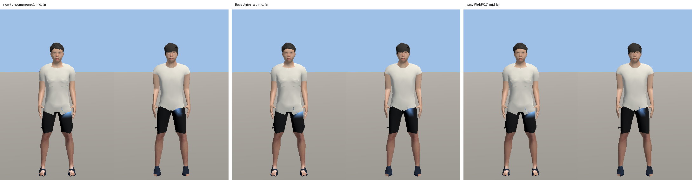

# The load of the web build (plan 0031)

Each step of plan 0031 is measured before and after (D2), with `tools/web/check.js --measure` (R1, D3): Chromium of the workspace as a phone (a touch screen, a mobile user agent, the processor four times slower, the screen 720 × 1280 and 2400 × 1080), with a limit on the network of 25 Mbit/s and of 100 Mbit/s (a latency of 40 ms), first with an empty cache and then again with the cache (a profile on the disk).

```sh
node tools/web/check.js "https://BRANCH-vung-tau.fifo.workers.dev/?start=bai_truoc&ride" OUT --measure --md=docs/web/load.md --step="NAME"
node tools/web/check.js "https://BRANCH-vung-tau.fifo.workers.dev/" OUT --pt85     # PT-85, after each deploy
```

The columns:

- **Over the network before the first frame**: the bytes of all the files of the page (compressed as they come) until the first frame of the world.
- **First frame**: from the start of the navigation to the first frame of the world (`window.vungTau.firstFrameMs`).
- **Can move**: until the player can move: the clock runs (the ground of the start is ready) and the scooter does not wait for the showcase (`window.vungTau.canMoveMs`, report 0018, D-0018-03).
- **Heap of the engine**: the memory of WebAssembly of Godot at the first frame. An iPhone gives a page about 300 MB to 500 MB only (plan 0031, D10).
- **JavaScript heap**: the heap of the page at the first frame (the files of the loader are there).
- **Page (renderer + GPU)**: the resident memory of the processes of Chromium for the page at the first frame (the renderer and the GPU process).

The targets of D10 (at 25 Mbit/s): at most 40 MB over the network before the first frame; the first frame at most 20 s after the page opens; the player can move at most 40 s after it (with the cache at most 15 s); the page at most 700 MB at the first frame.

The workspace draws WebGL 2 with SwiftShader (on the processor), and the throttle of the processor slows only the page, not SwiftShader: a phone with a graphics chip draws faster, and its processor can be slower than four times the workspace. The numbers are for the comparison of the steps; my look on the phone gives the real times.

## The test of D5: a second pack that the game downloads while it runs (2026-11-26)

`node tools/web/check.js URL OUT --packtest` opens the page with `?packtest`: after the first frame, the game downloads `packtest.pck` of its build (1.6 MB, made by `tools/web/make_pack.gd`), puts it in `user://`, loads it with `ProjectSettings.load_resource_pack()`, and makes the near level of the building `nha_mai_ngoi_cam` from it. The main pack of step 1 does not have that file (`scripts/web/pack_test.gd`).

| Build | Server | The way | Bytes that HTTPRequest counts | The file in `user://` | `load_resource_pack()` | The scene from the pack |
|---|---|---|---|---|---|---|
| Step 1 (`32feaeec2693`) | the Worker (Brotli) | HTTPRequest writes the file (`download_file`) | — (not given by that test) | 0 bytes | false | no |
| Step 1 (`32feaeec2693`) | a local server (no compression) | HTTPRequest writes the file (`download_file`) | — | 0 bytes | false | no |
| Step 2 code (local export) | a local server (no compression) | HTTPRequest writes the file (`download_file`) | 1 592 168 | 0 bytes | false | no |
| Step 2 code (local export) | a local server (no compression) | the body in memory, then FileAccess writes the file | 1 592 168 | 1 592 168 bytes | true (63 ms with the load of the scene) | yes, 1 mesh |
| Step 2 (`e2430eaea126`) | the Worker (Brotli) | HTTPRequest writes the file (`download_file`) | 1 592 168 | 0 bytes | false | no |
| Step 2 (`e2430eaea126`) | the Worker (Brotli) | the body in memory, then FileAccess writes the file | 1 592 168 | 1 592 168 bytes | true (66 ms with the load of the scene) | yes, 1 mesh |

The result: **it works in Chromium** (HeadlessChrome 157 of the workspace), with the body in memory and FileAccess. On the web, `HTTPRequest.download_file` of Godot 4.7.2 writes a file of 0 bytes, although the request counts all the bytes; the compression is not the cause (the same with a local server and no compression). `scripts/web/web_packs.gd` uses the way that works. The workspace has no Firefox and no Safari (a download of Firefox was not permitted in the workspace): the test in those browsers is not done. Chrome on a Pixel 10 is the reference (Q3).

## Base line: the build of part A, with the measures of R1 (98ff3d71277c) (2026-11-26)

`https://d7325705-vung-tau.fifo.workers.dev/?start=bai_truoc&ride`, the processor 4 times slower. A value in bold is over its target of D10 (at 25 Mbit/s).

| Size | Network | Cache | Over the network before the first frame | First frame | Can move | Heap of the engine | JavaScript heap | Page (renderer + GPU) |
|---|---|---|---|---|---|---|---|---|
| 720 × 1280 | 25 Mbit/s | empty | **331 MB** | **192 s** | **326 s** | 344 MB | 636 MB | **1923 MB** |
| 720 × 1280 | 25 Mbit/s | with the cache | 321.4 MB | **182 s** | **313 s** | 344 MB | 634 MB | **1913 MB** |
| 720 × 1280 | 100 Mbit/s | empty | 331 MB | 108 s | 239 s | 344 MB | 636 MB | **1926 MB** |
| 720 × 1280 | 100 Mbit/s | with the cache | 321.4 MB | 103 s | 231 s | 344 MB | 635 MB | **1913 MB** |

## Base line at 2400 × 1080 (98ff3d71277c) (2026-11-26)

`https://d7325705-vung-tau.fifo.workers.dev/?start=bai_truoc&ride`, the processor 4 times slower. A value in bold is over its target of D10 (at 25 Mbit/s).

| Size | Network | Cache | Over the network before the first frame | First frame | Can move | Heap of the engine | JavaScript heap | Page (renderer + GPU) |
|---|---|---|---|---|---|---|---|---|
| 2400 × 1080 | 25 Mbit/s | empty | **331 MB** | **197 s** | **537 s** | 344 MB | 637 MB | **2012 MB** |
| 2400 × 1080 | 25 Mbit/s | with the cache | 321.4 MB | **193 s** | **513 s** | 344 MB | 634 MB | **1998 MB** |
| 2400 × 1080 | 100 Mbit/s | empty | 331 MB | 110 s | 432 s | 344 MB | 636 MB | **2011 MB** |
| 2400 × 1080 | 100 Mbit/s | with the cache | 321.4 MB | 108 s | 433 s | 344 MB | 634 MB | **2002 MB** |

## Step 1: the cuts and the compression (32feaeec2693) (2026-11-26)

`https://8d365a1b-vung-tau.fifo.workers.dev/?start=bai_truoc&ride`, the processor 4 times slower. A value in bold is over its target of D10 (at 25 Mbit/s).

| Size | Network | Cache | Over the network before the first frame | First frame | Can move | Heap of the engine | JavaScript heap | Page (renderer + GPU) |
|---|---|---|---|---|---|---|---|---|
| 720 × 1280 | 25 Mbit/s | empty | **199.5 MB** | **144 s** | **271 s** | 344 MB | 434 MB | **1711 MB** |
| 720 × 1280 | 25 Mbit/s | with the cache | 191.5 MB | **135 s** | **256 s** | 344 MB | 432 MB | **1715 MB** |
| 720 × 1280 | 100 Mbit/s | empty | 199.5 MB | 89 s | 210 s | 344 MB | 434 MB | **1712 MB** |
| 720 × 1280 | 100 Mbit/s | with the cache | 191.5 MB | 82 s | 208 s | 344 MB | 432 MB | **1698 MB** |
| 2400 × 1080 | 25 Mbit/s | empty | **199.5 MB** | **151 s** | **476 s** | 344 MB | 434 MB | **1800 MB** |
| 2400 × 1080 | 25 Mbit/s | with the cache | 191.5 MB | **146 s** | **477 s** | 344 MB | 432 MB | **1786 MB** |
| 2400 × 1080 | 100 Mbit/s | empty | 199.5 MB | 97 s | 446 s | 344 MB | 434 MB | **1797 MB** |
| 2400 × 1080 | 100 Mbit/s | with the cache | 191.5 MB | 103 s | 455 s | 344 MB | 432 MB | **1787 MB** |

## Step 2: the start pack and the pack of the people (e2430eaea126) (2026-11-26)

`https://f69165a5-vung-tau.fifo.workers.dev/?start=bai_truoc&ride`, the processor 4 times slower. A value in bold is over its target of D10 (at 25 Mbit/s).

| Size | Network | Cache | Over the network before the first frame | First frame | Can move | Heap of the engine | JavaScript heap | Page (renderer + GPU) |
|---|---|---|---|---|---|---|---|---|
| 720 × 1280 | 25 Mbit/s | empty | **122.4 MB** | **115 s** | **255 s** | 344 MB | 255 MB | **1407 MB** |
| 720 × 1280 | 25 Mbit/s | with the cache | 0 MB | **63 s** | **195 s** | 344 MB | 254 MB | **1395 MB** |
| 720 × 1280 | 100 Mbit/s | empty | 122.4 MB | 80 s | 218 s | 344 MB | 255 MB | **1407 MB** |
| 720 × 1280 | 100 Mbit/s | with the cache | 0 MB | 62 s | 203 s | 344 MB | 254 MB | **1399 MB** |
| 2400 × 1080 | 25 Mbit/s | empty | **122.4 MB** | **126 s** | **478 s** | 344 MB | 255 MB | **1498 MB** |
| 2400 × 1080 | 25 Mbit/s | with the cache | 0 MB | **73 s** | **398 s** | 344 MB | 254 MB | **1485 MB** |
| 2400 × 1080 | 100 Mbit/s | empty | 122.4 MB | 87 s | 439 s | 344 MB | 255 MB | **1498 MB** |
| 2400 × 1080 | 100 Mbit/s | with the cache | 0 MB | 74 s | 431 s | 344 MB | 254 MB | **1488 MB** |

## PT-85 after each deploy (2026-11-26)

`node tools/web/check.js URL OUT --pt85`: Chromium as a computer (1280 × 720), 50 Mbit/s, an empty cache. SwiftShader of the workspace draws 0.4 to 0.6 frames a second here, so the ride of 300 m does not end in the time of the test.

| Build | Start | First frame | Can move | First move | Ride | The pack people | Errors |
|---|---|---|---|---|---|---|---|
| Step 1 (`32feaeec2693`) | `bai_truoc&ride` | 59 s | 179 s | 1.26 m | 85 m in 600 s | — | none |
| Step 1 (`32feaeec2693`) | `hem` | 61 s | 125 s | 1.16 m | — | — | none |
| Step 2 (`f416161ee448`) | `bai_truoc&ride` | 44 s | 171 s | 1.26 m | 258 m in 1500 s | there at the end (`waiting` 0) | none |
| Step 2 (`f416161ee448`) | `hem` | 44 s | 109 s | 1.16 m | — | — | none |

## Item 1 (D11): the line of the times and the parts of the start (e1e8ded33e6e). No old Godot process (2026-11-26)

`https://9809ba89-vung-tau.fifo.workers.dev/?start=bai_truoc&ride`, the processor 4 times slower. A value in bold is over its target of D10 (at 25 Mbit/s).

| Size | Network | Cache | Over the network before the first frame | First frame | Can move | Heap of the engine | JavaScript heap | Page (renderer + GPU) | Parts: download / compile / engine / world / move |
|---|---|---|---|---|---|---|---|---|---|
| 720 × 1280 | 25 Mbit/s | empty | **122.4 MB** | **102 s** | **196 s** | 344 MB | 255 MB | **1409 MB** | 47.3 / 5.4 / 5.1 / 46.5 / 95.3 s |
| 720 × 1280 | 25 Mbit/s | with the cache | 0 MB | **59 s** | **155 s** | 344 MB | 254 MB | **1395 MB** | 4.6 / 2.7 / 5.2 / 45.7 / 97.2 s |
| 720 × 1280 | 100 Mbit/s | empty | 122.4 MB | 73 s | 169 s | 344 MB | 255 MB | **1411 MB** | 18.9 / 1.9 / 5.4 / 45.9 / 97.5 s |
| 720 × 1280 | 100 Mbit/s | with the cache | 0 MB | 61 s | 169 s | 344 MB | 254 MB | **1397 MB** | 4.7 / 1.9 / 5.4 / 47.6 / 109.5 s |
| 2400 × 1080 | 25 Mbit/s | empty | **122.4 MB** | **115 s** | **358 s** | 344 MB | 255 MB | **1495 MB** | 49.3 / 5.5 / 5.8 / 51.3 / 246.4 s |
| 2400 × 1080 | 25 Mbit/s | with the cache | 0 MB | **72 s** | **314 s** | 344 MB | 254 MB | **1484 MB** | 8.5 / 2.4 / 6 / 50.2 / 245.1 s |
| 2400 × 1080 | 100 Mbit/s | empty | 122.4 MB | 80 s | 317 s | 344 MB | 255 MB | **1497 MB** | 19 / 1.7 / 5.1 / 48 / 236.1 s |
| 2400 × 1080 | 100 Mbit/s | with the cache | 0 MB | 71 s | 311 s | 344 MB | 254 MB | **1487 MB** | 8.2 / 1.2 / 5.5 / 48.9 / 243 s |

## The measure of D13: the pictures of the people (2026-11-26)

`tools/web/people_forms.gd` (the renderer of the web build, Compatibility, in the workspace) with the 40 scenes of the pack `people` (the mid and far levels of 20 people), for each form of `gltf/embedded_image_handling`. The pack is made with `tools/web/make_pack.gd` and compressed with `tools/web/compress.js`.

| Form | The pack | The pack with Brotli | The imported scenes | The load of the 40 scenes | The memory of their textures |
|---|---|---|---|---|---|
| Now: no compression (3) | 93.4 MB | 81.3 MB | 93.3 MB | 0.7 s | 262.8 MB |
| Basis Universal (2) | 56.8 MB | **16.7 MB** | 56.7 MB | 1.2 s | **79.2 MB** |
| Small lossy pictures (1: the pictures out of the scenes, WebP, quality 0.7, with mipmaps) | 17.1 MB | 9.3 MB | 9.7 MB (and 100 picture files) | 1.1 s | 256.2 MB |

walker_1 at 5 m, in the light of noon (the mid level, then the far level), in each form: I see no loss in Basis Universal or in the lossy form.



**My choice: Basis Universal**, on the web and on a computer (one import for all platforms; the look at 5 m is the same). The lossy form is 7.4 MB smaller over the network (about 2.4 s at 25 Mbit/s), but the engine keeps its pictures with no compression in the memory of the graphics (256 MB against 79 MB): the memory is the target of D16. It also puts 100 picture files of Godot in `assets/world/` (plan 0023 keeps only the files of World there). `tools/world/fetch.py` writes the import of a person with Basis Universal (`import_params()`); the other models keep their import.

## Item 1 again, with the people (before item 2; e1e8ded33e6e). No old Godot process (2026-11-26)

`https://9809ba89-vung-tau.fifo.workers.dev/?start=bai_truoc&ride`, the processor 4 times slower. A value in bold is over its target of D10 (at 25 Mbit/s).

| Size | Network | Cache | Over the network before the first frame | First frame | Can move | Heap of the engine | JavaScript heap | Page (renderer + GPU) | Parts: download / compile / engine / world / move | The people there: time, page, heap of the engine |
|---|---|---|---|---|---|---|---|---|---|---|
| 720 × 1280 | 25 Mbit/s | empty | **122.4 MB** | **105 s** | **206 s** | 344 MB | 255 MB | **1412 MB** | 46.9 / 5.3 / 5.4 / 49.7 / 101 s | 316 s, 2288 MB, 713 MB |
| 720 × 1280 | 25 Mbit/s | with the cache | 0 MB | **59 s** | **160 s** | 344 MB | 254 MB | **1394 MB** | 5.1 / 2.2 / 4.9 / 45.5 / 100.9 s | 392 s, 2302 MB, 713 MB |

## Item 2 (D13): the pictures of the people with Basis Universal (d548ae950ce8). No old Godot process (2026-11-26)

`https://51a0d3af-vung-tau.fifo.workers.dev/?start=bai_truoc&ride`, the processor 4 times slower. A value in bold is over its target of D10 (at 25 Mbit/s).

| Size | Network | Cache | Over the network before the first frame | First frame | Can move | Heap of the engine | JavaScript heap | Page (renderer + GPU) | Parts: download / compile / engine / world / move | The people there: time, page, heap of the engine |
|---|---|---|---|---|---|---|---|---|---|---|
| 720 × 1280 | 25 Mbit/s | empty | **122.4 MB** | **114 s** | **211 s** | 344 MB | 255 MB | **1409 MB** | 52.7 / 5.8 / 6.7 / 50.9 / 97.8 s | 230 s, 2013 MB, 594 MB |
| 720 × 1280 | 25 Mbit/s | with the cache | 0 MB | **53 s** | **145 s** | 344 MB | 253 MB | **1400 MB** | 4.6 / 1.4 / 3.2 / 42.3 / 91.6 s | 169 s, 2004 MB, 495 MB |
| 720 × 1280 | 100 Mbit/s | empty | 122.4 MB | 78 s | 170 s | 344 MB | 255 MB | **1412 MB** | 19.2 / 1.7 / 5.6 / 49.6 / 92.7 s | 186 s, 2010 MB, 594 MB |
| 720 × 1280 | 100 Mbit/s | with the cache | 0 MB | 53 s | 143 s | 344 MB | 251 MB | **1412 MB** | 4.1 / 1.9 / 3 / 43 / 90.1 s | 158 s, 1990 MB, 495 MB |
| 2400 × 1080 | 25 Mbit/s | empty | **122.4 MB** | **107 s** | **347 s** | 344 MB | 255 MB | **1501 MB** | 47.4 / 5.2 / 5.4 / 46.8 / 238.4 s | 404 s, 2100 MB, 594 MB |
| 2400 × 1080 | 25 Mbit/s | with the cache | 0 MB | **66 s** | **317 s** | 344 MB | 253 MB | **1493 MB** | 8 / 2.2 / 3.7 / 46 / 247.5 s | 349 s, 2067 MB, 495 MB |
| 2400 × 1080 | 100 Mbit/s | empty | 122.4 MB | 81 s | 330 s | 344 MB | 255 MB | **1502 MB** | 18.8 / 1.7 / 5.5 / 48.9 / 247 s | 379 s, 2099 MB, 594 MB |
| 2400 × 1080 | 100 Mbit/s | with the cache | 0 MB | 60 s | 289 s | 344 MB | 251 MB | **1497 MB** | 7.3 / 1.7 / 3 / 42.4 / 231.4 s | 320 s, 2104 MB, 594 MB |

## Item 3 (D14): the far levels first (09cf5f9c3445). No old Godot process (2026-11-26)

`https://1e202e10-vung-tau.fifo.workers.dev/?start=bai_truoc&ride`, the processor 4 times slower. A value in bold is over its target of D10 (at 25 Mbit/s).

| Size | Network | Cache | Over the network before the first frame | First frame | Can move | Heap of the engine | JavaScript heap | Page (renderer + GPU) | Parts: download / compile / engine / world / move | The people there: time, page, heap of the engine |
|---|---|---|---|---|---|---|---|---|---|---|
| 720 × 1280 | 25 Mbit/s | empty | **94 MB** | **93 s** | **187 s** | 344 MB | 198 MB | **1300 MB** | 37.2 / 5.3 / 5.1 / 47.2 / 96.1 s | 401 s, 2295 MB, 608 MB |
| 720 × 1280 | 25 Mbit/s | with the cache | 0 MB | **51 s** | **143 s** | 344 MB | 561 MB | **2267 MB** | 4.1 / 1.8 / 3.6 / 40.7 / 91.3 s | 344 s, 2318 MB, 713 MB |
| 720 × 1280 | 100 Mbit/s | empty | 94 MB | 69 s | 158 s | 344 MB | 198 MB | **1299 MB** | 14.7 / 1.7 / 5.1 / 45.7 / 90 s | 431 s, 2432 MB, 713 MB |
| 720 × 1280 | 100 Mbit/s | with the cache | 0 MB | 52 s | 141 s | 344 MB | 563 MB | **2275 MB** | 4 / 1.7 / 3.6 / 41.5 / 88.8 s | 369 s, 2323 MB, 713 MB |
| 2400 × 1080 | 25 Mbit/s | empty | **94 MB** | **98 s** | **329 s** | 344 MB | 198 MB | **1394 MB** | 36.9 / 5.4 / 5.5 / 48 / 233.7 s | — |
| 2400 × 1080 | 25 Mbit/s | with the cache | 0 MB | **62 s** | **283 s** | 344 MB | 196 MB | **1374 MB** | 7.2 / 1.2 / 4.9 / 42.4 / 219.9 s | — |
| 2400 × 1080 | 100 Mbit/s | empty | 94 MB | 70 s | 302 s | 344 MB | 198 MB | **1393 MB** | 14.5 / 1.7 / 5 / 43.9 / 233.6 s | — |
| 2400 × 1080 | 100 Mbit/s | with the cache | 0 MB | 65 s | 286 s | 344 MB | 197 MB | **1380 MB** | 7 / 1.3 / 4.8 / 45.8 / 220.4 s | — |

## R15 before item 4: the build of item 3 (09cf5f9c3445) (2026-11-26)

R15: `https://1e202e10-vung-tau.fifo.workers.dev/?start=bai_truoc&ride`, 720 × 1280, 100 Mbit/s, a disk cache of 50 MB, two visits (each a new browser on the same profile; the second with no HTTP cache, as a phone). **Fail**: the second visit gets 204.5 MB of packs over the network.

| Visit | Packs over the network | All over the network | First frame | Can move | The pack people there |
|---|---|---|---|---|---|
| first | 204.5 MB | 212.5 MB | 63 s | 147 s | 374 s |
| second | 204.5 MB | 212.5 MB | 66 s | 152 s | 382 s |
